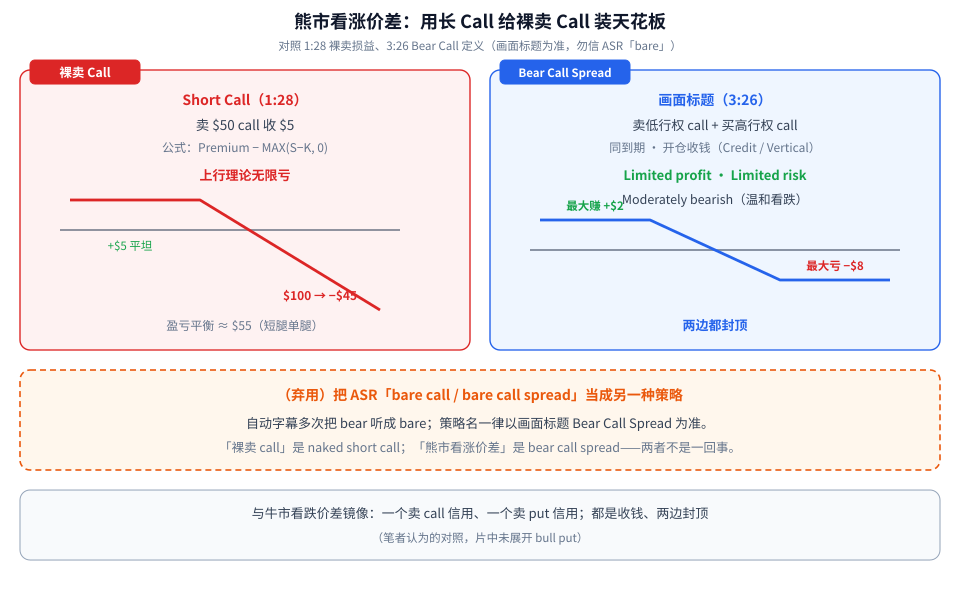
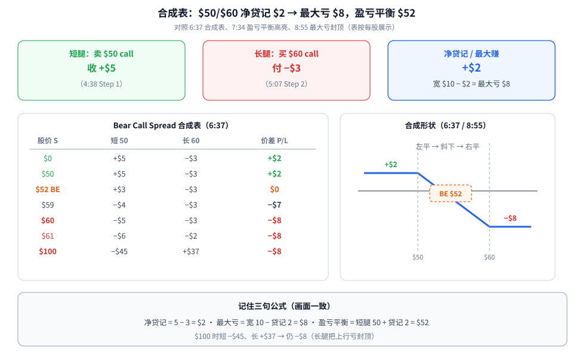
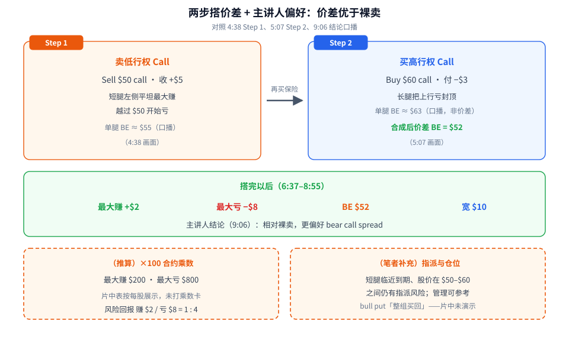

裸卖一张 call，上行理论亏无限——股价可以一直涨，你按固定行权价被迫卖股。**熊市看涨价差（Bear Call Spread）** 的做法很朴素：再买一张更高行权价的 call，给这笔裸卖**装上天花板**。

一句话先记住：

> **同一到期，卖低行权 call + 买高行权 call，开仓先收钱；最大赚 = 净贷记，最大亏 = 宽度 − 净贷记，盈亏平衡 = 短腿行权价 + 净贷记。**

素材为完整看过画面的教学视频（Ryan O'Connell，9:20，全片已看完），时间戳为视频内时间。片中 $50 / $60、+$5 / −$3 都是**教学数字**，不是模板；自动字幕多次把 **bear** 听成 **bare**——策略名一律以画面标题 **Bear Call Spread** 为准（见弃用项）。

---

## 1. 先看裸卖有多危险，再看价差怎么封顶

**读图**

- **左红框裸卖 Call（1:28）**：卖 $50 call 收 $5；公式 *Premium − MAX(S−K, 0)*。表上 $0/$50 仍赚 +$5，$55 打平，$100 亏 **−$45**——上行理论无限。盈亏平衡口播约 **$55**（短腿单腿）。
- **右蓝框 Bear Call Spread（3:26 画面标题）**：*selling a call option with a lower strike price and buying a call option with a higher strike price*；同标的、同到期。卡片写明：**Limited profit / Limited risk / Moderately bearish**。
- **底部橙色虚线框（弃用）**：ASR 常写成 “a bare call spread”——**不要把 bare 当成另一种策略**。「裸卖 call」= naked short call；「熊市看涨价差」= bear call spread。以画面标题为准。
- **最下一行（笔者补充）**：与 [牛市看跌价差](./2026-10-08-bull-put-spread-risk-sizing.md) 镜像——一个卖 call 信用、一个卖 put 信用；都是收钱、两边封顶。片中未展开 bull put。

两边各放一组 credit vertical，就是铁鹰——见 [Iron Condor：两边 Credit Vertical，别和 Short Strangle 搞混](./2026-09-18-Iron-Condor：两边Credit-Vertical，别和Short-Strangle搞混.md)。Debit / Credit 选腿总览见 [垂直价差：Debit/Credit、IV Rank 分段与 Delta 选腿](./2026-09-17-垂直价差：Debit-Credit、IV-Rank分段与Delta选腿.md)。

---

## 2. 合成表：净贷记 $2，最大亏 $8，盈亏平衡 $52

**读图**

- **三张顶卡**：短腿卖 $50 call **+$5**（4:38）；长腿买 $60 call **−$3**（5:07）；净贷记 / 最大赚 **+$2**；宽 $10 − $2 = 最大亏 **$8**。
- **左表（6:37 合成表）**：按每股展示。$0/$50 → **+$2**；$52 → **$0**（盈亏平衡）；$59 → −$7；$60/$61/$100 → **−$8**。注意：$100 时短腿 −$45、长腿 +$37，合计仍是 −$8——长腿把上行亏封死。
- **右图形状**：左平（最大赚）→ 两行权价之间斜下 → 右平（最大亏）。7:34 高亮 **$52** 行；8:55 高亮长腿右侧 **−$8** 封顶带。
- **底部三句公式**（与画面一致）：
  - 净贷记 = 5 − 3 = **$2**
  - 最大亏 = 宽 10 − 贷记 2 = **$8**
  - 盈亏平衡 = 短腿 50 + 贷记 2 = **$52**

> 小提醒：最多赚 $2、最多亏 $8——「收钱的策略」不等于「低风险」。别以为最多只亏掉收到的那 $2（那是弃用项）。

---

## 3. 两步怎么搭，以及主讲人为何更偏好价差

**读图**

- **左橙卡 Step 1（4:38）**：卖低行权 call——Sell $50 call 收 +$5；短腿左侧平坦最大赚，越过 $50 开始亏；单腿 BE 口播约 $55。
- **右蓝卡 Step 2（5:07）**：买高行权 call——Buy $60 call 付 −$3；长腿把上行亏封顶；口播长 call 单腿 BE 约 $63（**单腿，不是价差**）；合成后价差 BE = **$52**。
- **中间绿条**：搭完以后最大赚 +$2、最大亏 −$8、BE $52、宽 $10。主讲人结论（9:06）：相对裸卖，**更偏好 bear call spread**。
- **左下橙色虚线框（推算）**：若按 ×100 合约乘数，最大赚 **$200**、最大亏 **$800**；风险回报赚 $2 / 亏 $8 = **1 : 4**。片中表按每股展示，未打乘数卡，也未单独标此比。
- **右下橙色虚线框（笔者补充）**：短腿临近到期、股价在 $50–$60 之间时仍有指派风险；管理可参考 bull put 笔记的「整组买回」——**片中未演示仓位与管理**。强烈看空时，借记式买 put / 熊市看跌价差等另议——片中未展开。

---

## 价值判断：留下什么、丢掉什么

| 做法 | 建议 |
|------|------|
| 先算清净贷记与「宽度 − 贷记 = 最大亏损」；用合成表核对短腿 + 长腿 = 价差 P/L | **采用** |
| 盈亏平衡 = 短腿行权价 + 净贷记；用长 call 把裸卖 call 的上行亏封顶 | **采用** |
| 在「只想温和看跌 / 收权利金」时优先价差而非裸卖（主讲人结论） | **采用** |
| 片中 $50/$60、+$5/−$3 具体数字只是教学例；未给 Delta / DTE / 选标的规则 | **观望** |
| 把 ASR「bare call」当成另一种策略；以为最大亏损只是「亏掉收到的 $2」 | **弃用** |
| 忽视长腿封顶后仍可能亏满「宽度 − 贷记」 | **弃用** |

自检一句：净贷记多少？宽度多少？最大亏 = 宽 − 贷记对不对得上？盈亏平衡是不是短腿 + 贷记？

---

## 小结

1. 裸卖 $50 call 收 $5，$100 时亏 −$45，上行理论无限。
2. Bear Call Spread = 卖低行权 call + 买高行权 call（画面标题；勿信 ASR「bare」）。
3. 例：+$5 / −$3 → 净贷记 **$2**；宽 **$10**；最大亏 **$8**；BE **$52**。
4. 合成表到 $100 仍封顶 **−$8**——长腿起作用。
5. 主讲人更偏好价差而非裸卖；仓位与指派管理本片未讲，可对照 bull put 笔记。

---

## 参考来源

1. Ryan O'Connell, *The Bear Call Spread Option Strategy Explained*（https://www.youtube.com/watch?v=ih5VMCN6biQ ；浏览器完整观看 9:20/9:20）。画面时间点：0:20 策略简介（CC 误写 bare）；0:40 Call 定义；1:28 Short Call 损益表（$50/$5，$100→−$45）；3:26 Bear Call Spread 定义卡（Limited profit / Limited risk / Moderately bearish）；4:38 Step 1 卖 $50 call +$5；5:07 Step 2 买 $60 call −$3；6:26 合成说明句；6:37 合成表与损益图（+$2 / −$8 / BE $52）；7:34 高亮 $52；8:55 高亮 −$8 封顶；9:06 更偏好 bear call spread。说明：无 Transcript 面板；ASR 多次把 bear 听成 bare——**以画面标题为准**；片尾推荐缩略图数字与本策略无关，忽略。
2. 配图：`bcs-concept-vs-naked.svg`、`bcs-payoff-table.svg`、`bcs-steps-flow.svg`，依据上述画面重画的教学示意；橙色虚线框内为笔者补充或推算（×100 乘数、$200/$800、1:4 风险回报、指派管理对照 bull put），不是片中内容。

*仅供学习，不构成投资建议。期权有到期、指派、保证金与流动性风险；片中 $50/$60 与权利金数字均为教学示意，不是当前报价，也不是推荐。*
