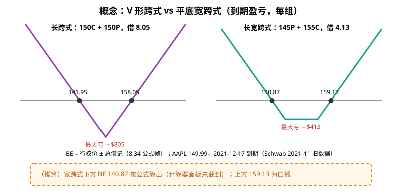
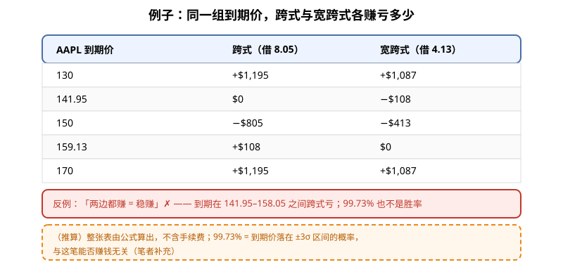
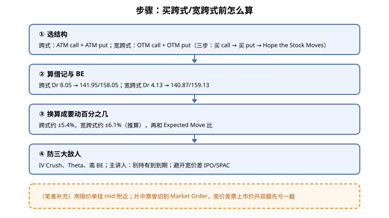

> 一句话：跨式和宽跨式都是「不知道往哪边走，但赌它会大动」。**先算股价要涨跌百分之几才回本**，再决定值不值。

## 1. 两个结构

- **长跨式（Long Straddle）**：同一到期、**同一平值行权价**，买 call + 买 put。盈亏图是 **V 形**（0:52）。
- **长宽跨式（Long Strangle）**：买**虚值** call（行权价高于现价）+ 买**虚值** put（低于现价）。更便宜，但回本点更远；盈亏图是**平底 V**（1:12）。
- 两者都只有买腿（2:02）。用在财报、SPAC/IPO、很波动的股票（2:19）。

**读图**
- 公式（8:34 关字幕暂停帧）：max loss = 总借记；max gain = unlimited；**breakeven = strike ± 总借记**。
- 跨式（11:15–12:06，Schwab，AAPL 149.99，2021-12-17 到期）：150C ask 4.05 + 150P ask 4.00 = **Dr 8.05 = $805/组**；计算器显示 BE **$141.95 / $158.05**，最大亏 −$805。
- 宽跨式（13:15–13:50）：145P 2.05 + 155C 2.08 = **Dr 4.13 = $413/组**，约跨式一半；上方 BE **159.13**（口播），下方 **140.87**（推算，按公式算出）。
- 下跌一侧不是真无限：股价最多跌到 0（片中口播也这么说）；图两翼写 Unlimited 是简化画法（笔者补充）。

## 2. 例子：同样的到期价，两者赚亏对比

**读图**
- 表中数字是（推算）：按「内在价值 − 借记」×100 算，不含手续费。
- 小波动（150 附近）：宽跨式亏得少（−$413 vs −$805）；大波动（130 / 170）：跨式赚得略多。用更低成本换更远的回本点。
- 反例：「两边都赚 = 稳赚」是错的。到期在 141.95–158.05 之间，跨式就是亏的。

**关于计算器的 99.73%**：11:44 的 Schwab 计算器显示「$122.43–$182.95 区间 99.73%」。这**不是胜率**——它是「到期价落在 ±3 个标准差区间内」的概率（勾选了 Show Standard Deviations），和这笔跨式能不能赚钱无关。跨式要赚钱，得跌破 141.95 或涨过 158.05（到期口径），这个概率片中没给（笔者补充）。

## 3. 步骤：买之前怎么算

**读图**
- ① 片中三步：Buy Call → Buy Put → Hope the Stock Moves（3:36–3:56，宽跨式 9:56–10:12）。
- ③ 跨式需要约 ±5.4%、宽跨式约 ±6.1%（推算）。平值跨式的价格本身就是市场给的预期波动，所以要和 [Expected Move](./2026-09-17-Expected-Move%EF%BC%9AStraddle%C3%970.85%E4%B8%8E%28Straddle%2BStrangle%29%C3%B72.md) 比——买跨式是赌「实际波动 > 已定价的波动」（笔者补充）。
- ④ 三大敌人（4:10、7:17）：IV Crush、时间衰减、盈亏平衡太高；主讲人明确**不建议持有到到期**。财报前 IV 往往鼓起，见 [IV 期限结构](./2026-10-06-IV%E6%9C%9F%E9%99%90%E7%BB%93%E6%9E%84%EF%BC%9AContango%E6%98%AF%E5%B8%B8%E6%80%81%EF%BC%8CBackwardation%E6%98%AF%E6%81%90%E6%85%8C%E6%A8%A1%E5%BC%8F.md)。14:29 提醒避开买卖价差很宽的投机 IPO/SPAC。
- 橙框：限价单建议是笔者补充；片中下单票曾切到 Market Order（12:46）。

## 价值判断

| 判断 | 内容 |
|---|---|
| 采用 | **BE = 行权价 ± 总借记**，先换算成要涨跌百分之几（±5.4% / ±6.1%）；跨式 vs 宽跨式的**成本与回本距离取舍**（$805 vs $413）；只在流动性好的标的用限价单 |
| 观望 | 财报跨式当常规策略——片中无胜率、无 IV Crush 量化、无退出规则；AAPL 是 2021 年旧数据 |
| 弃用 | 「两边都赚 = 稳赚」；把计算器的 99.73% 当胜率；默认持有到到期；把 6:43 幻灯笔误「put 上行无限」当真；宽价差票上市价开双腿 |

## 参考来源

1. Jake Broe, *Long Straddle & Long Strangle Options Strategy Explained*（https://www.youtube.com/watch?v=-ItCAYhSMRs ；浏览器完整观看 15:10/15:10）。画面时间点（除 8:34 外为 2× 估计，±3–6 秒）：0:52 跨式 V 图；1:12 宽跨式平底图；2:02 只有买腿；2:19 Earnings/SPACs/IPOs；4:10 IV Crush / Time Decay；7:17 三个问题；8:34 公式帧；9:10 宽跨式公式；11:15 跨式 Dr 8.05；11:44 计算器（−$805、141.95/158.05、99.73%）；13:15 宽跨式 Dr 4.13；13:50 159.13；14:29 价差警告。
2. 配图 `straddle-vs-strangle.svg`、`straddle-pl-table.svg`、`straddle-steps-flow.svg` 依画面重画；橙色虚线框为笔者补充或推算，不是片中原话。

*仅供学习，不构成投资建议。期权有到期、指派、保证金与流动性风险；文中标的与数字均为视频里的教学例，不是当前报价，也不是推荐。*
