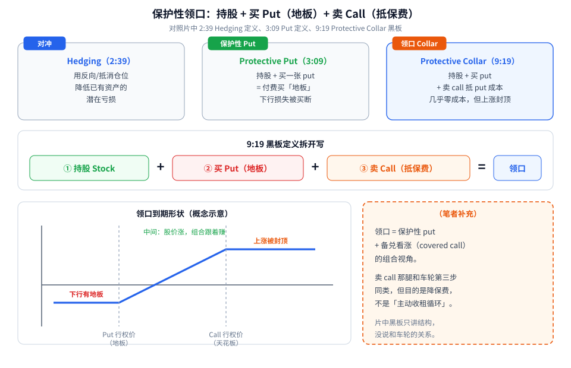
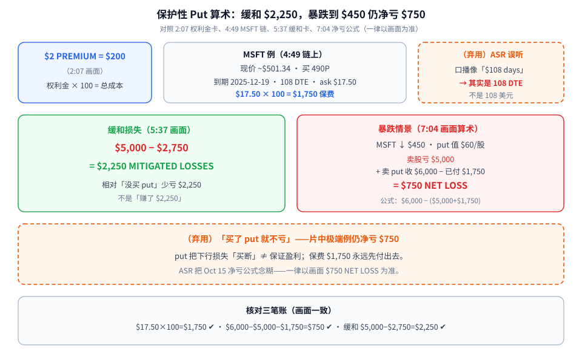
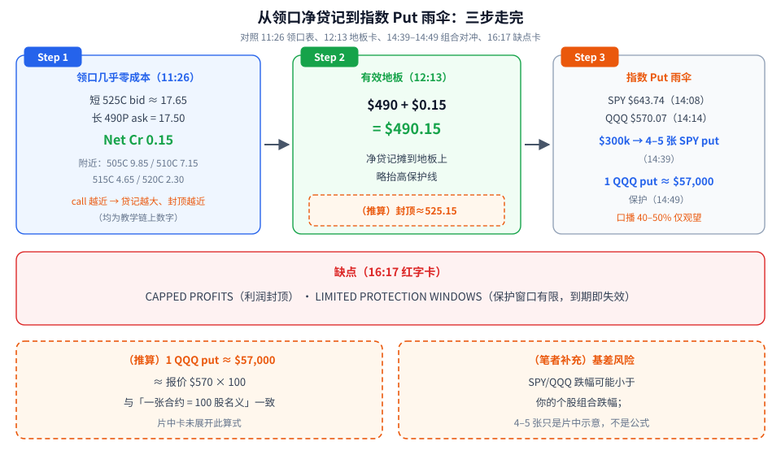

持股怕暴跌，第一次听到「买一张 put 当保险」，很容易以为：**付了保费就不会亏。** 这支 Barchart 视频把账算得很直白——买了 put 仍可能净亏；想把保费压到接近零，就要再卖一张 call，也就是领口（Protective Collar），代价是**上涨被封顶**。

一句话先记住：

- **保护性 put** = 持股 + 买 put → 付费买「地板」；
- **保护性领口** = 持股 + 买 put + 卖 call → 用卖 call 的钱几乎抵掉 put 保费，但利润封顶。

素材为完整看过画面的教学视频（Barchart，17:06，全片已看完），时间戳为视频内时间。片中的 MSFT、SPY、QQQ 都是**教学例子**，不是推荐；Transcript 面板当时不可用，口播以 CC + 截图为准，**数字一律以画面为准**（ASR 把 108 DTE 念成类似 “$108 days”——见下文弃用项）。

---

## 1. 对冲是什么，领口三腿怎么拼

**读图**

- **左边蓝框 Hedging（2:39 黑板）**：对冲 = 用反向/抵消仓位，降低**已有资产**的潜在亏损。不是「另开一笔赌方向」，而是给手里的股票装保险。
- **中间绿框 Protective Put（3:09）**：持股 + 买一张 put = 付费买「地板」。止损挂单可能滑点；put 把下行损失「买断」。
- **右边橙标领口（9:19 黑板）**：*holding the underlying stock, buying a put option (for downside protection), and selling a call option (to offset the cost of the put)*——持股 + 买 put + 卖 call 抵 put 成本。
- **中间公式行**：① 持股 + ② 买 Put（地板）+ ③ 卖 Call（抵保费）= 领口。
- **左下形状**：下行有地板、中间跟涨、上涨被 call 行权价封顶——这是领口的典型到期形状（概念示意）。
- **右下橙色虚线框（笔者补充）**：领口 ≈ 保护性 put + [备兑看涨](./2026-10-08-wheel-strategy-risks.md) 的组合视角；卖 call 那腿和车轮第三步同类，但目的是**降保费**，不是「主动收租循环」。片中黑板只讲结构，没说和车轮的关系。

片头还用「一年坏年景」当情绪钩子（0:55 标题卡 ALL IT TAKES IS ONE BAD YEAR）——提醒路径不平滑，**不构成择时信号**（笔者补充）。

---

## 2. MSFT 例：缓和 $2,250，暴跌到 $450 仍净亏 $750

**读图**

- **左上蓝框（2:07）**：$2 PREMIUM = $200/CONTRACT——权利金按「每股报价 × 100」算总成本。后面 $17.50 同理变成 **$1,750**。
- **中上链上（4:49）**：MSFT ~$501.34；买 **490P**，到期 **2025-12-19**、**108 DTE**、ask **$17.50**。这是保护性 put 的教学例。
- **右上橙色虚线框（弃用）**：ASR 把「108 DTE」念成类似 “$108 days of protection”——链上是 **108 天到期**，**不是 108 美元**。
- **左下绿框（5:37）**：$5,000 − $2,750 = **$2,250 MITIGATED LOSSES**——相对「没买 put」少亏 $2,250；不是「赚了 $2,250」。
- **右下红框（7:04 画面公式）**：股价跌到 **$450**，put 值 **$60/股**；卖股亏 $5,000 + 卖 put 收 $6,000 − 已付权利金 $1,750 → **$750 NET LOSS**。公式写在画面上：$6,000 − ($5,000 + $1,750) = $750。
- **底部橙色虚线框（弃用）**：「买了 put 就不亏」——片中极端例**仍净亏 $750**。保费先付出去；put 买断下行 ≠ 保证盈利。ASR 把这句净亏公式念糊，**以画面为准**。

核对三笔账（与笔记一致）：$17.50 × 100 = $1,750 ✔；$6,000 − $5,000 − $1,750 = $750 ✔；$5,000 − $2,750 = $2,250 ✔。

---

## 3. 领口净贷记 0.15、有效地板 490.15，以及 SPY/QQQ 雨伞

**读图**

- **Step 1（11:26 领口表）**：同一到期，买 **490P** ask 17.50，卖 **525C** bid ≈ 17.65 → **Net Cr 0.15**（几乎零成本，还略收一点）。附近更近的 call：505C 9.85 / 510C 7.15 / 515C 4.65 / 520C 2.30——**call 行权价越低，净贷记越大，但上涨封顶越近**。
- **Step 2（12:13 地板卡）**：$490 + $0.15 = **$490.15**——净贷记摊到地板上，有效保护线略抬高。橙色虚线小框是**（推算）**：有效封顶约 525 + 0.15 = **525.15**（片中未单独打出此卡）。
- **Step 3（14:08–14:49）**：组合层面可用指数 ETF 长 put 做「雨伞」。画面报价 **SPY $643.74**、**QQQ $570.07**；$300,000 组合约 **4–5 张 SPY long put**；**1 QQQ put ≈ $57,000** 名义保护。口播可做约 40–50% 部分覆盖——**仅口播、无标题卡，先观望**。
- **红框缺点（16:17）**：**CAPPED PROFITS**（利润封顶）+ **LIMITED PROTECTION WINDOWS**（保护窗口有限，到期即失效）。
- **左下橙色虚线框（推算）**：1 QQQ put ≈ $57,000 ≈ 报价 $570 × 100，与「一张合约对应 100 股名义」一致；片中卡未展开此算式。
- **右下橙色虚线框（笔者补充）**：指数 put 存在**基差风险**——SPY/QQQ 跌幅可能小于你的个股组合；4–5 张只是片中示意，不是公式。

想把「被指派拿股票再卖 call」当成主动循环，见 [车轮策略（The Wheel）：两个赚钱来源、两个致命风险](./2026-10-08-wheel-strategy-risks.md)——车轮卖的是现金担保 put，领口则是**已持股**上再叠 put + call，风险结构不同。

---

## 价值判断：留下什么、丢掉什么

| 做法 | 建议 |
|------|------|
| 权利金总成本 = 每股报价 × 100；用画面公式核对「卖股亏损 + 卖 put 收入 − 已付权利金」 | **采用** |
| 想压低保费时用领口（买 put + 卖更远的 call），开仓前看净贷记/净借记和有效地板（如 490.15） | **采用** |
| 组合层面可用 SPY/QQQ 长 put 做「雨伞」，先按名义保护额粗算张数 | **采用** |
| 片中 108 DTE、490/525 具体行权价——只是当时链上举例，不当固定模板；IV/HV 随日期变 | **观望** |
| 口播「约 40–50% 部分覆盖」——合理起点，但需按自己组合 beta/相关性另算 | **观望** |
| 以为「买了 put 就不亏」（片中极端例仍净亏 $750）；把 ASR「$108 days」当成美元成本 | **弃用** |
| 忽视 CAPPED PROFITS / LIMITED PROTECTION WINDOWS | **弃用** |

自检一句：这张 put 总成本多少？极端下跌后净亏还剩多少？领口的有效地板和天花板各是多少？保护哪天到期？

---

## 小结

1. 对冲 = 降低已有资产的潜在亏损；保护性 put = 持股 + 买 put。
2. 权利金 $2 = $200/张；MSFT 例 490P / 108 DTE / $17.50 → 保费 **$1,750**。
3. 缓和损失画面 **$2,250**；暴跌到 $450 仍 **净亏 $750**——不是「白赚」。
4. 领口 = 持股 + 买 put + 卖 call；525C≈17.65 vs 490P 17.50 → **Net Cr 0.15**，有效地板 **$490.15**。
5. $300k → 约 4–5 张 SPY put；1 QQQ put ≈ **$57,000** 名义保护。
6. 缺点写在红字卡上：利润封顶 + 保护窗口有限。

---

## 参考来源

1. Barchart, *How to Hedge Your Portfolio with Options (Before It’s Too Late!)*（https://www.youtube.com/watch?v=RjUoVnEWngY ；浏览器完整观看 17:06/17:06）。画面时间点：0:55 ONE BAD YEAR；2:07 $2 PREMIUM = $200；2:39 Hedging 定义；3:09 Put 定义；4:07 490-STRIKE LONG PUT；4:49 MSFT 490P / 108 DTE / $17.50；5:37 $2,250 MITIGATED LOSSES；6:08 MSFT ↓ $450；7:04 $750 NET LOSS 公式；9:19 Protective Collar 黑板；11:26 525C/490P Net Cr 0.15；12:13 地板 $490.15；14:08 SPY $643.74；14:14 QQQ $570.07；14:39 $300k → 4–5 SPY puts；14:49 1 QQQ put ≈ $57,000；16:17 CAPPED PROFITS / LIMITED PROTECTION WINDOWS。说明：Transcript 面板整段不可用；ASR 把 108 DTE 念糊、Oct 15 净亏口播含糊——**一律以画面数字为准**；约 40–50% 部分覆盖仅口播、无标题卡。
2. 配图：`collar-concept-structure.svg`、`collar-msft-put-math.svg`、`collar-credit-index-flow.svg`，依据上述画面重画的教学示意；橙色虚线框内为笔者补充或推算（有效封顶 525.15、QQQ≈$570×100、基差风险、与车轮对照），不是片中内容。

*仅供学习，不构成投资建议。期权有到期、指派、保证金与流动性风险；MSFT、SPY、QQQ 及链上报价均为片中教学画面，不是当前报价，也不是推荐。*
