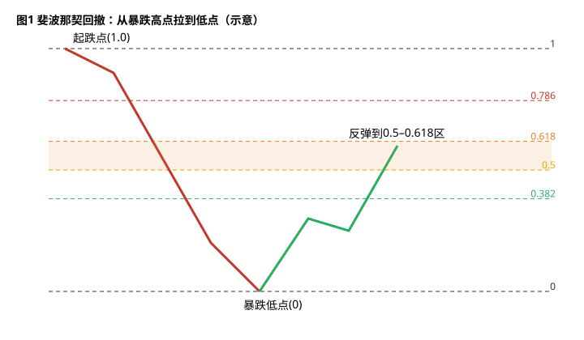
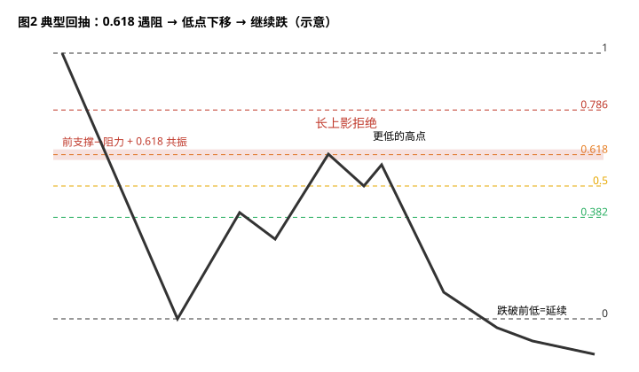
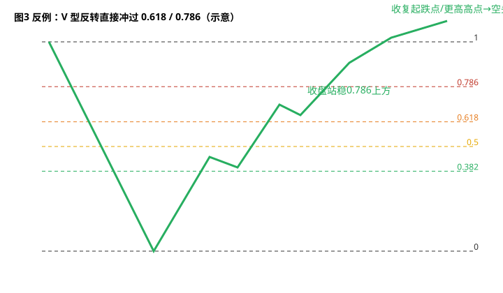
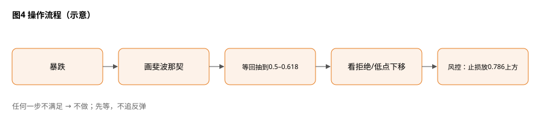

> 今天复盘的一句话教训：**「暴跌之后的回升大概率是回抽到关键位比如 0.618 后继续下跌。」**
> 这里的「大概率」是我自己的盘感和经验观察，**不是**统计结论，也不是规律。

## 1. 先搞懂：什么是「暴跌腿」

一段短时间内、几乎不回头的大幅下跌，就叫一条暴跌腿（crash leg）。它有清楚的**起跌点（高点）**和**暴跌低点**。我今天犯的错是：低点一出来，看到几根大阳线就以为「见底反转」，结果反弹到一半又被砸下去。

## 2. 怎么画斐波那契回撤

从**起跌高点拉到暴跌低点**（下跌腿：从高往低拉），工具会自动标出几条线：

- **0.382**：浅反弹，弱势反抽常停在这里
- **0.5**：一半位置（严格说不是斐波那契数，但大家都看）
- **0.618**：黄金分割，最常被盯的「关键位」
- **0.786**：深回撤，再往上就很难叫「回抽」了

**读图**
- 红线是暴跌腿，绿线是反弹；所有水平线都是**这条腿长度的百分比**，没有具体价格。
- 橙色带 = 0.5–0.618 区，我重点观察的「回抽目标区」。
- 1.0 = 起跌点，0 = 暴跌低点。

## 3. 为什么反弹常在 0.5–0.618 卡住（一般性常识补充）

以下是交易圈常见解释，属于**通用知识补充**，不是我的原创：

1. **套牢多头回本出逃**：在下跌途中接飞刀的人，价格一回到成本附近就想卖。
2. **前支撑变阻力**：暴跌中被跌破的平台，回来时往往变成压力。
3. **空头重新入场**：错过第一波的卖方，等的就是反弹到好位置再做空。
4. **自我实现**：大家都看 0.618，挂单本身就集中在那里。

## 4. 典型剧本：遇阻 → 低点下移 → 继续跌

**读图**
- 反弹到 0.618 且与「前支撑转阻力」重叠（共振），出现长上影 = 拒绝。
- 再一次反弹没过前高 → **更低的高点（lower high）**。
- 跌破反弹起点/前低，才算「继续下跌」确认。

## 5. 反例：V 型反转不讲道理

**读图**
- 价格直接冲过 0.618、并**收盘站稳 0.786 上方** → 「回抽」假设大概率要放弃。
- 收复起跌点 / 做出更高高点 → 空头逻辑彻底失效。
- 所以 0.618 只是**倾向**，不是定律；必须提前写好失效条件。

## 6. 我以后的操作流程

**读图**
- 五步按顺序走：暴跌 → 画斐波那契 → 等回抽到 0.5–0.618 → 看拒绝/低点下移 → 风控。
- 没有出现拒绝信号就**不动**；不把反弹当反转去追。
- 止损逻辑示例：放在 0.786 上方（或前阻力上方），触发即认错。

失效条件（任一满足就停止按「回抽」思路看）：
- 收盘并持续站稳 **0.786 上方**；
- 收复**起跌点**，或做出**更高的高点**。

相关旧文：[BOS 之前先把道氏三步写进 SOP](./2026-09-15-BOS%E4%B9%8B%E5%89%8D%E5%85%88%E6%8A%8A%E9%81%93%E6%B0%8F%E4%B8%89%E6%AD%A5%E5%86%99%E8%BF%9BSOP.md)、[扫流动性还是真突破](./2026-10-06-%E6%89%AB%E6%B5%81%E5%8A%A8%E6%80%A7%E8%BF%98%E6%98%AF%E7%9C%9F%E7%AA%81%E7%A0%B4%EF%BC%9A%E7%9C%8BK%E7%BA%BF%E5%AE%9E%E4%BD%93%E6%94%B6%E5%9C%A8%E5%93%AA%EF%BC%8C%E5%86%8D%E7%9C%8BFVG%E5%AE%88%E4%B8%8D%E5%AE%88%E5%BE%97%E4%BD%8F.md)

## 7. 采用 / 观望 / 弃用

| 结论 | 内容 |
|---|---|
| 采用 | 暴跌后先把反弹当「回抽」看；0.5–0.618 + 前支撑转阻力的共振区重点观察；写死 0.786/起跌点失效条件 |
| 观望 | 0.382 浅反弹就掉头的情况；不同周期上 0.618 是否同样好用，需要更多复盘 |
| 弃用 | 低点一出、几根阳线就当反转去追；只凭「到了 0.618」不等拒绝信号就动手 |

## 参考来源

- 个人交易复盘（2026-10-13）
- 斐波那契回撤、死猫跳等为交易常识，属通用知识补充

> 学习笔记，仅供学习，不构成投资建议。
