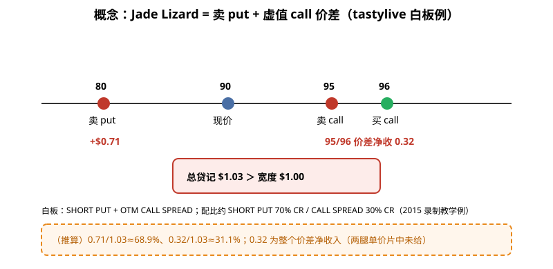
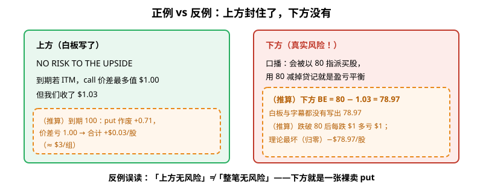
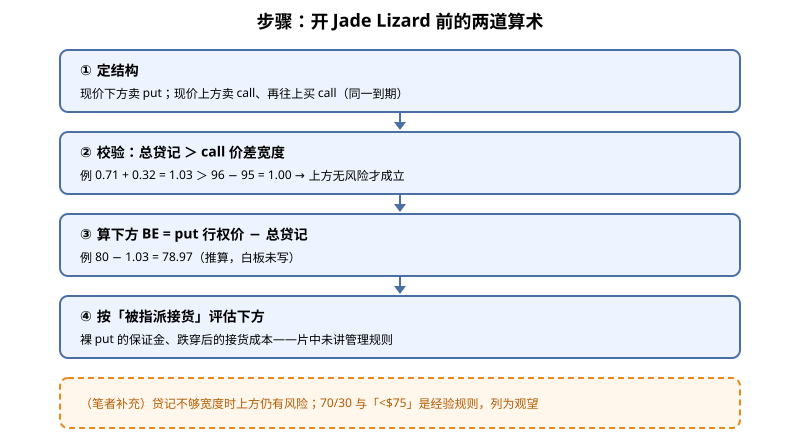

> 一句话：Jade Lizard = **卖一张虚值 put + 卖一组虚值 call 价差**。只要总贷记 > call 价差宽度，**上方**就没风险；但**下方仍是一张裸卖 put，风险是真实的**。

## 1. 结构是什么

白板标题（0:39）：**SHORT PUT + OTM CALL SPREAD**，同一到期日三条腿：现价下方卖 put、现价上方卖 call、再往上买一张 call 保护。开仓整体收钱。

- 卖 put 这条腿是看涨假设：股价待在 put 行权价上方，权利金留下（1:27）。
- call 价差那条腿希望股价别涨过去（1:56）——它就是一组 [熊市看涨价差](./2026-10-09-bear-call-spread.md)。
- 主讲人把整体定位为 **中性偏多**（6:58 Takeaways）。

**读图**
- 白板例（3:14–3:24）：现价 **90**；卖 **80 put** 收 **$0.71**；**95/96 call 价差**净收 **0.32**；总贷记 **$1.03**。这是 2015 年录制的教学例。
- 字幕把总贷记听成「$13」，是语音识别错误，白板写的是 **$1.03**。
- Best Practices（2:26–3:04）：SHORT PUT ≈ 70% 贷记、CALL SPREAD ≈ 30%，最关键的一条：**TOTAL CREDIT > 价差宽度**。
- 橙框（推算）：0.71/1.03≈68.9%，与 70/30 吻合；0.32 是整个价差的净收入，两腿各自价格片中没给。

## 2. 正例 vs 反例：上方封住了，下方没有

**读图**
- 左（白板原文，3:56–4:24）：**NO RISK TO THE UPSIDE**；到期如果 call 价差全在价内，最多值 **$1.00**，但我们收了 **$1.03**。
- 左橙框（推算）：到期股价 100 时 put 作废留 0.71，价差亏 1.00，合计仍 **+$0.03/股**。
- 右（口播 6:08–6:18）：大跌会被以 80 指派买股，「用 80 减掉贷记就是盈亏平衡」。
- 右橙框：**下方盈亏平衡 78.97 是（推算）**——80 − 1.03 算出来的，**白板和字幕都没有写这个数**。跌破 80 后每跌 $1 多亏 $1，理论最坏（股价归零）−$78.97/股（推算）。
- 结论：**“No risk to the upside” 只说了上方。下方的 short put 风险和裸卖 put 一样大**，不要理解成整笔无风险。

## 3. 步骤：开仓前两道算术

**读图**
- ② 是这个策略能不能叫「上方无风险」的关键：贷记不够宽度，上方就仍有风险（笔者补充）。
- ③ 下方 BE = put 行权价 − 总贷记，本例 78.97（推算）。
- ④ 片中没给 DTE、Delta、止盈止损规则；被指派的保证金和接货成本要自己评估。

为什么贷记能大于宽度？Takeaways 第一条说它「takes advantage of volatility skew」——虚值 put 通常比同距离虚值 call 贵（见 [波动率偏斜入门](./2026-10-13-volatility-skew.md)），卖 put 收得多，才付得起那张保护 call（笔者补充，片中未展开原因）。

对照其他结构（笔者补充）：下方也用价差封顶 → 见 [牛市看跌价差](./2026-10-08-bull-put-spread-risk-sizing.md)；两边各一组 credit vertical → 见 [Iron Condor](./2026-09-18-Iron-Condor%EF%BC%9A%E4%B8%A4%E8%BE%B9Credit-Vertical%EF%BC%8C%E5%88%AB%E5%92%8CShort-Strangle%E6%90%9E%E6%B7%B7.md)。Jade Lizard 是「只封上方、不封下方」的折中。

其余 Takeaways（6:58）：tastylive 用于股价 **< $75** 标的的策略之一；可做财报玩法（盈亏平衡拉得宽）；**设置正确时**上方无风险。注意片中自己的例子现价是 90，「<$75」只是偏好。

## 价值判断

| 判断 | 内容 |
|---|---|
| 采用 | 开仓前核**总贷记 > call 价差宽度**；下方 **BE = put 行权价 − 总贷记**（本例 78.97，推算），并按「被指派接货」评估下方最坏情况 |
| 观望 | 70%/30% 配比、「< $75」——tastylive 经验规则，片中无数据支撑、无管理规则 |
| 弃用 | 把「No risk to the upside」理解成「整笔无风险」；把 ASR「$13」当贷记金额（白板为 $1.03）；忽略下方裸 put 的保证金与指派 |

## 参考来源

1. tastylive, *What is a Jade Lizard Strategy? | Options Trading Concepts*（Mike and His White Board；https://www.youtube.com/watch?v=zKkz2AM5rRA ；浏览器完整观看 10:11/10:11，台标 10/15/15 录制）。画面时间点：0:39 结构白板；1:27 SHORT PUT → CR；1:56 OTM CALL SPREAD → CR；2:26 SHORT PUT = 70% CR；3:04 CALL SPREAD = 30% CR / TOTAL CREDIT >；3:14 例 80/90/95/96；3:24 $0.71 / 0.32 / $1.03；3:56 NO RISK TO THE UPSIDE；4:24 $1.00 vs $1.03；6:08–6:18 盈亏平衡口播（无数字）；6:58 TAKEAWAYS。
2. 配图 `jade-structure.svg`、`jade-upside-vs-downside.svg`、`jade-check-flow.svg` 依白板重画；橙色虚线框为笔者补充或推算（含 78.97），不是片中原话。

*仅供学习，不构成投资建议。期权有到期、指派、保证金与流动性风险；文中标的与数字均为视频里的教学例，不是当前报价，也不是推荐。*
