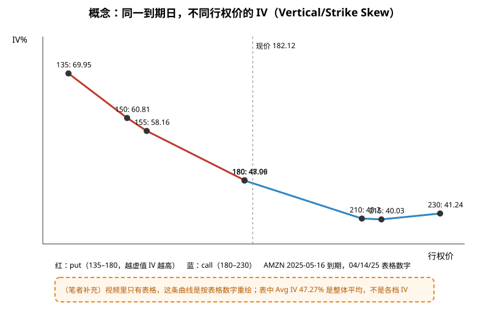
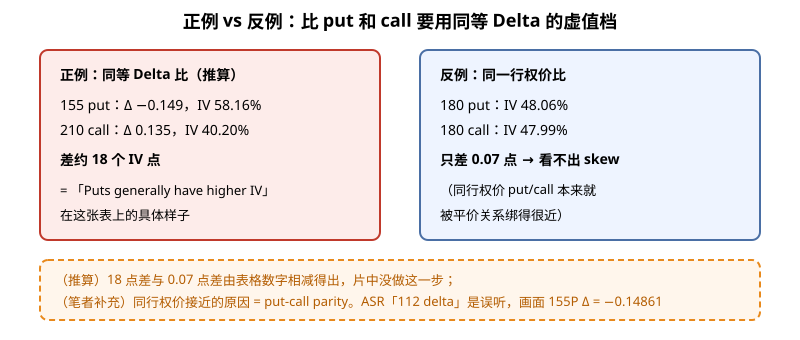
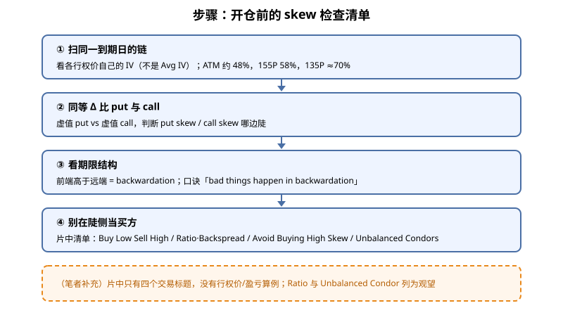

> 一句话：**同一天到期的期权，不同行权价的「保险费率」（隐含波动率 IV）不一样**，这就是偏斜（skew）。它决定你在某个行权价是多付还是多收。

## 1. 先把概念说清楚

隐含波动率（IV）可以理解成「市场给这张期权定的费率」。视频的定义（1:09 幻灯）：**同一到期日、不同行权价之间的 IV 差**。片中分三类（4:48 幻灯）：

- **Vertical Skew / Strike Skew**：同一到期日，ITM / ATM / OTM 之间的 IV 差——本文主角。
- **Horizontal Skew / Time Skew**：不同到期日的 IV 差，幻灯原话 “also known as the term structure”。严格说它已不是「同一到期日」，详见 [IV 期限结构：Contango 是常态，Backwardation 是恐慌模式](./2026-10-06-IV%E6%9C%9F%E9%99%90%E7%BB%93%E6%9E%84%EF%BC%9AContango%E6%98%AF%E5%B8%B8%E6%80%81%EF%BC%8CBackwardation%E6%98%AF%E6%81%90%E6%85%8C%E6%A8%A1%E5%BC%8F.md)。
- **Put / Call Skew**：put 与 call 的 IV 差，幻灯原话 “Puts generally have higher IV”。

视频用的是 Barchart 上 AMZN 2025-05-16 到期的期权表（1:49，数据日 04/14/25，现价约 182.12）：

**读图**
- 红线是 put：平值 180 put **48.06%**（2:12），155 put **58.16%**（2:21），135 put **69.95%**（2:00）——越往下越虚值，IV 越高。
- 蓝线是 call：从 180 的 47.99% 降到 215 的 40.03%，230 回到 41.24%（1:49 表格）。
- 表里每行都写 Avg IV 47.27%，那是整个到期日的平均，**不是**各档自己的 IV，别读错。
- 橙色虚线框：视频只给了表格，曲线是笔者按表格重绘（笔者补充）。

为什么 put 侧更贵？幻灯给了三条（5:38–6:01）：① 投资者买 put 对冲组合，抬高下方 IV；② 市场预期某方向会大动；③ 大机构在特定行权价下大单造成供需失衡。

## 2. 正例 vs 反例：put 和 call 到底怎么比

**读图**
- 正例（推算）：155 put Δ −0.149 / IV 58.16%，对比 210 call Δ 0.135 / IV 40.20%，差约 **18 个 IV 点**——这才是「put 通常更贵」的具体样子。
- 反例：同一行权价 180 put 48.06% vs 180 call 47.99%，只差 0.07 点，看不出任何 skew。原因是 put-call parity 把同行权价的两者绑在一起（笔者补充）。
- 字幕在 2:21 说成「112 delta」，是语音识别错误；画面上 155 put 的 Delta 是 **−0.14861**，以画面为准。

## 3. 期限结构：倒挂时要警惕

3:03 的 AMZN 期限结构图：IV 47.90%、HV 55.49%、IV Rank 61.67%、IV Percentile 97%；前端 04/17 约 52.73，05/02 52.11（财报 04/29 之后那档），05/09 48.72，07/18 37.68，远端降到约 33。前端高、远端低 = **backwardation（倒挂）**。主讲人口诀：**“bad things happen in backwardation”**（4:05）。财报那一档 IV 局部鼓起，和事后的 IV Crush 是同一件事的两面（笔者补充）。

## 4. 步骤：开仓前的 skew 检查清单

**读图**
- ①② 是片中 7:21「How to Read」幻灯的落地：多数平台都能按行权价画 IV，看 put skew、call skew（口播提到 call skew 常见于热门股）。
- ③ 对应期限结构的 contango / backwardation。
- ④ 是 8:38–9:16「How to Trade」的四个标题：Buy Low Sell High、Ratio Spreads or Backspreads、Avoid Buying High Skew、Unbalanced Condors。片中**没有**行权价与盈亏算例；口播只提醒 ratio 类结构会留下方向性暴露。
- 结尾（9:50）一句：别在 skew 陡的地方多付钱。

想看 skew 在策略里怎么用：Jade Lizard 就是靠「虚值 put 卖得贵」来凑够贷记的，见 [Jade Lizard 笔记](./2026-10-13-jade-lizard.md)。

## 价值判断

| 判断 | 内容 |
|---|---|
| 采用 | 开仓前扫同一到期日链上**各行权价的 IV**；用**同等 Delta 的虚值档**比 put 与 call（155P 58% vs 210C 40%），不比同一行权价；把期限结构**倒挂**当过滤条件；别在 skew 陡的一侧当买方 |
| 观望 | Ratio / Backspread、Unbalanced Condor、「虚值 put 贵就卖」——片中只有标题和一句风险提醒，没有算例 |
| 弃用 | ASR「112 delta」（画面为 −0.14861）；把 Avg IV 47.27% 当各档 IV；拿深实值冷门档（如 230P 成交仅 26）的 IV 跳动当信号（笔者补充）；把 horizontal 与 vertical skew 混为一谈 |

## 参考来源

1. Barchart × Options Trading IQ, *Understanding Volatility Skew: What it is and How to Trade it*（https://www.youtube.com/watch?v=i-DYaM66f4U ；浏览器完整观看 9:55/9:55）。画面时间点：0:49 Why It Matters；1:09 定义；1:35 Vertical Skew；1:49 AMZN Volatility & Greeks 表；2:00 put IV 递增（135=69.95%）；2:12 180P 48.06%；2:21 155P 58.16% / Δ −0.14861；2:39 Horizontal Skew；3:03–4:05 期限结构与 backwardation；4:48 三类 skew；5:38–6:01 三个原因；7:21 How to Read；8:38–9:16 How to Trade；9:33 Final Thoughts；9:50 Conclusion。
2. 配图 `skew-concept-amzn.svg`、`skew-equal-delta-compare.svg`、`skew-checklist-flow.svg` 依画面数字重画；橙色虚线框为笔者补充或推算，不是片中原话。

*仅供学习，不构成投资建议。期权有到期、指派、保证金与流动性风险；文中标的与数字均为视频里的教学例，不是当前报价，也不是推荐。*
