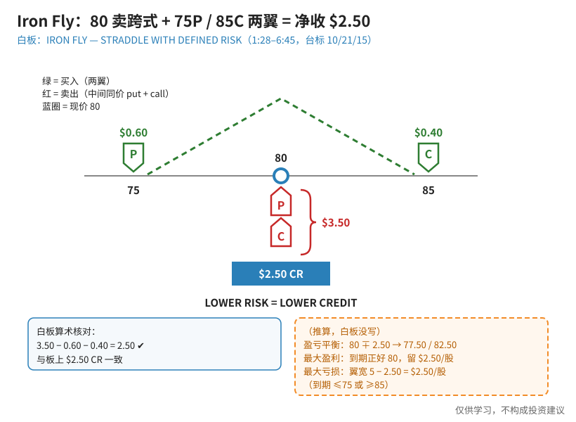
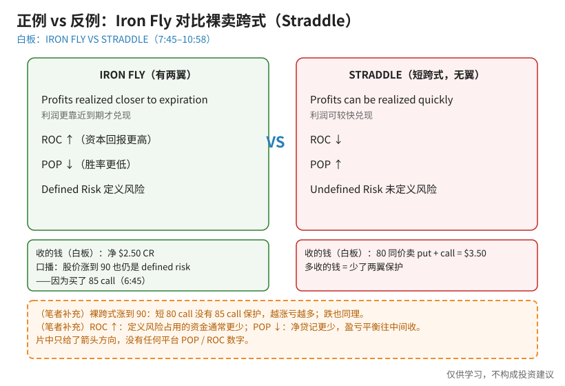
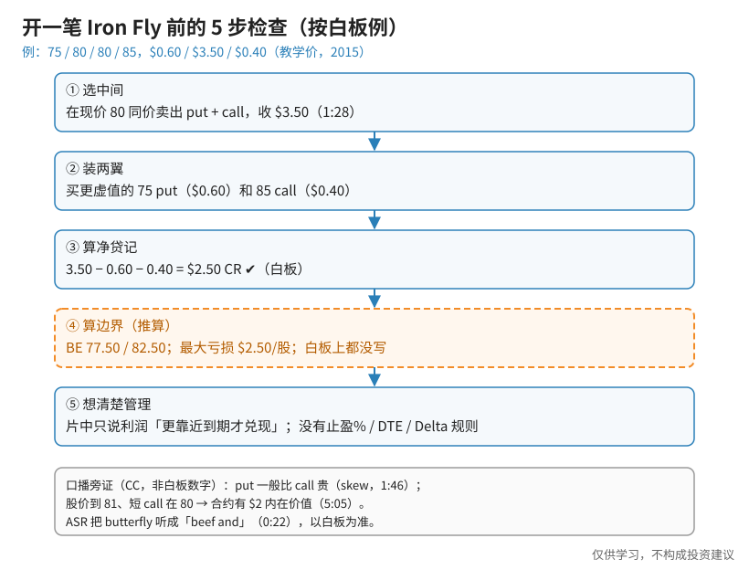

> 一句话：Iron Fly（铁蝶）= **在现价同一个行权价卖出 put + call（卖跨式），再在两侧各买一张更虚值的期权当「翅膀」**。白板副标题：**「STRADDLE WITH DEFINED RISK」**——带定义风险的跨式。代价写在板上：**LOWER RISK = LOWER CREDIT**。

主讲人开场说它「你可能也知道它叫 butterfly」——自动字幕把 butterfly 听成了「beef and」（0:22），以口播语境和白板为准。白板数字是 2015 年（台标 10/21/15）的教学例，不是当前报价。

## 0. 先认识几个词（第一次学看这里）

- **跨式（straddle）**：同一个行权价同时有 put 和 call。卖出跨式 = 两张都卖，收两份钱。
- **翅膀（wing）**：离现价更远、买来做保护的期权。买了翅膀，最坏亏多少就被「封顶」了。
- **贷记（CR, credit）**：开仓时净收到的钱。
- **定义风险（Defined Risk）**：最大亏损开仓时就算得出来；**未定义风险**则算不出上限。
- **ROC**：资本回报率（赚的钱 ÷ 占用的资金）；**POP**：盈利概率。

## 1. 概念：卖跨式 + 两只翅膀

**读图**
- 中间（白板，1:28）：现价 **80**（蓝圈），红 **P** 叠红 **C** = 在 80 同价卖出 put + call，括号写 **$3.50**。
- 两翼（白板）：绿 **P** 在 **75**（**$0.60**）、绿 **C** 在 **85**（**$0.40**）——这两张是买入的保护。
- 底框 **$2.50 CR**：3.50 − 0.60 − 0.40 = **2.50** ✔，与白板一致。
- 口号 **LOWER RISK = LOWER CREDIT**（4:05 那一帧完整可读）：加两翼把风险封顶，代价是净收入从 3.50 降到 2.50。
- 橙框全部是**（推算）**，白板上**没有**写：BE 77.50 / 82.50（80 ∓ 2.50）；最大盈利 $2.50/股（到期正好 80）；最大亏损 = 翼宽 5 − 2.50 = **$2.50/股**（到期 ≤75 或 ≥85）。

口播旁证（CC，不是白板数字）：put 一般比 call 贵（skew，1:46）；股价到 **81**、短 call 在 80 时，这张合约有 **$2** 内在价值（5:05）；股价一路涨到 **90**，因为买了 85 call，仍是 defined risk（6:45）。

## 2. 正例 vs 反例：有翅膀的 Iron Fly 对比没翅膀的卖跨式

**读图**
- 白板原文（8:45 完整可读）：Iron Fly = Profits realized **closer to expiration** / **ROC↑** / **POP↓** / **Defined Risk**；Straddle = Profits can be realized **quickly** / **ROC↓** / **POP↑** / **Undefined Risk**。
- 为什么 Iron Fly 的利润更靠近到期才兑现？口播（8:25）：因为大部分外在价值（extrinsic value）在那附近——字幕拼成了「exttrinsic」。
- 口播（10:08、10:58）：定义风险通常带来更高的 return on capital；**减少 credit 会压低盈亏平衡、提高 POP**——但板上**没有写出**具体 BE 数字。
- 橙框**（笔者补充）**：裸跨式涨到 90 时，短 80 call 没有 85 call 保护，越涨亏越多；ROC↑ 是因为定义风险占用资金通常更少；POP↓ 是因为净贷记更少、盈亏平衡往中间收。片中**只给箭头方向，没有任何平台 POP / ROC 数字**。

## 3. 步骤：开一笔 Iron Fly 前的 5 步检查

**读图**
- ①②③ 全部来自白板：同价卖 80 put + call 收 $3.50 → 买 75P $0.60 / 85C $0.40 → 净 $2.50 CR。
- ④ 橙框是**（推算）**：BE 77.50 / 82.50、最大亏损 $2.50/股，白板上都没写，不能当成「板上数字」引用。
- ⑤ 管理：片中只有「利润更靠近到期才兑现」这一句定性提示，没有止盈% / DTE / Delta 规则。

## 4. 和其他结构的关系（笔者补充）

- **[Short Strangle](./2026-10-14-short-strangle.md)**：卖的是**不同**的虚值行权价、两边都不封顶；Iron Fly 卖的是**同一个**平值行权价、两边有翅膀。
- **[Butterfly 蝶式](./2026-09-25-Butterfly%EF%BC%9A1-2-1%E5%AF%B9%E7%A7%B0%E7%BF%BC%EF%BC%8C%E5%88%AB%E6%8A%8A%E6%95%99%E5%AD%A619%E6%AF%941%E5%BD%93%E6%88%90%E5%AE%9E%E7%9B%98.md)**：经典蝶式是同一种期权 1:2:1 三档；Iron Fly 用 put 价差 + call 价差四条腿搭成「中间卖、两边买」，盈亏形状都像帐篷——所以片中直接叫它 butterfly。
- **[Iron Condor](./2026-09-18-Iron-Condor%EF%BC%9A%E4%B8%A4%E8%BE%B9Credit-Vertical%EF%BC%8C%E5%88%AB%E5%92%8CShort-Strangle%E6%90%9E%E6%B7%B7.md)**：两侧**虚值**各卖一组垂直价差，利润区更宽、贷记通常更少；Iron Fly 在**平值**叠卖，利润区更尖、贷记相对更多。

## 价值判断

| 判断 | 内容 |
|---|---|
| 采用 | Iron Fly = 平值卖跨式 + 两侧虚值长翼 = 定义风险版跨式；**LOWER RISK = LOWER CREDIT**；净贷记算术 3.50 − 0.60 − 0.40 = 2.50；对比裸跨式的 **ROC↑ / POP↓ / Defined vs Undefined** 权衡 |
| 观望 | 「利润更靠近到期才兑现」只是定性提示，无止盈 / DTE / Delta 规则；higher ROC、lower POP 没有平台数字；75/80/85 与 $0.60/$3.50/$0.40 是 2015 年教学价 |
| 弃用 | 把 Iron Fly 当成「没风险」；把推算的 77.50 / 82.50、$2.50 最大亏损写成仿佛白板上有的数字；采信 ASR「beef and」 |

## 参考来源

1. tastylive, *How to Trade the Iron Fly Strategy*（Mike and His White Board；https://www.youtube.com/watch?v=MqB7BGBLXYw ；浏览器完整观看 11:37/11:37，台标 10/21/15 录制）。画面时间点：0:22 口播「butterfly」（ASR 误作 beef and）；1:28 IRON FLY / STRADDLE WITH DEFINED RISK 结构板（75 $0.60 / 80 $3.50 / 85 $0.40 / $2.50 CR）；1:46 put 比 call 贵；4:05 LOWER RISK = LOWER CREDIT；5:05 $2 内在价值；6:45 涨到 90 仍 defined risk；7:45–8:45 IRON FLY VS STRADDLE；10:08 higher ROC；10:58 breakeven / POP 口播。
2. 配图 `ironfly-structure-250cr.svg`、`ironfly-vs-straddle-board.svg`、`ironfly-five-step-check.svg` 依白板重画；橙色虚线框为笔者补充或推算，不是片中原话。

*仅供学习，不构成投资建议。期权有到期、指派、保证金与流动性风险；文中数字均为视频里的教学例，不是当前报价，也不是推荐。*
