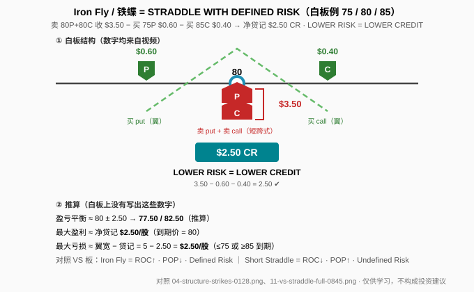
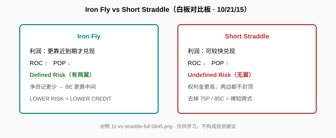

> 一句话：Iron Fly = **平值短跨式 + 两侧虚值长翼**。白板副标题是 **「STRADDLE WITH DEFINED RISK」**；口号是 **LOWER RISK = LOWER CREDIT**。

## 1. 结构与白板算术

白板（1:28）：现价 **80** 卖 put+call 收 **$3.50**；买 **75 put（$0.60）** 和 **85 call（$0.40）** 做两翼；底框净贷记 **$2.50 CR**。

核对：3.50 − 0.60 − 0.40 = **2.50** ✔。两翼各宽 5 点。主讲人说它也就是常说的 butterfly（0:22 ASR 把 butterfly 听成 “beef and”，以白板为准）。

**读图**
- 绿 P/C = 长翼；红 P 叠红 C = 短跨式；口号 **LOWER RISK = LOWER CREDIT** 写在板上。
- 口播补充（非白板数字）：put 一般比 call 贵（skew）；股价到 **81** 时短 call 有 **$2** 内在价值；涨到 **90** 仍是 defined risk（有 85 长 call）。
- 橙框「推算」：BE ≈ **77.50 / 82.50**；最大盈利 ≈ **$2.50/股**；最大亏损 ≈ 5 − 2.50 = **$2.50/股**。这些**白板上没写**，勿当成板面数字。

## 2. 和短跨式比什么

**读图**
- 白板对比四行（8:45）：Iron Fly = 利润更靠近到期兑现、**ROC↑**、**POP↓**、**Defined Risk**；Short Straddle = 利润可较快兑现、ROC↓、POP↑、**Undefined Risk**。
- 口播收尾：定义风险通常占用资金更少 → ROC 更高；净 credit 变少会把 BE 往中间收 → POP 往往下降。板上**没有**平台百分比。

对照（笔者补充）：
- 去掉 75P/85C = 裸卖 80 跨式（片中短腿 3.50），两边未定义风险。
- 和 [Short Strangle](./2026-10-14-short-strangle.md)：宽跨式卖的是**不同**虚值行权价；Iron Fly 卖的是**同一**平值再加两翼。
- 和铁秃鹰：铁秃鹰两侧各卖虚值垂直（利润区更宽）；Iron Fly 中间平值叠卖，利润区更尖。

## 3. 采用前记住的取舍

加两翼把风险封顶，代价是净权利金变少（3.50 → 2.50）。开仓前先核净贷记，再自己算 BE / 最大亏损，并标成「推算」——不要把推算写回白板。

片中没有止盈%、DTE、Delta 规则；75/80/85 与 $0.60/$3.50/$0.40 是 2015 教学例。

## 价值判断

| 判断 | 内容 |
|---|---|
| 采用 | Iron Fly = ATM short straddle + 两侧 OTM 长翼；**LOWER RISK = LOWER CREDIT**；净贷记 3.50−0.60−0.40=2.50；相对裸短跨式的 ROC↑ / POP↓ / Defined vs Undefined 权衡 |
| 观望 | 「利润更靠近到期」只是定性提示；higher ROC / lower POP 无平台数字；2015 教学价 |
| 弃用 | 当成「没风险」；把 **77.50 / 82.50** 写成仿佛白板上有；采信 ASR「beef and」；编造 BE/MaxL 却不标推算 |

## 参考来源

1. tastylive, *How to Trade the Iron Fly Strategy*（Mike and His White Board；https://www.youtube.com/watch?v=MqB7BGBLXYw ；浏览器完整观看 11:37/11:37，台标 10/21/15）。关键帧：1:28 结构与 $2.50 CR；4:05 LOWER RISK = LOWER CREDIT；8:45 完整 VS 板。
2. 配图 `iron-fly-structure.svg`、`iron-fly-vs-straddle.svg` 依白板重画；推算数字单独标出。

*仅供学习，不构成投资建议。期权有到期、指派、保证金与流动性风险；文中标的与数字均为视频教学例或明确标注的推算，不是当前报价，也不是推荐。*
