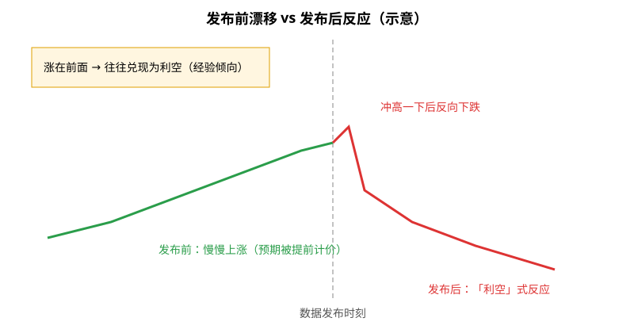
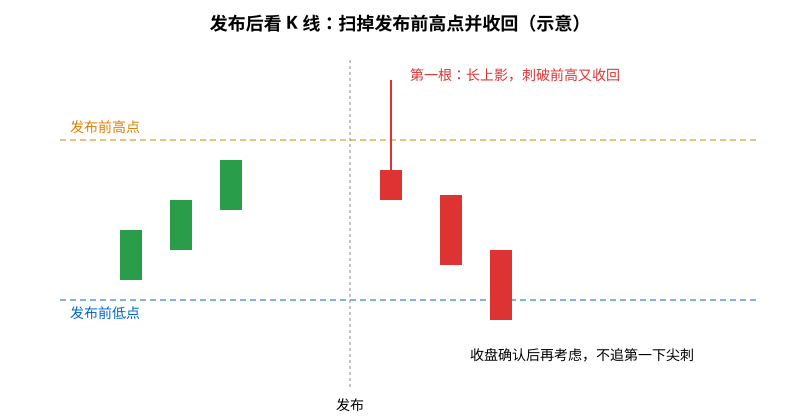
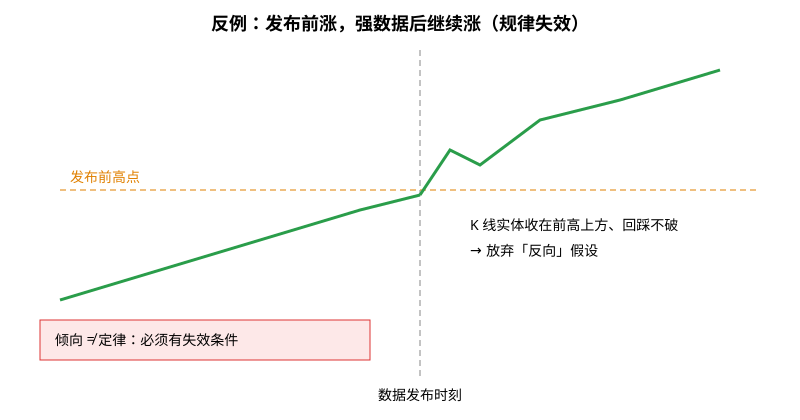
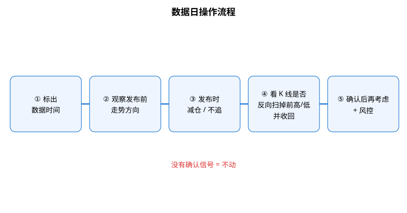

> 昨天（CPI 数据日）复盘的一句话：**「在数据发布之前，如果有上涨，大概率是利空；如果有下跌，大概率是利好，要密切关注 K 线情况。」**
> 这里的「大概率」是我自己的经验观察，**不是**统计结论，也不是规律。

## 1. 先搞懂：什么是「定时发布的宏观数据」

有些经济数据会在**事先公布的固定时间**发布，市场都盯着它，比如：

- **CPI**（消费者物价指数）：衡量通胀；
- **NFP**（非农就业）：衡量就业；
- **FOMC**（美联储议息会议）：利率决议和发言。

因为时间是提前知道的，大家会在发布前就开始「押题」。这就产生了我观察到的现象：**发布前的漂移方向，常常和发布后的真实反应相反。**

**读图**
- 虚线是数据发布时刻，左边是发布前，右边是发布后；全是相对位置，没有价格。
- 发布前慢慢涨（绿）→ 发布后先冲一下再掉头下跌（红），表现得像「利空」。
- 反过来，发布前跌、发布后往上走，就是「利好」式反应。

## 2. 为什么会这样（笔者补充）

以下是交易圈的常见解释，属于**通用知识补充**：

1. **提前站队（positioning）**：很多人在发布前就按自己的预期建仓，价格先走了一段。
2. **买预期，卖事实（buy the rumor, sell the news）**：数据一出，先进场的人兑现离场，价格反向。
3. **一边堆满止损/流动性**：发布前往一个方向走，会在前高/前低附近堆积止损，发布瞬间容易被扫。
4. **预期已被计价**：涨了一段等于已经提前反映「好数据」，实际数据就算不错也不够惊喜，反而反转。

## 3. 「盯紧 K 线」到底盯什么

**读图**
- 先标出**发布前的高点和低点**（橙/蓝虚线）。
- 发布后第一根 **1m/5m K 线**：如果长上影刺破前高又收回来，是「拒绝」信号。
- 关键是**等 K 线收盘**确认，而不是对第一下尖刺做反应——尖刺可能来回扫两边。
- 后续 K 线实体回到区间内、继续往反方向走，才算反向确认。

## 4. 反例：发布前涨，数据强，继续涨

**读图**
- 数据明显超预期时，发布前的方向可能**直接延续**。
- K 线实体收在发布前高点上方、回踩不破 → 放弃「反向」假设。
- 所以这只是我观察到的**倾向**，不是定律，必须提前写好失效条件。

## 5. 我以后的数据日流程

**读图**
- 五步按顺序走：标时间 → 看发布前方向 → 发布时减仓/不追 → 看是否反向扫前高/低并收回 → 确认后再考虑 + 风控。
- 没有确认信号就**不动**。

## 6. 风险提示

- 发布前后**点差扩大、滑点严重**，止损可能成交在比预期差得多的位置。
- **不要带着重仓过数据**；方向猜对了，也可能被第一根尖刺先扫出局。
- 失效条件（任一满足就停用「反向」思路）：K 线实体收盘站稳发布前高点（或低点）之外，且回踩不破。

相关旧文：[扫流动性还是真突破](./2026-10-06-%E6%89%AB%E6%B5%81%E5%8A%A8%E6%80%A7%E8%BF%98%E6%98%AF%E7%9C%9F%E7%AA%81%E7%A0%B4%EF%BC%9A%E7%9C%8BK%E7%BA%BF%E5%AE%9E%E4%BD%93%E6%94%B6%E5%9C%A8%E5%93%AA%EF%BC%8C%E5%86%8D%E7%9C%8BFVG%E5%AE%88%E4%B8%8D%E5%AE%88%E5%BE%97%E4%BD%8F.md)、[暴跌后的反弹往往只是回抽到 0.618](./2026-10-13-crash-rebound-618-lesson.md)

## 7. 采用 / 观望 / 弃用

| 结论 | 内容 |
|---|---|
| 采用 | 数据日先标时间和发布前高/低；发布前的漂移当作「可能反向」的线索；等发布后 K 线收盘确认扫掉并收回再考虑 |
| 观望 | 不同数据（CPI/NFP/FOMC）、不同周期上这个倾向是否一样明显，需要更多复盘 |
| 弃用 | 发布前顺着漂移方向重仓押注；对发布后第一下尖刺追单 |

## 参考来源

- 个人交易复盘（2026-10-14，CPI 数据日）
- positioning、buy the rumor sell the news、流动性扫荡等为交易常识，属通用知识补充

> 学习笔记，仅供学习，不构成投资建议。
