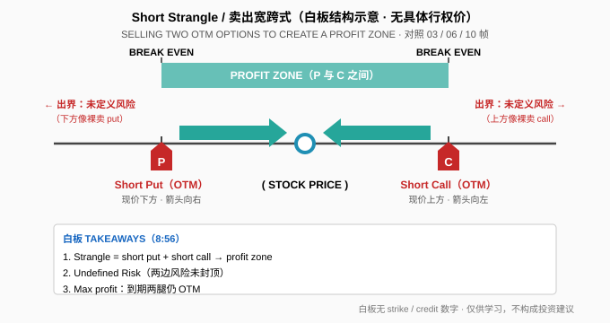
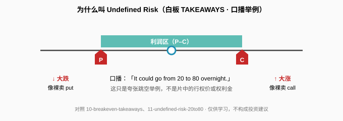

> 一句话：Short Strangle = **卖一张虚值 put + 卖一张虚值 call**。白板原文是 **「SELLING TWO OTM OPTIONS TO CREATE A PROFIT ZONE」**——利润在中间，两边风险都没封顶。

## 1. 结构是什么

白板（1:12–4:07）：现价下方卖 put（红 **P**）、现价上方卖 call（红 **C**），两条腿叠完后，**P 与 C 之间**那条青绿横条就是利润区，两端标 **BREAK EVEN**。

- Short put：希望股价待在 put 行权价上方（箭头向右）。
- Naked short call：希望股价待在 call 行权价下方（箭头向左）。
- 到期两腿都仍虚值（OTM）→ 拿走最大盈利（白板 TAKEAWAYS 第 3 条）。

**读图**
- 白板**全程没有**行权价、权利金、贷记数字，只有结构示意（台标 09/17/15）。
- BE 只标了「BREAK EVEN」字样，**没有**写出公式。
- 生命周期板（4:56–6:12）用 START → FINISH 画一条扭在两行权价之间的路径；口播有「buy it back」，但**没给**止盈/止损规则。

## 2. 正例 vs 风险：中间赚钱，两边未封顶

**读图**
- TAKEAWAYS 第二条就是 **Undefined Risk**：出界后下方像裸卖 put、上方像裸卖 call。
- 口播举例（9:49）：「It could go from **20 to 80** overnight.」——只是夸张跳空，**不是**片中的行权价或权利金。
- 「推算」（非片中）：最大盈利 ≈ 两腿权利金之和；下方 BE ≈ put 行权价 − 总贷记；上方 BE ≈ call 行权价 + 总贷记。白板没写这些公式，勿当成片中内容。

对照（笔者补充）：
- 和 [Long Strangle](./2026-10-09-long-straddle-strangle.md) **正好相反**：那边买两张、中间亏、两边赚。
- 和 [Jade Lizard](./2026-10-13-jade-lizard.md)：Jade 用更虚值的买 call 把上方改成定义风险；Short Strangle 上方仍是裸 call。
- 和铁秃鹰：两侧各加保护腿 → 定义风险；Short Strangle ≈ 铁秃鹰去掉两翼。

## 3. 采用前先记住三件事

1. 结构直觉：short put + short call = **P–C 利润区**。
2. 到期两腿都 OTM 才拿满最大盈利。
3. **Undefined Risk 是一等公民**——两边都可能被指派，亏损可以远大于收到的权利金。

片中没有 DTE、Delta、止盈% 或仓位管理规则；2015 白板是纯示意。

## 价值判断

| 判断 | 内容 |
|---|---|
| 采用 | 把 Short Strangle 记成「两侧各卖一张虚值期权、中间利润区」；把 **Undefined Risk** 当开仓前必过的一关 |
| 观望 | 「buy it back」生命周期提示；「20 to 80」口播夸张；无管理规则的 2015 教学板 |
| 弃用 | 把未定义风险当小事；和 Long Strangle 搞混买卖方向；在没有 strike/credit 证据时编造权利金或行权价 |

## 参考来源

1. tastylive, *What is a Short Strangle & How do I Trade it?*（Mike and His White Board；https://www.youtube.com/watch?v=dNv1UYRawB8 ；浏览器完整观看 11:30/11:30，台标 09/17/15）。关键帧：1:12 利润区白板；3:03 put+call 两行；4:07 profit zone；8:56 BREAK EVEN + TAKEAWAYS；9:49「20 to 80」口播。
2. 配图 `short-strangle-structure.svg`、`short-strangle-undefined.svg` 依白板重画；橙色/推算说明不是片中原话。

*仅供学习，不构成投资建议。期权有到期、指派、保证金与流动性风险；文中数字均为视频教学例或明确标注的推算，不是当前报价，也不是推荐。*
