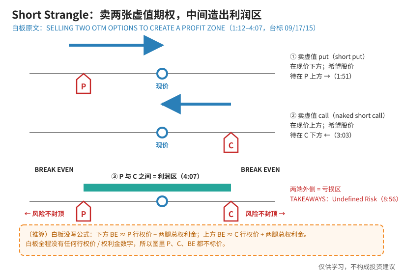
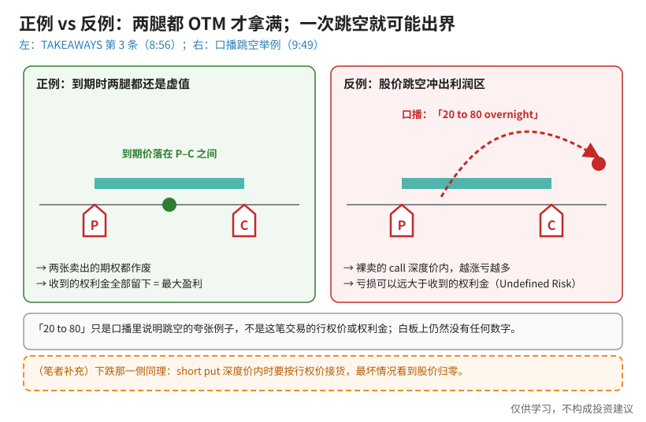
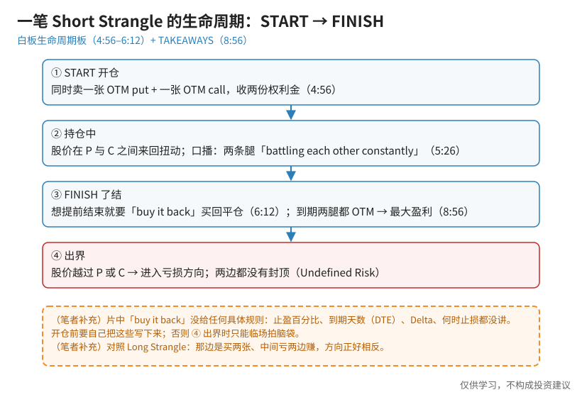

> 一句话：Short Strangle（卖出宽跨式）= **在现价下方卖一张虚值 put + 在现价上方卖一张虚值 call**。白板原文：**「SELLING TWO OTM OPTIONS TO CREATE A PROFIT ZONE」**——利润在中间，两边的风险都没有封顶。

这期白板是 2015 年录制的（台标 09/17/15），**白板全程没有写任何行权价或权利金数字**，只画结构。所以这篇也不编数字：图里的 P、C、BE 都不标价。

## 0. 先认识几个词（第一次学看这里）

- **期权卖方**：先收一笔钱（权利金），换来一项义务。期权到期作废，这笔钱就留下。
- **虚值（OTM）**：put 的行权价在现价**下方**、call 的行权价在现价**上方**，现在去行权不划算。
- **Short put**：卖出 put。股价待在行权价上方，你就安心收钱。
- **Naked short call（裸卖 call）**：卖出 call，手里**没有**股票也没有买 call 保护。股价待在行权价下方，你就安心收钱。
- **盈亏平衡（BREAK EVEN，BE）**：到期时不赚不亏的价格。

## 1. 概念：两条腿叠起来，中间就是利润区

**读图**
- 第一行（1:12–1:51）：现价下方卖一张 put（红 **P**），蓝箭头向右——股价待在 P **上方**对你有利。
- 第二行（3:03）：现价上方卖一张 call（红 **C**），蓝箭头向左——股价待在 C **下方**对你有利。
- 第三行（4:07）：两条腿叠在一起，**P 和 C 之间**那条青绿横条就是「zone of profitability」（利润区）；8:56 的板上在横条两端标了 **BREAK EVEN**。
- 两端外侧是亏损区，而且**没有封顶**：TAKEAWAYS 第二条就是 **Undefined Risk**。
- 橙色虚线框是**（推算）**：BE ≈ P 行权价 − 总权利金 / C 行权价 + 总权利金。白板只写了「BREAK EVEN」几个字，**没写公式，也没给数字**。

## 2. 正例 vs 反例：到期两腿都 OTM 才拿满，一次跳空就可能出界

**读图**
- 左（正例，TAKEAWAYS 第 3 条，8:56）：*Max profit is realized if options are OTM at expiration.* 到期价落在 P–C 之间 → 两张期权都作废 → 收的权利金全部留下。
- 右（反例，口播 9:49）：主讲人说股价「could go from **20 to 80** overnight」——一夜跳空冲过 C，裸卖的 call 深度价内，越涨亏得越多，亏损可以远大于当初收的钱。
- 注意：「20 to 80」**只是口播里说明跳空风险的夸张例子**，不是这笔交易的行权价或权利金；白板上依然没有数字。
- 橙框**（笔者补充）**：下跌那一侧同理——short put 深度价内时要按行权价接货，最坏情况要看到股价归零。片中没有展开这一侧的算例。

## 3. 步骤：一笔 Short Strangle 的生命周期

**读图**
- ① START（4:56）：生命周期板顶部写 START，下方左右各一个红 P、红 C。
- ② 持仓中（5:26）：一条蓝色曲线在两个行权价之间扭来扭去；口播说两条腿「are going to be battling each other constantly」——涨了 call 那边难受，跌了 put 那边难受。
- ③ FINISH（6:12）：口播「I need to **buy it back**」——想提前了结就要把卖出的期权买回来；到期两腿都 OTM 则拿满最大盈利。
- ④ 出界：股价越过 P 或 C 就进入亏损方向，两边都不封顶。
- 橙框**（笔者补充）**：片中**没有**给任何管理规则（止盈百分比、到期天数 DTE、Delta、何时止损），开仓前要自己写下来。

## 4. 别和这几个结构搞混（笔者补充）

- **[Long Strangle](./2026-10-09-long-straddle-strangle.md)**：买两张虚值期权，**中间亏、两边赚**，风险封顶在付出的权利金；Short Strangle 方向正好相反——中间赚、两边亏、风险不封顶。
- **[Jade Lizard](./2026-10-13-jade-lizard.md)**：在 short strangle 的上方再买一张更虚值的 call，把上方改成定义风险（贷记 > call 价差宽度时上方「无风险」）；下方仍是裸 put。
- **[Iron Condor](./2026-09-18-Iron-Condor%EF%BC%9A%E4%B8%A4%E8%BE%B9Credit-Vertical%EF%BC%8C%E5%88%AB%E5%92%8CShort-Strangle%E6%90%9E%E6%B7%B7.md)**：两边都各买一张保护腿 → 两边都定义风险。可以把 Short Strangle 理解为「铁秃鹰去掉两只翅膀」。
- 同价卖 put + call 叫跨式（straddle）；本片白板写的是 **STRANGLE**（不同行权价），没有展开跨式。定义风险版的跨式见 [Iron Fly](./2026-10-14-iron-fly.md)。

## 价值判断

| 判断 | 内容 |
|---|---|
| 采用 | 结构直觉：short put + short call = **P–C 之间的利润区**；到期两腿都 OTM 才拿满最大盈利；把 **Undefined Risk** 当一等公民——开仓前先想清楚两边各自最坏会怎样 |
| 观望 | 「buy it back」没有任何止盈 / DTE / Delta 管理规则；2015 年的白板纯示意，没有实盘数字；BE 公式只能作推算 |
| 弃用 | 把未定义风险当小事；在没有行权价 / 权利金证据时编造数字；把 Short Strangle 和 Long Strangle（买卖方向相反）搞混；把口播「20 to 80」当成交易参数 |

## 参考来源

1. tastylive, *What is a Short Strangle & How do I Trade it?*（Mike and His White Board；https://www.youtube.com/watch?v=dNv1UYRawB8 ；浏览器完整观看 11:30/11:30，台标 09/17/15 录制）。画面时间点：1:12 STRANGLE / SELLING TWO OTM OPTIONS TO CREATE A PROFIT ZONE；1:51 short put；3:03 put 行 + call 行；4:07 profit zone；4:56 START 生命周期板；5:26 P/L 路径；6:12 FINISH /「buy it back」；8:56 BREAK EVEN + TAKEAWAYS 三条；9:49 口播「20 to 80 overnight」。
2. 配图 `sstrangle-concept-profit-zone.svg`、`sstrangle-ok-vs-gap.svg`、`sstrangle-lifecycle-flow.svg` 依白板重画；橙色虚线框为笔者补充或推算，不是片中原话。

*仅供学习，不构成投资建议。卖出期权涉及指派、保证金与跳空风险；文中没有任何具体标的或价格，也不是交易推荐。*
