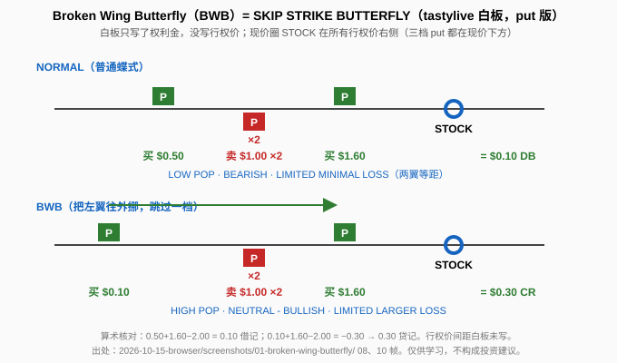
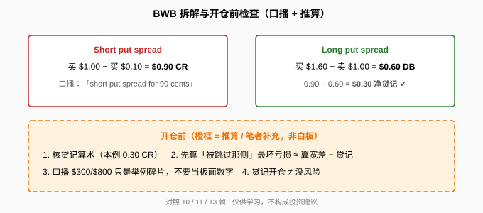

> 一句话：Broken Wing Butterfly（又名 **SKIP STRIKE BUTTERFLY**）= 普通蝶式把**一侧的翼往外挪、跳过一档**。本片 put 版算例：普通蝶式 **$0.10 借记** → 挪翼后 **$0.30 贷记**；标签从 LOW POP / LIMITED MINIMAL LOSS 变成 HIGH POP / LIMITED LARGER LOSS。

## 1. 普通蝶式 vs BWB（白板两组算例）

白板（0:56–5:26）：上行 NORMAL 两翼等距；下行 BWB 左翼被挪远。现价圈 **STOCK** 在所有 put 右侧（三档都在现价下方）。

- **普通**：买 $0.50 + 买 $1.60 − 卖 $1.00×2 = **$0.10 DB**。标签：LOW POP、BEARISH、LIMITED MINIMAL LOSS。
- **BWB**：左翼只要 $0.10 → $0.10 + $1.60 − $1.00×2 = **$0.30 CR**。标签：HIGH POP、NEUTRAL - BULLISH、LIMITED LARGER LOSS。

**读图**
- 白板**全程没写行权价**，只写权利金（台标 01/14/16）。
- 算术核对：0.50+1.60−2.00 = 0.10 ✔；0.10+1.60−2.00 → 0.30 贷记 ✔。
- TAKEAWAYS 第 4 条有一个词被打码（「This is the ████ preferred butterfly」），无法辨认，文中不猜。

## 2. 拆开看 + 开仓前检查

**读图**
- 口播（6:37）：下半段是收 **90 美分**的 short put spread（卖 1.00 − 买 0.10）；上半段是付 0.60 的 long put spread；0.90 − 0.60 = 0.30 ✔。
- 怎么赚（口播）：股价可以待在原地、上涨、或只小跌一点——比「必须跌到正中间」有更多做对的方式。
- 代价（口播 7:42–8:44）：亏损仍有上限，但更大。口播出现「5 点宽 / $800 / $300」碎片——**白板没画**，不要当板面算例。
- 橙框推算：若窄翼 5、宽翼 8，跌破最低行权价时亏损 ≈ (8−5) − 0.30；口播「$300」更像没扣贷记的 8−5。最大盈利（短行权价处）≈ 窄翼宽 + 贷记——白板没写。

对照（笔者补充）：
- 和 [Jade Lizard](./2026-10-13-jade-lizard.md)：都是让一侧更「安全」、风险集中到另一侧。
- 和 [Iron Fly](./2026-10-14-iron-fly.md)：Iron Fly 用 put+call 搭在平值；本片 BWB 全用 put、在现价下方，偏中性偏多。被挪远的是**下方**翼 → 大跌那侧风险变大。

## 3. 采用前先算被跳过那侧

贷记开仓 ≠ 没风险。开仓前：① 核贷记算术；② 先算「被跳过那侧」最多亏多少；③ 口播金额只当线索，不写进板面数字。

片中没有行权价、DTE、止盈止损或调整规则；POP 无具体百分比。

## 价值判断

| 判断 | 内容 |
|---|---|
| 采用 | BWB = 普通蝶式挪远一只翼；两组算例（0.10 DB → 0.30 CR）与 short put spread 收 0.90 的拆解；**HIGH POP ↔ LARGER LOSS**；开仓前先算被跳过那侧最坏亏损 |
| 观望 | 无行权价/DTE/管理规则；「更多做对的方式」无 POP 数字；打码的 preferred butterfly |
| 弃用 | 把贷记开仓理解成没风险；把口播 $300/$800 当白板算例；在没有板面证据时编造行权价 |

## 参考来源

1. tastylive, *What is a Broken Wing Butterfly?*（Mike and His White Board；https://www.youtube.com/watch?v=sjCWOmn4OgA ；浏览器完整观看 11:46/11:46，台标 01/14/16）。关键帧：0:56 SKIP STRIKE 结构；2:46 普通 $0.10 DB；5:26 BWB $0.30 CR；6:37「90 cents」拆解；9:29 TAKEAWAYS。
2. 配图 `bwb-structure.svg`、`bwb-split-flow.svg` 依白板与口播重画；推算单独标出。

*仅供学习，不构成投资建议。期权有到期、指派、保证金与流动性风险；文中数字均为视频教学例或明确标注的推算，不是当前报价，也不是推荐。*
