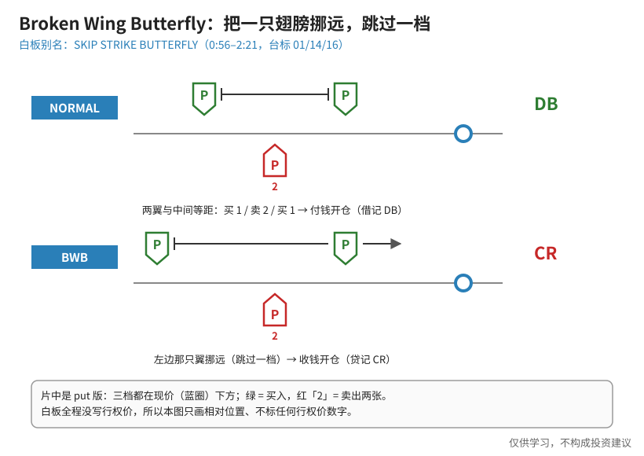
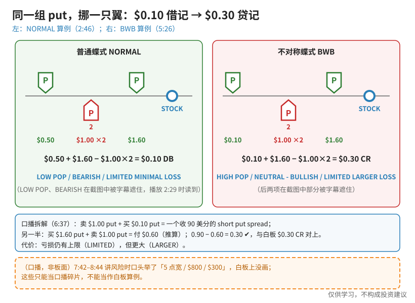
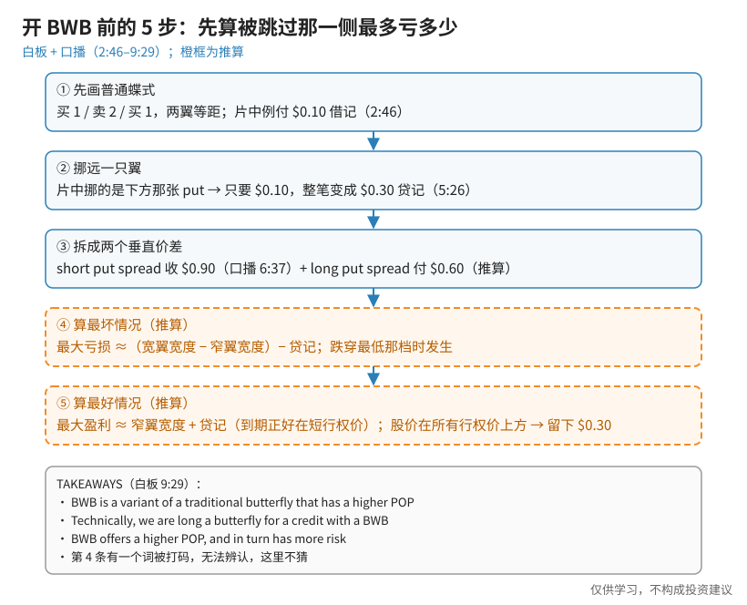

> 一句话：Broken Wing Butterfly（BWB，不对称蝶式，白板别名 **SKIP STRIKE BUTTERFLY**）= 普通蝶式**把一只翅膀往外挪、跳过一档**。片中例子：同一组 put，普通蝶式要**付 $0.10**，挪远一翼后变成**收 $0.30**——胜率（POP）高了，但最坏情况的亏损也变大了。

白板是 2016 年录制的（台标 01/14/16）。**白板全程没写行权价，只写了权利金**，所以本文的图也只画相对位置，不画任何行权价数字。

## 0. 先认识几个词（第一次学看这里）

- **蝶式（butterfly）**：买 1 张、卖 2 张、再买 1 张，三个行权价，中间卖两张，两边各买一张当「翅膀」。普通蝶式两翼与中间**等距**。
- **借记（DB, debit）/ 贷记（CR, credit）**：开仓净付钱 / 净收钱。
- **垂直价差**：同到期、不同行权价，一买一卖。蝶式可以拆成两个垂直价差。
- **POP**：盈利概率。片中只说高低，没给数字。

## 1. 概念：跳过一档，借记变贷记

**读图**
- 白板（0:56）上下两行：**NORMAL** 两只绿 P 与中间红 P「2」等距，右边写绿色 **DB**；**BWB** 左边那只绿 P 挪得更远（长横杠带箭头），右边写红色 **CR**。
- 口播（0:56）：普通蝶式的两边「equal equidistant」；（2:07）挪翼是为了「create a credit scenario as opposed to a debit」。
- 片中是 **put 版**：三档都在现价（蓝圈）**下方**。
- 图里不标行权价——因为白板上就没有。

## 2. 正例 vs 反例：同一组 put，两种开法

**读图**
- 左（白板 2:46）：$0.50 + $1.60 − $1.00×2 = **$0.10 DB**；标签 **LOW POP / BEARISH / LIMITED MINIMAL LOSS**——最多只亏付出的 $0.10，但要股价正好跌到中间那档才赚得多。（LOW POP、BEARISH 在截图里被字幕遮住，是 2:29 播放时读到的。）
- 右（白板 5:26）：最远那张 put 只要 **$0.10**，$0.10 + $1.60 − $1.00×2 = **$0.30 CR**；标签 **HIGH POP / NEUTRAL - BULLISH / LIMITED LARGER LOSS**。
- 口播拆解（6:37）：卖 $1.00 put + 买 $0.10 put = 一个收 **90 美分**的 short put spread；另一半买 $1.60 + 卖 $1.00 = 付 $0.60（这个数是**推算**）；0.90 − 0.60 = 0.30 ✔。
- 怎么赚（口播 7:01–7:26）：股价**不动、上涨、或只小跌一点**都能赚——比普通蝶式「得正好跌到中间」有更多做对的方式。
- 代价（7:42）：「this trade has a **limited larger loss**」——亏损仍有上限，但更大。
- 橙框：7:42–8:44 口播里提到的「**5 点宽 / $800 / $300**」**只是口播**，白板上没画，句子还跨帧被截断，不能当作板面算例。

## 3. 步骤：开 BWB 前先算被跳过那一侧

**读图**
- ①② 来自白板：先画等距蝶式（付 $0.10）→ 挪远下方那只翼（变成收 $0.30）。
- ③ 拆成两个垂直价差：short put spread 收 $0.90 是口播；long put spread 付 $0.60 是推算。
- ④ 橙框**（推算）**：最大亏损 ≈（宽翼宽度 − 窄翼宽度）− 贷记，发生在股价跌穿最低那一档时。片中**没写这个公式**。
- ⑤ 橙框**（推算）**：最大盈利 ≈ 窄翼宽度 + 贷记（到期正好落在短行权价）；股价停在所有行权价上方时，所有 put 作废，留下 $0.30 贷记。
- TAKEAWAYS（9:29）四条照抄白板；**第 4 条「This is the ████ preferred butterfly」有一个词被打码，无法辨认，本文不猜**。

一个**（推算）**小练习：如果按口播的说法，窄翼 5 点、宽翼 8 点，那么跌穿最低档时亏损 ≈ (8 − 5) − 0.30 = $2.70/股 ≈ $270/张。口播里的「$300」看起来像是没扣贷记的 8 − 5 = 3，但字幕句子被截断，无法确认原话。这只是帮助理解公式，**不是视频里的白板算例**。

## 4. 和已学结构对照（笔者补充）

- **[Jade Lizard](./2026-10-13-jade-lizard.md)**：思路相似——用结构让「一侧不亏甚至留贷记」，把风险集中到另一侧。Jade Lizard 是「贷记 > call 价差宽度 → 上方无风险」；BWB 是「贷记开仓 → 现价侧无风险，被跳过的一侧风险变大」。
- **[Iron Fly](./2026-10-14-iron-fly.md)**：Iron Fly 用 put + call 搭在平值、两翼对称；本片 BWB 全用 put、搭在现价下方、两翼不对称，偏中性偏多。
- **[普通 Butterfly](./2026-09-25-Butterfly%EF%BC%9A1-2-1%E5%AF%B9%E7%A7%B0%E7%BF%BC%EF%BC%8C%E5%88%AB%E6%8A%8A%E6%95%99%E5%AD%A619%E6%AF%941%E5%BD%93%E6%88%90%E5%AE%9E%E7%9B%98.md)**：1-2-1 对称翼是 BWB 的起点；BWB 就是「把对称打破」。
- 方向：片中挪远的是**下方**那只翼，所以风险在**大跌**那侧；若用 call 并挪远上方翼，就是镜像（偏中性偏空）。

## 价值判断

| 判断 | 内容 |
|---|---|
| 采用 | BWB = 普通蝶式挪远一只翼；两组白板算例（$0.10 DB → $0.30 CR）与「short put spread 收 $0.90」的拆解；**HIGH POP ↔ LIMITED LARGER LOSS** 的取舍；开仓前先算被跳过那侧最多亏多少 |
| 观望 | 白板没给行权价、DTE、止盈止损或调整规则；「更多做对的方式」只是定性说法，POP 没有数字；最大亏损 / 最大盈利公式只能作推算 |
| 弃用 | 把「贷记开仓」理解成「没风险」；把口播「5 点宽 / $800 / $300」当成白板算例；猜 TAKEAWAYS 第 4 条被打码的词；在没有板面证据时编造行权价 |

## 参考来源

1. tastylive, *What is a Broken Wing Butterfly? | Options Trading Concepts*（Mike and His White Board；https://www.youtube.com/watch?v=sjCWOmn4OgA ；浏览器完整观看 11:46/11:46，台标 01/14/16 录制）。画面时间点：0:56 BROKEN WING BUTTERFLY / SKIP STRIKE BUTTERFLY 与 NORMAL vs BWB；2:07 credit vs debit；2:46 NORMAL 算例 $0.10 DB；4:33 口播 5 点宽举例；5:26 BWB 算例 $0.30 CR；6:37 口播 short put spread 90 美分；7:42 limited larger loss；8:44 口播 $300；9:29 TAKEAWAYS。
2. 配图 `bwb-skip-strike-concept.svg`、`bwb-debit-vs-credit-boards.svg`、`bwb-five-step-risk-check.svg` 依白板重画；橙色虚线框为笔者补充、推算或口播，不是白板内容。

*仅供学习，不构成投资建议。期权有到期、指派、保证金与流动性风险；文中数字均为视频里的教学例，不是当前报价，也不是推荐。*
