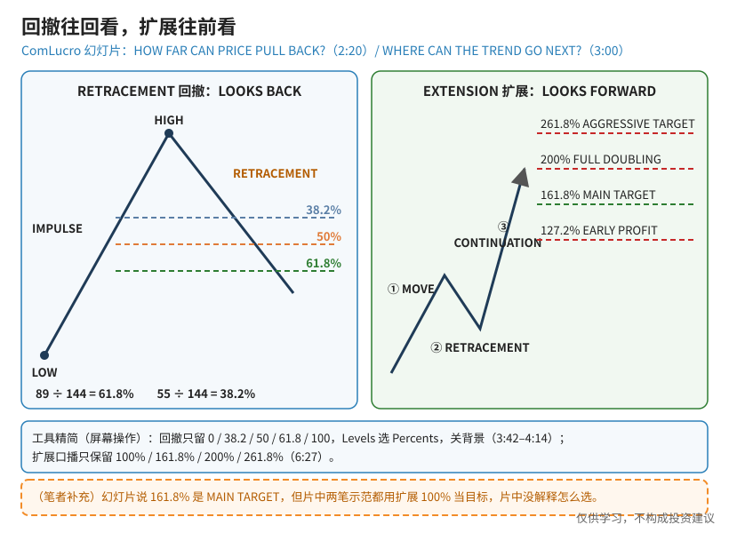
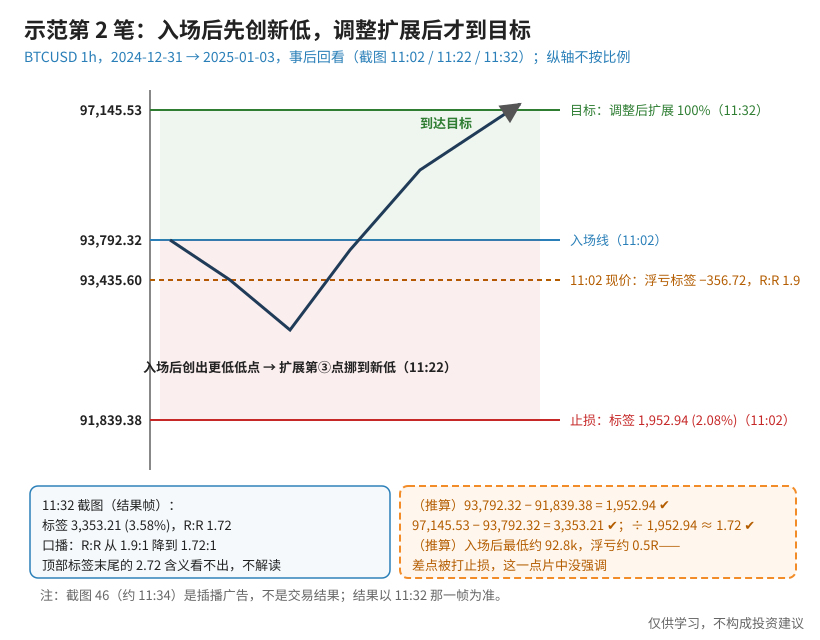
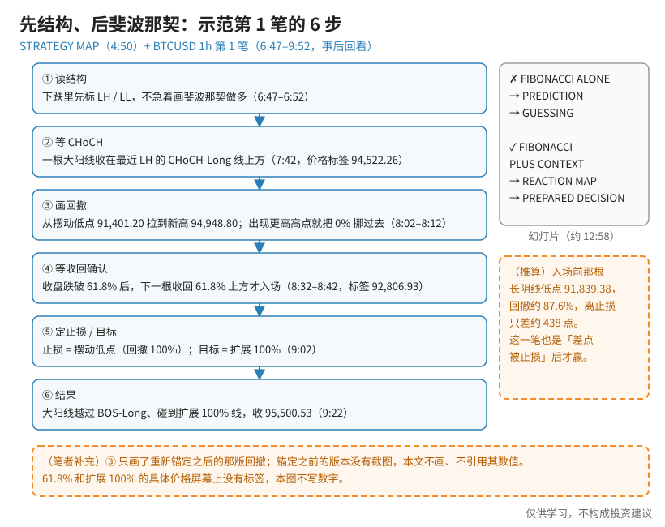

> 一句话：**回撤（Retracement）往回看**——回调可能停在哪；**扩展（Extension）往前看**——趋势可能走到哪。这节课的核心不是数字本身，而是顺序：**先读结构、等 CHoCH，再画斐波那契，再等收盘确认**。片中自己的结论是：**FIBONACCI IS NOT THE PLAN**。

视频是 ComLucro（频道显示 ComLucro Trader）「Technical Analysis for Day Traders」课程的一课，图表是 **BTCUSD 1 小时**，两笔示范交易都在 2024-12-30 → 2025-01-03 这一段上涨里，**都是事后回看**，不是实时行情。

和我之前那篇 [交易教训：暴跌后的反弹往往只回抽到 0.618](./2026-10-13-crash-rebound-618-lesson.md) 的区别：那篇是自己的复盘，讲**下跌腿**里把反弹当「回抽」看；这篇是视频课，讲**结构翻转向上之后**怎么用回撤找入场、用扩展定目标。两篇方向相反，可以对照看。

## 0. 先认识几个词（第一次学看这里）

- **斐波那契数列**：0、1、1、2、3、5、8、13、21……每个数等于前两个数之和。数越大，相邻两数的比越接近 1.618 / 0.618（黄金比例，片中 2:04 用 89 ÷ 55 → 1.618 演示）。
- **回撤百分比**：把一段上涨从低点到高点当 100%，回调回去了多少。片中 2:20：89 ÷ 144 = 61.8%，55 ÷ 144 = 38.2%。
- **LH / LL / HH / HL**：更低的高点 / 更低的低点 / 更高的高点 / 更高的低点，用来判断趋势方向。
- **CHoCH**：Change of Character，结构转变。下跌里价格收在最近一个 LH 上方，就是第一个「可能翻转」的信号。
- **BOS**：Break of Structure，结构突破，用来确认新趋势。
- **R:R**：风险回报比 = 目标距离 ÷ 止损距离。

## 1. 概念：回撤往回看，扩展往前看

**读图**
- 左（幻灯片 2:20，HOW FAR CAN PRICE PULL BACK?）：LOW → IMPULSE → HIGH，之后回调落在 **38.2 / 50 / 61.8** 这条带里；PREVIOUS MOVE → MARKET GIVES BACK PART OF IT → POSSIBLE REACTION → TREND CONTINUES。
- 右（幻灯片 3:00，WHERE CAN THE TREND GO NEXT?）：① MOVE ② RETRACEMENT ③ CONTINUATION；目标档位 **127.2% EARLY PROFIT（早止盈）/ 161.8% MAIN TARGET（主目标）/ 200% FULL DOUBLING（翻倍）/ 261.8% AGGRESSIVE TARGET（激进目标）**。
- 工具精简（屏幕操作 3:42–4:14）：回撤只留 0 / 38.2 / 50 / 61.8 / 100，Levels 选 **Percents**，不勾 Background、Reverse、Prices；扩展口播只保留 100% / 161.8% / 200% / 261.8%（6:27）。
- 橙框**（笔者补充）**：幻灯片把 161.8% 叫主目标，但两笔示范都把目标放在**扩展 100%**，片中没解释怎么选。

片中对「为什么有效」的说法（约 12:03，NOT MAGIC NUMBERS）：不是自然界的神秘定律（HIDDEN LAW OF NATURE ✗），而是很多人盯着同一条线（SHARED REFERENCE ✓）→ 订单扎堆 → 价格有反应；**FIBONACCI DOES NOT PREDICT → PARTICIPATION CREATES REACTION**。

## 2. 正例（也是提醒）：示范第 2 笔，入场后先创新低

**读图**
- 11:02 截图：入场线 **93,792.32**；止损 **91,839.38**，标签 **1,952.94 (2.08%)**；当时现价 93,435.60，持仓标签 **−356.72**，R:R **1.9**。
- 口播（11:02–11:22）：「After we enter, price prints a lower low than the previous one」→ 把扩展的第③点挪到新低，目标下移，R:R「from 1.9:1 to 1.72:1」。
- 11:32 截图（结果帧）：目标价标签 **97,145.53**，结果标签 **3,353.21 (3.58%)**，R:R **1.72**。顶部标签末尾还有一个 2.72，截图看不出含义，不作解读。
- 注意：**截图 46（约 11:34）是插播广告，不是交易结果**；结果以 11:32 那一帧为准。
- 橙框**（推算）**：93,792.32 − 91,839.38 = 1,952.94 ✔；97,145.53 − 93,792.32 = 3,353.21 ✔；3,353.21 ÷ 1,952.94 ≈ 1.72 ✔。入场后最低约 92.8k，浮亏约 0.5R——**这笔其实是先难受了一阵才赢的**，片中没有强调这一点。

为什么把它当「提醒」：持仓中因为新低去调整扩展目标，可以理解为「跟着结构更新」，但这也是**开仓后改规则**。如果事先没写清「什么情况下挪第③点」，就容易变成事后拟合（笔者补充）。

## 3. 步骤：先结构、后斐波那契（示范第 1 笔）

**读图**
- ① 读结构（6:47–6:52）：下跌里先标 LH、LL；口播「wait for a CHoCH … before we even think about buying」。
- ② 等 CHoCH（7:42）：一根大阳线收在 CHoCH-Long 线上方（价格标签 94,522.26）。
- ③ 画回撤（8:02–8:12）：从摆动低点 **91,401.20** 拉到新高 **94,948.80**；口播「prints a higher high … we recalibrate the tool」——出现更高高点就把 0% 挪过去。**重新锚定之前那一版没有截图，本文不画、不引用它的数值。**
- ④ 等收回确认（8:32–8:42）：一根长阴线把价格打到 **91,839.38**，之后收盘跌破 61.8%，口播「we watch for the very next candle to close back above it」——收回 61.8% 上方那根 K 线的价格标签 **92,806.93**。
- ⑤ 止损 / 目标（9:02）：止损区下沿在摆动低点（回撤 100%）；口播「the target is the 100% level of the Fibonacci extension」。
- ⑥ 结果（9:22）：大阳线越过 BOS-Long、碰到扩展 100% 线，收 **95,500.53**；口播「this setup delivers a winning trade」。
- 右侧灰框（幻灯片约 12:58）：**FIBONACCI ALONE → PREDICTION → GUESSING ✗**；**FIBONACCI PLUS CONTEXT → REACTION MAP → PREPARED DECISION ✓**。口播：「Fibonacci should never be your only reason to enter a trade」。
- 橙框**（推算）**：入场前那根长阴线低点 91,839.38，相当于回撤约 87.6%，离止损只差约 438 点——第 1 笔同样是「差点被止损」后才赢。61.8% 和扩展 100% 的具体价格屏幕上没有清晰标签，图里不写数字。

## 4. 片中其他值得记的点

- **KEEP IT SIMPLE**（4:26）与 David Paul 采访片段（4:34–5:30）：刚入行时规则简单、做得好；「成了专家」以后反而不及时止损——「the more you know, at times, the more difficult it is」。
- **DISCOUNT VS PREMIUM**（约 12:13）：多头偏见下，61.8% 以下是 DISCOUNT（顺势买），100%–200% 是 PREMIUM（止盈）；**换方向，区域也跟着翻**。
- **PEOPLE MOVE THE MARKET**（约 13:18）：真正推动价格的是背后下单的人，不是斐波那契本身。
- 结构翻转后（10:12–10:42）：清掉旧的 LH/LL/CHoCH/BOS，重新标 High / Low / HL，再画新的回撤。

## 5. 和已学内容对照（笔者补充）

- 「先等 CHoCH → 回调到区 → 收回确认 → 顺势」和 [TAE 框架](./2026-09-15-%E5%88%AB%E5%86%8D%E5%A0%86%E6%8C%87%E6%A0%87%E7%94%A8TAE%E6%8A%8A%E6%8A%80%E6%9C%AF%E5%88%86%E6%9E%90%E7%90%86%E9%A1%BA.md)（趋势 → 价值区 → 入场确认）几乎同构，斐波那契只是把「价值区」换成 38.2–61.8 这条带。
- 「收盘跌破再收回」很像 [扫流动性](./2026-10-06-%E6%89%AB%E6%B5%81%E5%8A%A8%E6%80%A7%E8%BF%98%E6%98%AF%E7%9C%9F%E7%AA%81%E7%A0%B4%EF%BC%9A%E7%9C%8BK%E7%BA%BF%E5%AE%9E%E4%BD%93%E6%94%B6%E5%9C%A8%E5%93%AA%EF%BC%8C%E5%86%8D%E7%9C%8BFVG%E5%AE%88%E4%B8%8D%E5%AE%88%E5%BE%97%E4%BD%8F.md)：先刺穿大家盯着的线，再收回来。片中没用这个词。
- 结构判断可对照 [BOS 之前先把道氏三步写进 SOP](./2026-09-15-BOS%E4%B9%8B%E5%89%8D%E5%85%88%E6%8A%8A%E9%81%93%E6%B0%8F%E4%B8%89%E6%AD%A5%E5%86%99%E8%BF%9BSOP.md)。
- 盈亏平衡胜率（推算）：R:R 1.72 时，胜率要高于约 36.8%（1 ÷ 2.72）才不亏，未计手续费和滑点；片中没给胜率。

## 价值判断

| 判断 | 内容 |
|---|---|
| 采用 | **先结构、后斐波那契**：下跌里不画回撤做多，先等 CHoCH；回撤工具多头从低连到高，只留 0 / 38.2 / 50 / 61.8 / 100，显示 Percents；**入场要收盘确认**（跌破 61.8% 后下一根收回）；止损放摆动低点、开仓前算好 R:R；结构翻转后清旧标注、重新锚定；把斐波那契当「反应地图」而不是预测 |
| 观望 | 目标用扩展 100% 还是幻灯片说的 161.8% 主目标，片中没解释，需要自己比较；持仓中因新低下调目标（1.9 → 1.72）要事先写清触发条件；127.2 / 161.8 / 200 / 261.8 分级止盈只有定性标签；「机构在 61.8% / 161.8% 挂单」的示意没有订单流证据；只演示了 BTC 1h |
| 弃用 | 把两笔赢单当策略有效的证据（同一段行情、事后挑图、没有输单和胜率）；忽略两笔都「差点被止损」；把「贝壳 / 花朵 / 星系的黄金比例」当交易理由；只凭一条斐波那契线进场；把截图 46（广告）当交易结果；引用没有截图证据的小字读数 |

## 参考来源

1. ComLucro Trader, *Fibonacci Trading Strategy: Retracements, Extensions and Market Structure Explained*（https://www.youtube.com/watch?v=KiFAIGpORzQ ；浏览器分两次完整观看 15:00/15:00）。画面时间点（以截图里播放器读数为准）：0:19–0:23 WHY DOES PRICE REACT HERE?；1:14 THE MAN BEHIND THE MATH；1:30 数列；2:04 THE GOLDEN RATIO；2:20 HOW FAR CAN PRICE PULL BACK?；3:00 WHERE CAN THE TREND GO NEXT?；3:28 回撤画法；3:42–4:14 回撤设置精简；4:26 KEEP IT SIMPLE；4:50 STRATEGY MAP；5:40 TOOLS NEED DISCIPLINE；6:07–6:27 扩展设置；6:47–7:42 LH/LL → Down Trend → CHoCH 确认；8:02–8:12 回撤锚到 94,948.80；8:32–8:42 收回 61.8%；9:02 Long Position 工具 / 目标 = 扩展 100%；9:22 第 1 笔到目标；10:12–10:42 重画结构；11:02 第 2 笔入场与 −356.72 / 1.9；11:22 调整扩展；11:32 第 2 笔达标 3,353.21 (3.58%) / 1.72；约 12:03 NOT MAGIC NUMBERS；约 12:13 DISCOUNT VS PREMIUM；约 12:58 FIBONACCI IS NOT THE PLAN；约 13:18 PEOPLE MOVE THE MARKET。
2. 配图 `fibx-retrace-vs-extension.svg`、`fibx-trade2-lower-low-example.svg`、`fibx-structure-first-flow.svg` 依截图与幻灯片重画；橙色虚线框为笔者补充或推算，不是片中原话；没有截图的画面（重新锚定前的回撤版本等）一律不画。

*仅供学习，不构成投资建议。示范交易均为事后回看的教学例，不代表任何品种的未来走势，也不是买卖建议。*
