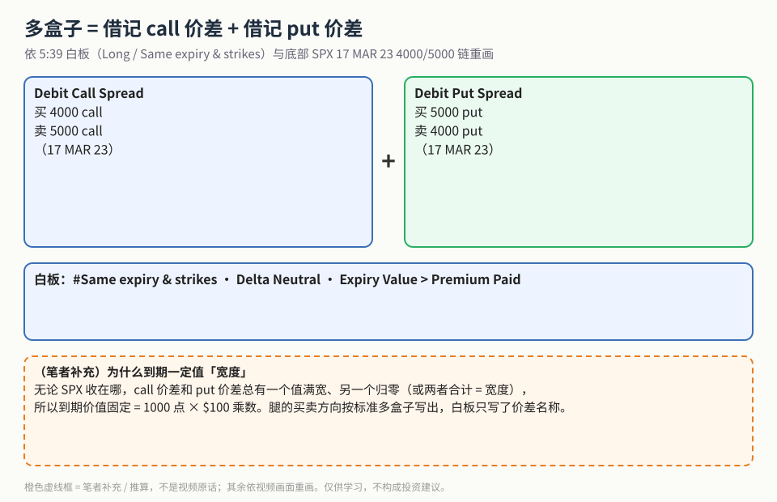
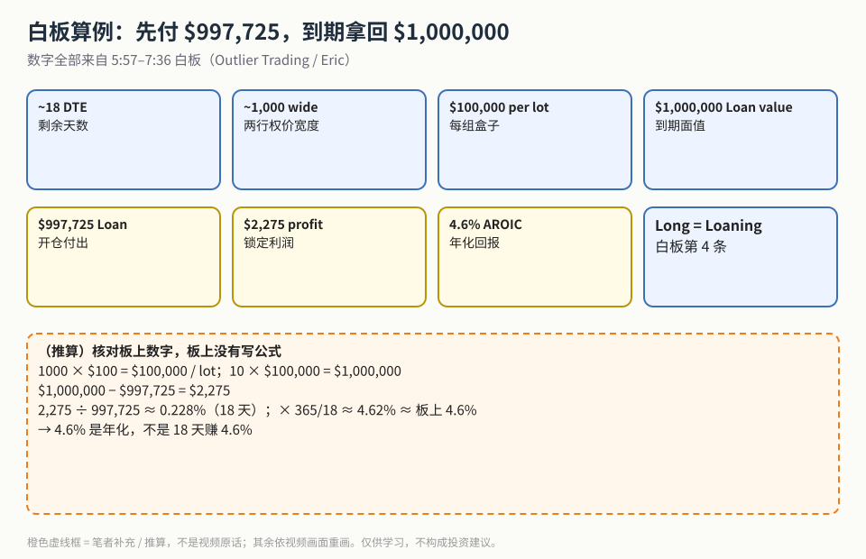
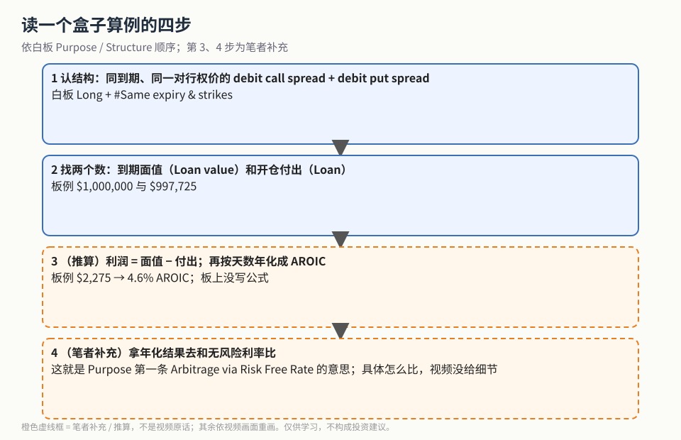

盒子价差（Box Spread）第一次学，先记白板上的一句：**Long = Loaning**。做多一个盒子，就像**把一笔钱借出去**：现在先付一个略低于「宽度面值」的价格，到期固定拿回宽度面值，差额就是利息。

> 说明：这支视频**全程没有字幕**。本文只写白板和交易软件画面上看得见的内容；口头讲解里不能确认的部分一律不写。

做盒子之前要满足的四条硬条件（欧式、流动性、时机……）放在姊妹篇 [《盒子价差四条硬条件》](./2026-10-20-box-spread-european-liquidity.md)。借记价差本身的基础见 [Bull Put Spread](./2026-10-08-bull-put-spread-risk-sizing.md) / [Bear Call Spread](./2026-10-09-bear-call-spread.md) 等垂直价差篇。

## 1. 白板 Purpose 栏

0:40 白板标题 *Option Box Spreads Explained*，Purpose 栏写着：

- Arbitrage via Risk Free Rate
- High Collateral w/ Low Reward
- I use to optimize capital efficiency
- Delta Neutral
- Expiry Value > Premium Paid

## 2. 结构：四条腿

**读图**
- 5:39 白板 Long 下面写着 *Debit call spread + Debit Put Spread*、*#Same expiry & strikes*。
- 画面底部的期权链是 S&P 500 INDEX，**17 MAR 23** 到期的 **4000 / 5000** call 和 put。
- 中间蓝框是白板 Purpose 栏的三个关键词。
- 底部橙色虚线框为**（笔者补充）**：白板只写了「借记 call 价差 + 借记 put 价差」，每条腿买哪个、卖哪个是按标准多盒子写出的；到期价值固定等于宽度的原因也是笔者解释。

## 3. 白板算例

**读图**
- 七个数字全部来自 5:57–7:36 的白板：~18 DTE、~1,000 wide、$100,000 per lot、$1,000,000 Loan value、$997,725 Loan、$2,275 profit、4.6% AROIC。
- 6:57、7:36 紫色强调先后落在 $997,725 Loan 和 4.6% AROIC 上，数字本身没变。
- 底部虚线框是**（推算）**：白板没有写公式，笔者用「利润 ÷ 付出 × 365/18」核对，约 4.62%，和板上 4.6% 一致。
- 关键结论：**4.6% 是年化**，18 天的持有期回报约 0.228%（推算）。

## 4. 读算例的四步

**读图**
- 第 1、2 步只用白板上写的字。
- 第 3 步（推算）、第 4 步（笔者补充）是虚线框：怎么和无风险利率具体比较，视频画面没有给细节。

**（笔者补充）** 和 put-call parity 的关系：同一到期、同一对行权价上，一个合成多头 + 一个合成空头相互抵消，剩下的就是固定的宽度现金流，开仓价应接近这笔现金流按利率贴现后的值。同日的 [合成多头篇](./2026-10-20-synthetic-long-structure.md) 讲的就是「合成多头」这块积木。

## 价值判断

| 判断 | 内容 |
|---|---|
| 采用 | 多盒子 = 同到期、同行权价的借记 call 价差 + 借记 put 价差；Long = 放贷；Expiry Value > Premium Paid；用年化 AROIC 而不是绝对美元比较 |
| 观望 | 和 T-bill / 券商融资利率怎么精确比；空盒子（Short = Borrowing）的保证金实操；链上报价字太小，无法独立复算 $997,725 |
| 弃用 | 把 4.6% 当成 18 天收益；把盒子当方向交易；把视频里听不清的口头内容当成依据 |

## 参考来源

1. Outlier Trading（Eric）, *Box Spreads Explained*（https://www.youtube.com/watch?v=TQe-HW7-x5I ；浏览器完整观看 12:49/12:49，CC 全程不可用）。画面时间点：0:40 Purpose；5:39 Structure（Long / Same expiry & strikes / SPX 17 MAR 23 4000/5000）；5:57 数字列；6:57 / 7:36 紫色强调；10:39 TOS SPX 演示。
2. 配图 `boxloan-four-legs.svg`、`boxloan-board-numbers.svg`、`boxloan-check-steps.svg` 依白板重画；橙色虚线框为笔者补充 / 推算。
3. 姊妹篇：[《盒子价差四条硬条件》](./2026-10-20-box-spread-european-liquidity.md)

*仅供学习，不构成投资建议。SPX 4000/5000、$997,725 等是 2023 年的教学画面，利率环境与今天不同，不能当作交易模板。*
