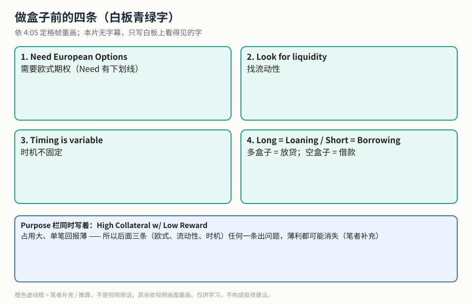
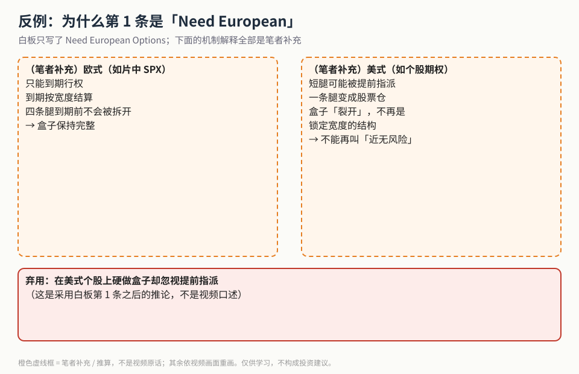
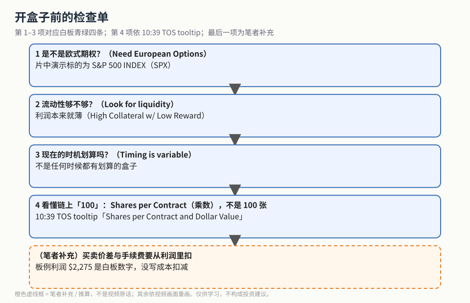

姊妹篇 [《盒子价差入门》](./2026-10-20-box-spread-as-loan.md) 讲了盒子的结构和 $997,725 → $1,000,000 的白板算例。这一篇讲**做之前要过的四道关**。

> 说明：这支视频**全程没有字幕**。下面只写白板与交易软件画面上的文字；主讲人口头讲的风险举例无法逐字核对，本文不写。凡是机制解释，都标为（笔者补充）。

## 1. 白板青绿四条

**读图**
- 四个绿框照抄 4:05 定格帧左栏：1. Need European Options（Need 有下划线）；2. Look for liquidity；3. Timing is variable；4. Long = Loaning / Short = Borrowing。
- 底部蓝框：Purpose 栏的 *High Collateral w/ Low Reward*。后半句「任何一条出问题，薄利都可能消失」是**（笔者补充）**。

## 2. 反例：为什么必须是欧式

**读图**
- 白板只写了 *Need European Options*；两个虚线框里的机制都是**（笔者补充）**。
- 左：欧式（片中演示的 SPX 就是）只能到期行权，四条腿到期前不会被拆开。
- 右：美式（如多数个股期权）短腿可能被提前指派，一条腿变成股票仓，盒子「裂开」，不能再叫近无风险。
- 底部红框：由此推出的弃用项，不是视频口述。

## 3. 开盒子前的检查单

**读图**
- 第 1–3 项对应白板青绿四条。
- 第 4 项来自 10:39 TOS 画面：鼠标悬停时 tooltip 显示 *Shares per Contract and Dollar Value* —— 链上每行前面的「100」是乘数，不是 100 张。
- 最后一格是**（笔者补充）**：白板 $2,275 利润没有写手续费和买卖价差的扣减。

10:39 的 TOS 画面：S&P 500 INDEX 约 4045.64，Position 区仍是 17 MAR 23 的 4000/5000 四条腿，和白板同一套行权价。链上报价字太小，本文不抄。

## 价值判断

| 判断 | 内容 |
|---|---|
| 采用 | 优先欧式（如 SPX）与流动性好的合约；接受「时机不固定」；先看懂乘数「100」 |
| 观望 | 空盒子的保证金与税务实操；何时「划算」的具体判断标准（画面未给） |
| 弃用 | 在美式个股上硬做盒子却忽视提前指派；无视买卖价差/手续费仍按「理论无风险」重仓；把无字幕视频里听不清的口头内容写成结论 |

## 参考来源

1. Outlier Trading（Eric）, *Box Spreads Explained*（https://www.youtube.com/watch?v=TQe-HW7-x5I ；浏览器完整观看 12:49/12:49，CC 全程不可用）。画面时间点：0:40 Purpose；4:05 青绿四条完整定格；5:39 Structure；10:39 TOS SPX ~4045.64 与 Shares per Contract tooltip；10:54 镜头 + TOS 轨道。
2. 配图 `boxcond-four-rules.svg`、`boxcond-european-vs-american.svg`、`boxcond-checklist.svg` 依画面重画；橙色虚线框为笔者补充。
3. 姊妹篇：[《盒子价差入门》](./2026-10-20-box-spread-as-loan.md)

*仅供学习，不构成投资建议。*
