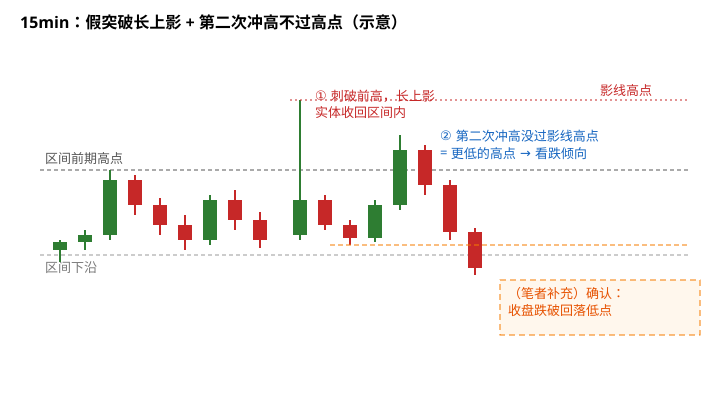
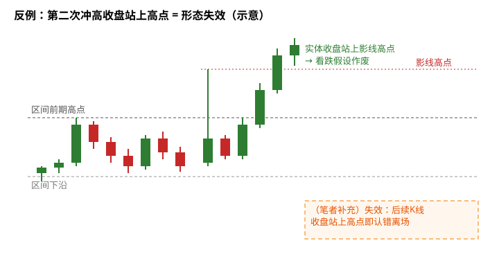
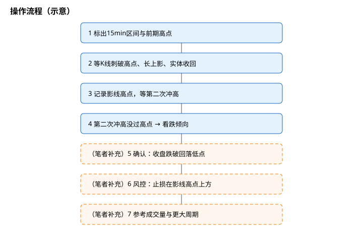

> 今天复盘的一句话教训：**「在 15min 图上如果出现突破区间前期高点但是收长上影线实体落下来，第二次冲高没有过高点的情况，看跌。」**
> 这里的「看跌」是我自己的经验：这种形态之后**大概率**偏弱。这是盘感观察，**不是**统计结论，也没有胜率数字。

## 1. 先搞懂几个词

- **区间 / 前期高点**：价格在一段时间里上下震荡，上沿最高的那个点就是前期高点，很多人会盯着它看「突破」。
- **长上影线**：K 线最高价比实体高出很多，说明价格冲上去后被打回来了。
- **实体落下来**：这根 K 线收盘时，实体回到前高**下方**、区间以内——突破没站住，就是**假突破**。
- **第二次冲高没过高点**：之后价格再往上试一次，但连那根上影线的最高点都碰不到，形成**更低的高点（lower high）**。

## 2. 形态长什么样

**读图**
- 灰色虚线是区间前期高点；① 那根 K 线刺破它，但留下长上影、实体收回区间内。
- 红色点线标的是**影线高点**，后面所有判断都拿它做参照。
- ② 第二次冲高没过影线高点 → 更低的高点 → 我的经验是**大概率看跌**。
- 橙色虚线框（笔者补充）：更稳的做法是等收盘跌破两次冲高之间的回落低点再确认。

## 3. 为什么会这样（笔者补充，通用常识）

以下解释是我补充的交易圈常识，不是这次复盘的原话：
1. 前高上方常堆着止损单和突破追多单，刺破后被吃掉，买盘没能接住，于是长上影。
2. 第二次上攻连影线高点都到不了，说明买方力量比第一次更弱。
3. 和 [扫流动性还是真突破](./2026-10-06-%E6%89%AB%E6%B5%81%E5%8A%A8%E6%80%A7%E8%BF%98%E6%98%AF%E7%9C%9F%E7%AA%81%E7%A0%B4%EF%BC%9A%E7%9C%8BK%E7%BA%BF%E5%AE%9E%E4%BD%93%E6%94%B6%E5%9C%A8%E5%93%AA%EF%BC%8C%E5%86%8D%E7%9C%8BFVG%E5%AE%88%E4%B8%8D%E5%AE%88%E5%BE%97%E4%BD%8F.md) 的思路一致：看**实体收在哪**，而不只看影线碰到哪。

## 4. 反例：第二次冲高收盘站上高点

**读图**
- 第二次冲高**实体收盘站上**影线高点，说明之前的上影只是一次洗盘。
- 这时「更低的高点」不存在了，看跌假设**作废**。
- 橙色虚线框（笔者补充）：提前写好失效条件——后续 K 线收盘站上高点就认错。

## 5. 我以后的流程

**读图**
- 蓝色实线框 1–4 是我这次复盘的原话拆解。
- 橙色虚线框 5–7 都是（笔者补充）：跌破回落低点确认、止损放影线高点上方、参考成交量和更大周期背景。
- 没走完前 4 步就**不动**；只当作「偏空倾向」，不是指令。

## 6. 风险与失效（笔者补充）

- 失效：后续 K 线**收盘站上**影线高点。
- 15 分钟图噪音大，更大周期（如 1H/4H）若是强上升趋势，这个信号可能只是回调。
- 冲高时成交量若明显放大且收得住，要警惕是真突破。

相关旧文：[扫流动性还是真突破](./2026-10-06-%E6%89%AB%E6%B5%81%E5%8A%A8%E6%80%A7%E8%BF%98%E6%98%AF%E7%9C%9F%E7%AA%81%E7%A0%B4%EF%BC%9A%E7%9C%8BK%E7%BA%BF%E5%AE%9E%E4%BD%93%E6%94%B6%E5%9C%A8%E5%93%AA%EF%BC%8C%E5%86%8D%E7%9C%8BFVG%E5%AE%88%E4%B8%8D%E5%AE%88%E5%BE%97%E4%BD%8F.md)、[OTZ 与收盘确认](./2026-09-15-OTZ%E4%B8%8E%E6%94%B6%E7%9B%98%E7%A1%AE%E8%AE%A4.md)、[Pinbar 插针线](./2026-10-01-Pinbar-%E6%8F%92%E9%92%88%E7%BA%BF-%E8%A3%B8K%E7%BA%BF%E4%BA%A4%E6%98%93%E6%B3%95%E7%AC%AC%E5%9B%9B%E7%AB%A0.md)、[K 线上升趋势组合形态](./2026-08-30-K%E7%BA%BF%E4%B8%8A%E5%8D%87%E8%B6%8B%E5%8A%BF%E7%BB%84%E5%90%88%E5%BD%A2%E6%80%81.md)、[暴跌后的反弹往往只是回抽到 0.618](./2026-10-13-crash-rebound-618-lesson.md)、[数据发布前的走势容易反向](./2026-10-14-pre-data-move-reversal-lesson.md)

## 7. 采用 / 观望 / 弃用

| 结论 | 内容 |
|---|---|
| 采用 | 15min 区间前高被刺破但长上影、实体收回，且第二次冲高不过影线高点 → 视为偏空倾向；以影线高点作为失效参照 |
| 观望 | 更大周期强趋势下是否同样有效；成交量如何辅助判断，需要更多复盘 |
| 弃用 | 一看到刺破前高就追多；形态未完成就提前押注；收盘站上高点后还死扛空头观点 |

## 参考来源

- 个人交易复盘（2026-10-20）
- 假突破、流动性扫荡、更低的高点等为交易常识，属通用知识补充

> 学习笔记，仅供学习，不构成投资建议。
