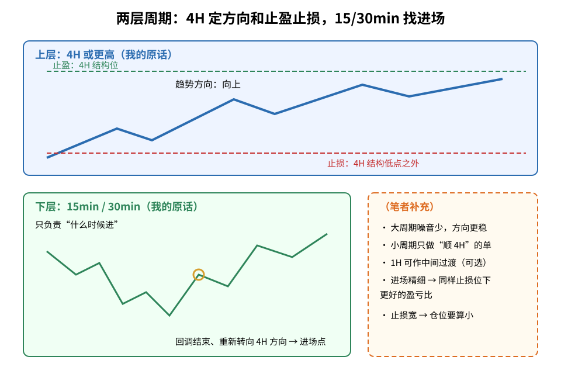
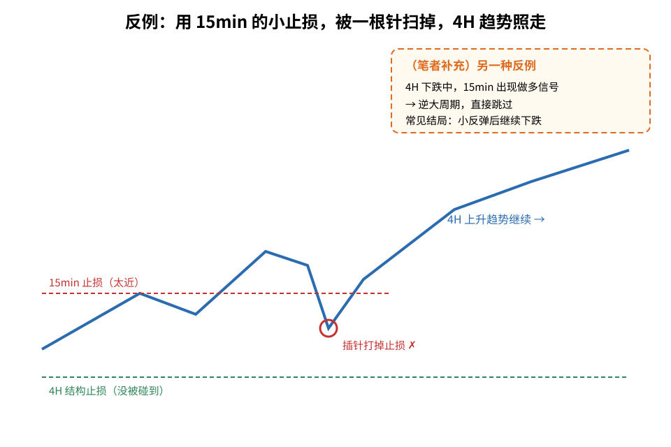
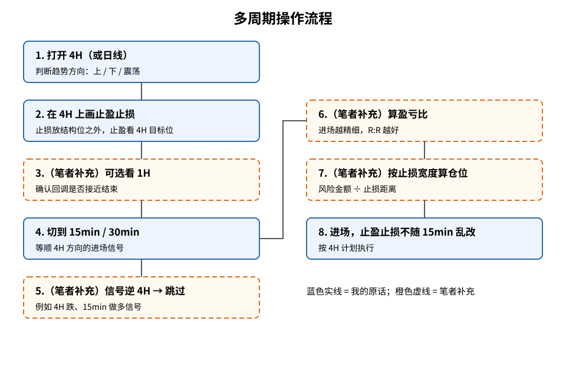

> 今天复盘的一句话教训：**「趋势和止盈止损要看 4h 以上，进场时间看 15 或 30min。」**
> 这是我自己的交易经验，**不是**统计结论，也没有胜率数字。文中凡标（笔者补充）的内容，都是我在原话之外补充的通用常识。

## 1. 先搞懂几个词

- **周期（timeframe）**：一根 K 线代表多长时间。4H 图一根 = 4 小时，15min 图一根 = 15 分钟。
- **大周期 / 小周期**：4H、日线算大周期；15min、30min 算小周期。
- **趋势**：价格整体往哪个方向走（高点低点逐步抬高 = 上升，逐步降低 = 下降）。
- **止盈 / 止损**：事先定好的「赚到哪里走」和「错到哪里认」的价位。
- **进场时机**：在方向已经定好的前提下，具体哪一刻下单。

## 2. 核心：两层分工

**读图**
- 上层蓝框（我的原话）：**4H 或更高**决定三件事——趋势方向、止盈位、止损位。
- 下层绿框（我的原话）：**15min / 30min** 只负责「什么时候进」，圆圈处是回调结束、重新转向 4H 方向的位置。
- 橙色虚线框（笔者补充）：大周期噪音少；小周期只做顺 4H 的单；1H 可作为中间过渡；进场越精细、盈亏比越好；止损宽则仓位要算小。

一句话：**大周期决定「做不做、做哪边、目标和认错点在哪」，小周期只决定「什么时候按下按钮」。**

## 3. 为什么这样分（笔者补充，通用常识）

以下解释是我补充的，不是复盘原话：
1. **大周期噪音少**：15min 上的一根插针，在 4H 上往往只是一根 K 线里的影线，方向判断更稳定。
2. **15min 的止损太近容易被扫**：小周期结构位离价格很近，正常波动就能打到，这和 [扫流动性还是真突破](./2026-10-06-%E6%89%AB%E6%B5%81%E5%8A%A8%E6%80%A7%E8%BF%98%E6%98%AF%E7%9C%9F%E7%AA%81%E7%A0%B4%EF%BC%9A%E7%9C%8BK%E7%BA%BF%E5%AE%9E%E4%BD%93%E6%94%B6%E5%9C%A8%E5%93%AA%EF%BC%8C%E5%86%8D%E7%9C%8BFVG%E5%AE%88%E4%B8%8D%E5%AE%88%E5%BE%97%E4%BD%8F.md) 里讲的流动性扫荡是一回事。
3. **只顺 4H 方向进场**：15min 出现逆 4H 趋势的信号，默认跳过。
4. **1H 可作桥梁（可选）**：4H 跳到 15min 跨度大时，用 1H 看回调是否接近尾声。
5. **对盈亏比和仓位的影响**：止损按 4H 结构放，距离会比 15min 宽；在同样风险金额下，仓位就要相应变小。仓位怎么算可以看 [风控仓位：先算手数再下单](./2026-09-16-%E9%A3%8E%E6%8E%A7%E4%BB%93%E4%BD%8D%EF%BC%9A%E5%8F%AA%E6%8B%BF%E9%A3%8E%E9%99%A9%E8%B5%84%E6%9C%AC%EF%BC%8C%E5%85%88%E7%AE%97%E6%89%8B%E6%95%B0%E5%86%8D%E4%B8%8B%E5%8D%95.md) 和 [ATR 调仓位](./2026-09-18-ATR%E8%B0%83%E4%BB%93%E4%BD%8D%EF%BC%9A%E9%A3%8E%E9%99%A9%E9%87%91%E9%A2%9D%C3%B7(N%C3%97ATR).md)。15min 进场的意义，是让进场点更靠近 4H 止损，从而改善盈亏比。
6. 这也符合 [TAE](./2026-09-15-%E5%88%AB%E5%86%8D%E5%A0%86%E6%8C%87%E6%A0%87%E7%94%A8TAE%E6%8A%8A%E6%8A%80%E6%9C%AF%E5%88%86%E6%9E%90%E7%90%86%E9%A1%BA.md) 的思路：先趋势（Trend），再区域（Area），最后才是进场（Entry）。

## 4. 反例：15min 止损被扫，4H 趋势照走

**读图**
- 4H 是上升趋势；如果把止损放在 15min 的小结构位（红虚线），一根插针（红圈）就把止损打掉。
- 而按 4H 结构放的止损（绿虚线）根本没被碰到，趋势随后继续向上——方向看对了，钱却亏了。
- 橙色虚线框（笔者补充）另一种反例：4H 在下跌，15min 出现做多信号，这是逆大周期，应直接跳过。

## 5. 我以后的流程

**读图**
- 蓝色实线框 1、2、4、8 是我这次复盘的原话拆解：4H 定方向 → 4H 画止盈止损 → 15/30min 等进场 → 按 4H 计划执行。
- 橙色虚线框 3、5、6、7 都是（笔者补充）：可选看 1H、信号逆 4H 就跳过、算盈亏比、按止损宽度算仓位。
- 进场后止盈止损不因 15min 的波动随手改动。

和今天另一篇复盘 [15 分钟图假突破长上影](./2026-10-20-failed-breakout-upper-wick-lower-high-lesson.md) 搭配：那个形态就是 15min 级别的**进场信号**，按本文的规则，它只有在 4H 方向也偏空时才值得用。

## 6. 风险与失效（笔者补充）

- 4H 处于震荡、方向不清时，这套「顺大周期」逻辑没有可顺的方向，宜观望。
- 大周期止损更宽，如果不缩小仓位，单笔亏损会变大。
- 重大数据发布前后大小周期都会失真，参见 [数据发布前的走势容易反向](./2026-10-14-pre-data-move-reversal-lesson.md)。

相关旧文：[暴跌后的反弹往往只是回抽到 0.618](./2026-10-13-crash-rebound-618-lesson.md)、[日内先看会话](./2026-09-16-%E6%97%A5%E5%86%85%E5%85%88%E7%9C%8B%E4%BC%9A%E8%AF%9D%EF%BC%9AAsia%20Sweep%20%E2%86%92%20London%20Push%20%E2%86%92%20NY%20%E7%AC%AC%E4%BA%8C%E6%AC%A1%E5%8A%A8%E9%87%8F.md)

## 7. 采用 / 观望 / 弃用

| 结论 | 内容 |
|---|---|
| 采用 | 趋势方向、止盈、止损都在 4H 或更高周期上定；进场时机在 15min / 30min 上找 |
| 观望 | 1H 作为中间桥梁是否必要；4H 震荡时如何处理，需要更多复盘 |
| 弃用 | 用 15min 的结构位放止损；在 15min 上逆 4H 趋势进场；进场后因小周期波动随手改止盈止损 |

## 参考来源

- 个人交易复盘（2026-10-20）
- 多周期分析、流动性扫荡、按止损距离算仓位等为交易常识，属通用知识补充

> 学习笔记，仅供学习，不构成投资建议。
