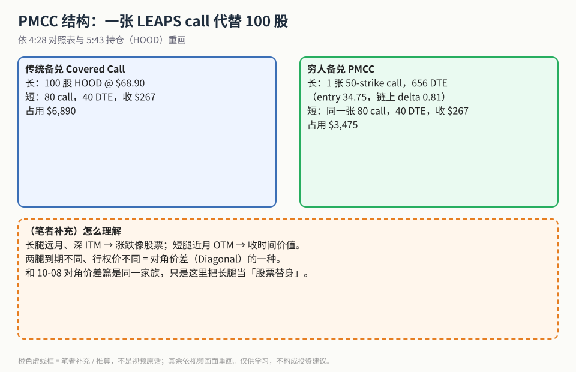
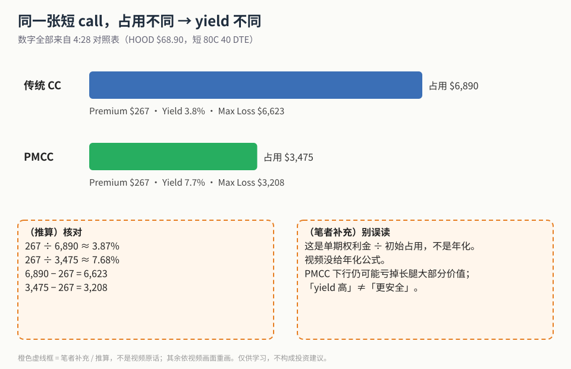
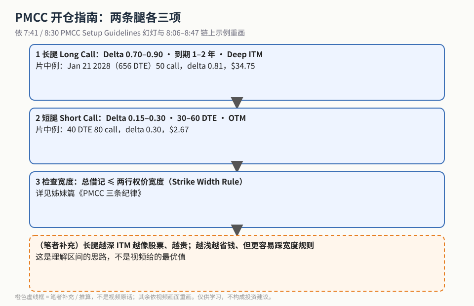

备兑看涨（Covered Call）大家都听过：手里有 100 股，再卖一张虚值 call 收租。问题是 100 股很贵。**穷人备兑（Poor Man's Covered Call，PMCC）的想法是：拿一张深度实值、远月的 LEAPS call 当「股票替身」，再卖同样的短 call。**

这一篇只算「钱」：同一张短 call，占用差多少、yield 差多少、长腿和短腿怎么挑。宽度规则、滚动和被指派的处理放在姊妹篇 [《PMCC 三条纪律》](./2026-10-20-pmcc-width-roll-assignment.md)。结构上 PMCC 属于对角价差，基础概念见 [10-08 对角价差篇](./2026-10-08-diagonal-spread-75pct-rule.md)，本文不重复。

## 1. 结构：两条腿

**读图**
- 左：传统备兑 = 100 股 HOOD（$68.90）+ 卖 80 call（40 DTE，收 $267），占用 $6,890。
- 右：PMCC = 1 张 50-strike call（656 DTE，entry 34.75，链上 delta 0.81）+ 同一张 80 call，占用 $3,475。
- 数字来自 4:28 对照表与 5:43 持仓画面。
- 橙色虚线框为**（笔者补充）**：两腿到期、行权价都不同，所以是 Diagonal 的一种。

## 2. 占用与 yield 对比

**读图**
- 两条柱子长度按占用 $6,890 / $3,475 等比例画；收的权利金都是 $267。
- 4:28 对照表：传统 Yield **3.8%**、Max Loss **$6,623**；PMCC Yield **7.7%**、Max Loss **$3,208**。
- 左下虚线框是**（推算）**核对，和表上数字一致。
- 右下虚线框是**（笔者补充）**：这个 yield 是「单期权利金 ÷ 初始占用」，视频没有年化；PMCC 的 max loss 更小只是因为本金更少，不代表更安全。

6:07 的宽幅 P/L 图也能看到同一件事：股价下跌时，虚线（PMCC）左侧约压在 −$3K，实线（传统 CC）约 −$5K；过了约 $80 以后两者都被封顶。

## 3. 开仓指南

**读图**
- 第 1、2 步照抄 7:41 / 8:30 的 *PMCC Setup Guidelines*：长腿 Delta 0.70–0.90、1–2 年、Deep ITM；短腿 Delta 0.15–0.30、30–60 DTE、OTM。
- 片中例子都在区间里：长 50C delta 0.81、656 DTE；短 80C delta 0.30、40 DTE、$2.67。
- 第 3 步是宽度规则，详见 [姊妹篇](./2026-10-20-pmcc-width-roll-assignment.md)。
- 最后一格是**（笔者补充）**：区间的理解思路，不是视频给的最优值。

## 价值判断

| 判断 | 内容 |
|---|---|
| 采用 | PMCC = 深 ITM 远月 LEAPS call + 近月 OTM 短 call；4:28 资金对比表；长/短腿的 Delta 与 DTE 区间 |
| 观望 | yield 没有年化、没扣滑点和税费；片中 HOOD IV 很高，是否适合高 IV 标的没讨论；0:00–4:28 的建模过程截图很少 |
| 弃用 | 把 7.7% 当成年化稳赚；把 PMCC 当「比持股更安全」（长腿仍可能亏掉大部分价值） |

## 参考来源

1. projectoption（Chris）, *Poor Man's Covered Call Tutorial (Covered Calls With Less Money)*（https://www.youtube.com/watch?v=-Kx4G_glx8Q ；浏览器完整观看 16:32/16:32）。画面时间点：4:28 Covered Call vs PMCC 对照表；5:04–5:36 P/L 图；5:43 持仓与链；6:07 −$3K vs −$5K；7:41 / 8:30 Setup Guidelines；8:06–8:47 LEAP 与 40 DTE 链。
2. 配图 `pmcccap-structure.svg`、`pmcccap-yield-compare.svg`、`pmcccap-setup-steps.svg` 依视频画面重画；橙色虚线框为笔者补充 / 推算。
3. 相关：[姊妹篇《PMCC 三条纪律》](./2026-10-20-pmcc-width-roll-assignment.md)；[对角价差 75% 规则](./2026-10-08-diagonal-spread-75pct-rule.md)；[Wheel 策略风险](./2026-10-08-wheel-strategy-risks.md)。

*仅供学习，不构成投资建议。HOOD 数字只是视频里的教学算例，不是推荐，也不是当前报价。*
