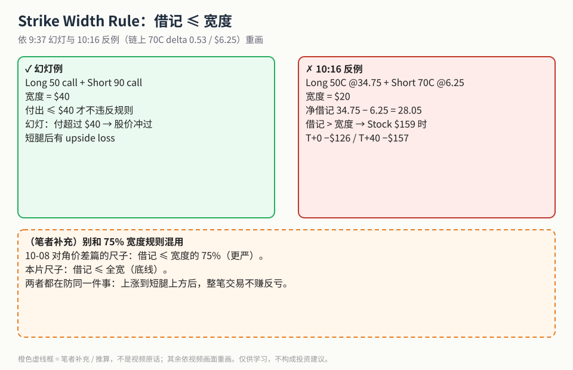
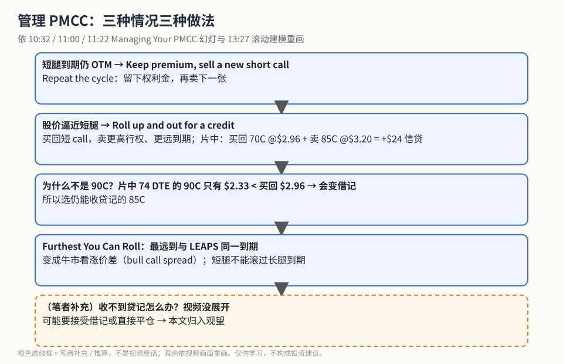
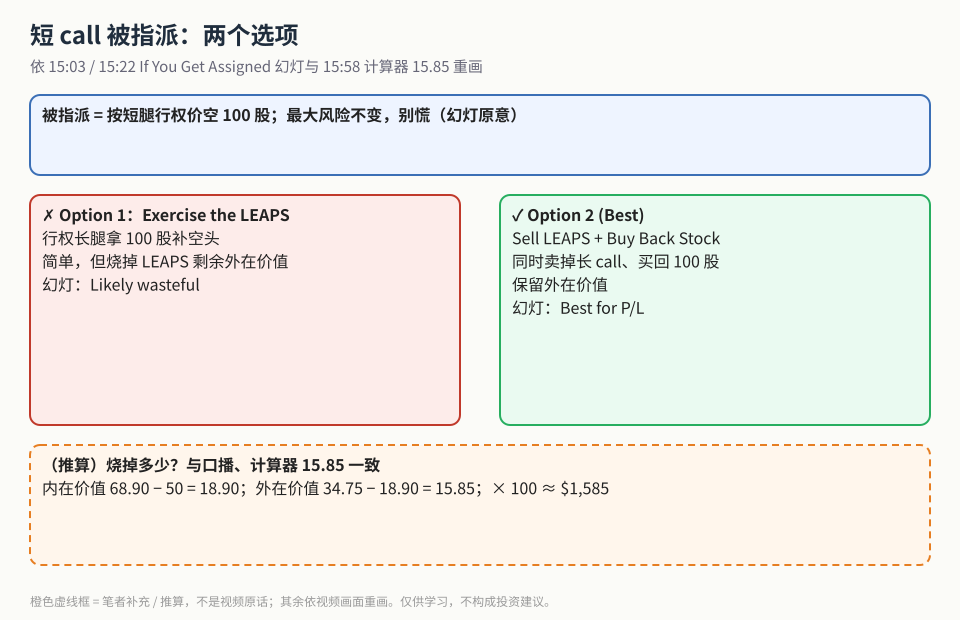

PMCC 是什么、比传统备兑省多少钱，见姊妹篇 [《穷人备兑 PMCC》](./2026-10-20-pmcc-vs-covered-call-capital.md)。这一篇讲开仓以后最容易出事的三处：

1. **开仓价格**：总借记不能超过两腿行权价宽度。
2. **股价逼近短腿**：向上并向外滚动，尽量收贷记。
3. **短 call 被指派**：别行权 LEAPS，而是卖 LEAPS + 买回股票。

## 1. Strike Width Rule

**读图**
- 左（9:37 幻灯）：Long 50 call + Short 90 call，宽 $40；付超过 $40，股价远超短腿后会出现 upside loss。
- 右（10:16 反例）：短腿换成 70C（链上 delta 0.53 / $6.25），净借记 34.75 − 6.25 = 28.05，宽度只有 $20 → 借记 > 宽度。画面上 Stock $159 时 T+0 −$126、T+40 −$157：**股价大涨反而亏**。
- 橙色虚线框为**（笔者补充）**：[10-08 对角价差篇](./2026-10-08-diagonal-spread-75pct-rule.md) 的尺子是「≤ 宽度的 75%」，本片是「≤ 全宽」，两把尺子不要混着用。

## 2. 管理：OTM 续卖、逼近就滚

**读图**
- 第 1 格：短腿到期仍 OTM → 留下权利金，再卖一张（*Repeat the cycle*）。
- 第 2 格：股价逼近短腿 → *Roll up and out for a credit*。13:27 建模：买回 70C @$2.96 + 卖 85C @$3.20 = **+$24** 信贷。
- 第 3 格：为什么不滚到 90C？12:53 链上 74 DTE 的 90C 只有 $2.33，低于买回成本 $2.96，会变成借记。
- 第 4 格：最远只能滚到和 LEAPS **同一到期**，那时结构变成牛市看涨价差。
- 最后一格**（笔者补充）**：收不到贷记时怎么办，视频没展开。

## 3. 被指派：两个选项

**读图**
- 顶部：被指派 = 按短腿行权价空 100 股；幻灯说最大风险不变，别慌。
- 左（Option 1）：行权 LEAPS 补股，简单，但烧掉剩余外在价值，幻灯标 *Likely wasteful*。
- 右（Option 2 Best）：同时卖 LEAPS + 买回股票，保留外在价值，*Best for P/L*。
- 底部虚线框是**（推算）**：68.90 − 50 = 18.90（内在价值），34.75 − 18.90 = 15.85（外在价值），× 100 ≈ $1,585，与 15:58 计算器上的 15.85 一致。

## 价值判断

| 判断 | 内容 |
|---|---|
| 采用 | 总借记 ≤ 行权价宽度；逼近短腿时 roll up and out 尽量收贷记；最远滚到 LEAPS 同到期；被指派时卖 LEAPS + 买回股票 |
| 观望 | 收不到贷记时怎么处理；滚到同到期之后如何退出 |
| 弃用 | 借记超过宽度还硬上；被指派就行权 LEAPS 图省事；把 75% 规则和全宽规则混为一谈 |

## 参考来源

1. projectoption（Chris）, *Poor Man's Covered Call Tutorial (Covered Calls With Less Money)*（https://www.youtube.com/watch?v=-Kx4G_glx8Q ；浏览器完整观看 16:32/16:32）。画面时间点：9:37 Strike Width Rule；10:16 50/70 反例；10:32 / 11:00 / 11:22 Managing Your PMCC；11:42 12 DTE 70C；12:53 74 DTE 85C vs 90C；13:27 +$24 credit；15:03 / 15:22 If You Get Assigned；15:58 计算器 15.85。
2. 配图 `pmccwr-width-rule.svg`、`pmccwr-manage-flow.svg`、`pmccwr-assignment-options.svg` 依视频画面重画；橙色虚线框为笔者补充 / 推算。
3. 相关：[姊妹篇《穷人备兑 PMCC》](./2026-10-20-pmcc-vs-covered-call-capital.md)；[对角价差 75% 规则](./2026-10-08-diagonal-spread-75pct-rule.md)。

*仅供学习，不构成投资建议。*
