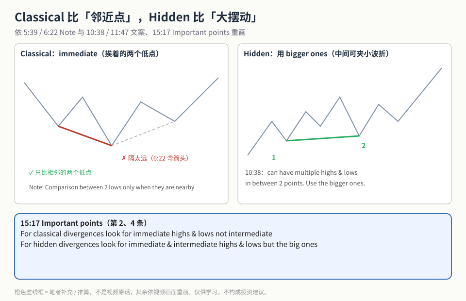
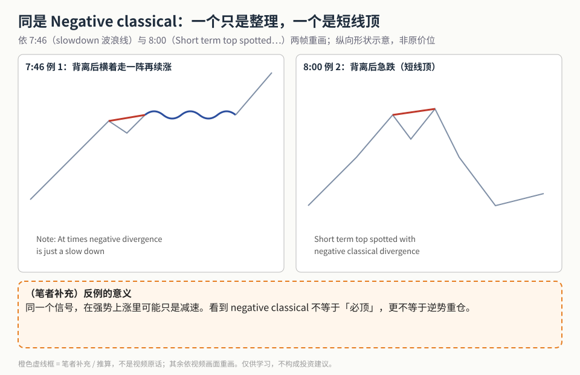
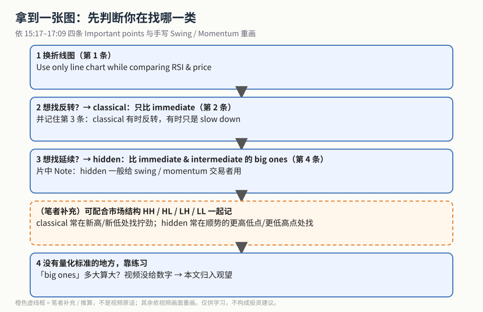

上一篇 [《RSI 四类背离入门》](./2026-10-20-rsi-four-divergences.md) 讲了四类各比哪两个点。这一篇讲更容易犯错的两件事：

1. **比哪两个点？** classical 只比挨着的（immediate），hidden 要比更大的摆动（bigger ones）。
2. **背离之后一定反转吗？** 不一定 —— negative classical 有时只是「减速」。

视频 15:17 的 *Important points for divergences* 四条，就是这篇的骨架：

1. Use only line chart while comparing RSI & price instead only candlesticks
2. For classical divergences look for immediate highs & lows not inermediate（幻灯原拼写）
3. At times classical divergences can act as trend reversal & at times a slow down
4. For hidden divergences look for immediate & intermediate highs & lows but the big ones

## 1. 邻近点 vs 大摆动

**读图**
- 左：classical 只连**相邻**的两个低点（红实线）。6:22 主讲人画了一条弯箭头去连隔得很远的低点，说明这种远距离的对比不要做（灰虚线）。
- 右：hidden 的两个点之间可以夹好几个小波折。10:38 幻灯：*can have multiple highs & lows in between 2 points. Use the bigger ones.*
- 底部蓝框照抄 Important points 第 2、4 条。
- 口播里举过「两点间隔约 10–11 天」来说明 intermediate 的意思；那是口播描述，不是规则参数。

## 2. 反例：同是 negative classical，结局不同

**读图**
- 左（7:46）：强势上涨里出现 negative classical，主讲人画了一段粗蓝波浪线 —— 价格横着整理一阵，然后**继续上涨**。幻灯 Note：*At times negative divergence is just a slow down*。
- 右（8:00）：标题 *Short term top spotted with negative classical divergence* —— 这次背离后急跌。
- 两张都是形状示意，没有照抄价位。
- 橙色虚线框为**（笔者补充）**：同一个信号，在强趋势里可能只是减速；见到就逆势重仓，就是把「提示」当成「结论」。

## 3. 拿到一张图的判断顺序

**读图**
- 第 1–3 步依次对应 Important points 的第 1、2/3、4 条。
- 片中 13:53 Note：*Hidden divergence is generally used by swing or momentum traders*；Important points 页底部也手写了 Swing / Momentum。
- 橙色虚线框为**（笔者补充）**：可以和 HH / HL / LH / LL 市场结构一起记，这不是视频内容。
- 最后一步说明缺口：「big ones」到底多大算大，视频没给量化标准。

**（笔者补充）** 和本库的 CVD 背离对照：那里拧着走的是成交量 delta，这里是 RSI；思路都是「价格和另一条曲线不同步」，但不是同一个指标，规则不能照搬。

## 价值判断

| 判断 | 内容 |
|---|---|
| 采用 | classical 只比 immediate；hidden 比 immediate & intermediate 的 big ones；classical 有时只是 slowdown；hidden 偏 swing / momentum |
| 观望 | 「big ones」靠练习，没有量化标准；没有周期参数与统计 |
| 弃用 | 强趋势里一见 negative classical 就重仓逆势；把隔得很远的两个点硬连成 classical |

## 参考来源

1. Vishal Bheda, *Complete Tutorial on 4 Types of RSI Divergence*（https://www.youtube.com/watch?v=auSnrsOAd6k ；浏览器完整观看 17:38/17:38）。画面时间点：5:39 / 6:22 nearby Note 与弯箭头；7:04–7:46 slow down；8:00 short term top；9:32 手写 swing；10:38 / 11:47 bigger ones；13:53 swing or momentum Note；15:17–17:09 Important points。
2. 配图 `rsicvh-immediate-vs-bigger.svg`、`rsicvh-slowdown-vs-top.svg`、`rsicvh-choose-flow.svg` 依视频画面重画；橙色虚线框为笔者补充。
3. 姊妹篇：[《RSI 四类背离入门》](./2026-10-20-rsi-four-divergences.md)

*仅供学习，不构成投资建议。*
