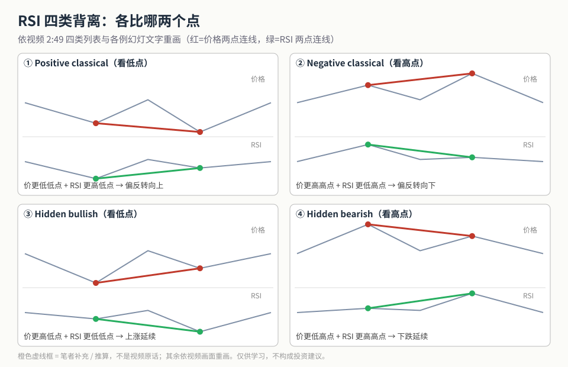
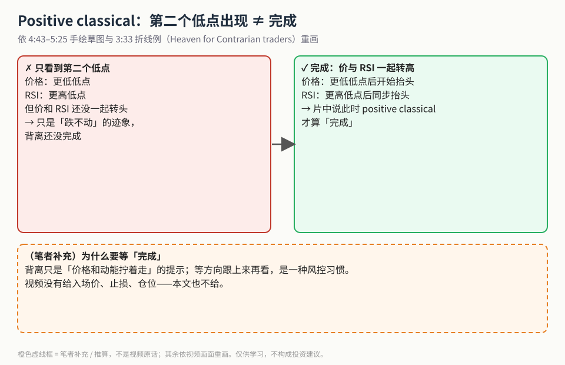
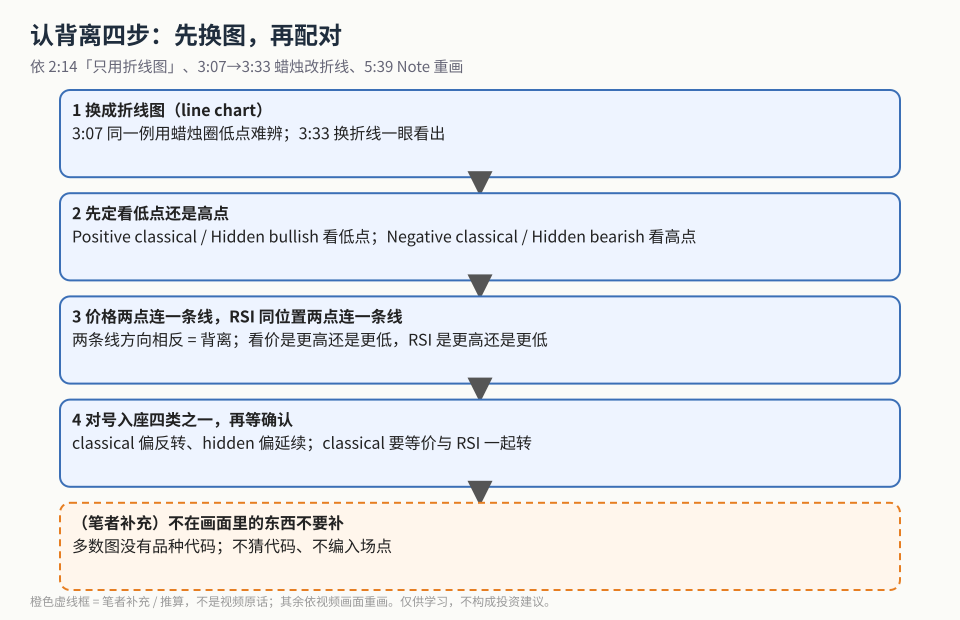

第一次学 RSI 背离，先记一句话：**价格和 RSI 这两条线「拧着走」的时候，就叫背离。** 视频 1:25 的定义幻灯写得很直白：价格和 RSI 走势不同，可能提示趋势 **continuation（延续）** 或 **reversal（反转）**，两个词都画了下划线。

这一篇只讲一件事：**四类背离各比哪两个点、怎么认。**「反转还是延续、邻近点还是大摆动」这些取舍单独放在姊妹篇 [《Classical 还是 Hidden？》](./2026-10-20-rsi-classical-vs-hidden.md)。

## 1. 四类背离一张图

视频 2:49 的列表：1 Positive classical、2 Negative classical、3 Hidden bullish、4 Hidden bearish。口播说前两种偏反转，后两种偏延续。

**读图**
- 左列都看**低点**，右列都看**高点**；红线连价格的两个点，绿线连 RSI 同位置的两个点。
- 两条线方向**相反**才算背离；方向相同就是「同步」，不是背离。
- 上排 classical：价格创新低/新高，RSI 却没跟上 → 偏反转。下排 hidden：价格还在顺势，RSI 反而走得更深 → 偏延续。
- 四个小图只是形状示意，**没有画品种和价位**：视频里多数图没有品种代码，nifty / Bank Nifty 只在口播里出现过。

四类的「配对规则」（全部来自各例幻灯文字）：

| 类型 | 价格 | RSI | 视频的说法 |
|---|---|---|---|
| Positive classical | 更低低点 | 更高低点 | 3:33 例旁写着 *Heaven for Contrarian traders* |
| Negative classical | 更高高点 | 更低高点 | 7:04 *Price makes higher high & RSI makes lower high* |
| Hidden bullish | 更高低点 | 更低低点 | 8:56 *Positive hidden divergence is a continuation pattern* |
| Hidden bearish | 更低高点 | 更高高点 | 12:44 *sign of continuation that downtrend will continue* |

## 2. Positive classical 什么时候算「完成」

4:43–5:25 主讲人画了一段手绘草图，重点是：**只看到第二个更低的低点还不够，要等价格和 RSI 一起转头向上，背离才算完成。**

**读图**
- 左边红框：价格更低低点 + RSI 更高低点，但两者还没转头 —— 只是「跌不动了」的迹象。
- 右边绿框：两条线一起抬头，片中说这时 positive classical 才算「完成」。
- 下方橙色虚线框是**（笔者补充）**：把「等完成」理解成一种风控习惯；视频没有给入场价、止损、仓位，本文也不给。

## 3. 认背离四步

**读图**
- 第 1 步来自 2:14 幻灯「只用折线图」：3:07 同一例用蜡烛图圈低点很难看清，3:33 换成折线后高低点一目了然。
- 第 2–3 步就是上面那张四宫格的做法：先定看低点还是高点，再分别连线。
- 第 4 步：对号入座以后，classical 还要等确认（见第 2 节）。
- 最后一格是**（笔者补充）**：画面里没有的品种代码、入场点，不要自己补。

另一个值得记的画面细节：5:39 的例 2 上方写着 *Note: Comparison between 2 lows only when they are nearby*。「比哪两个点」是有距离讲究的，展开见 [姊妹篇](./2026-10-20-rsi-classical-vs-hidden.md)。

**（笔者补充）** 记忆口诀（不是幻灯原文）：classical = 价格创新极值、动能却没跟上 → 可能要掉头；hidden = 价格结构还顺势、动能却回撤得更深 → 多半是回调后继续。

## 价值判断

| 判断 | 内容 |
|---|---|
| 采用 | 四类背离的价/RSI 配对表；折线图优先；positive classical 要等价与 RSI 一起转头才算完成 |
| 观望 | 视频没给 RSI 周期参数，也没给胜率或样本统计；「high probability」只是口播定性 |
| 弃用 | 只靠字幕不看图上的高低点；臆造画面上没有的品种代码或入场点；片尾推荐卡内容 |

## 参考来源

1. Vishal Bheda, *Complete Tutorial on 4 Types of RSI Divergence*（https://www.youtube.com/watch?v=auSnrsOAd6k ；浏览器完整观看 17:38/17:38）。画面时间点：0:15 标题卡；1:25 定义；2:14 只用折线图；2:49 四类列表；3:07→3:33 蜡烛改折线；4:43–5:25 完成草图；5:39 例 2 Note；7:04 negative classical；8:56 hidden bullish；12:44 / 13:53 hidden bearish。
2. 配图 `rsi4d-four-types-grid.svg`、`rsi4d-pos-classical-completion.svg`、`rsi4d-identify-steps.svg` 依视频幻灯与图例重画；橙色虚线框为笔者补充，不是视频内容。
3. 姊妹篇：[《Classical 还是 Hidden？RSI 背离里「反转 / 延续」与「邻近点 / 大摆动」怎么选》](./2026-10-20-rsi-classical-vs-hidden.md)

*仅供学习，不构成投资建议。文中没有任何标的、入场价或仓位建议。*
