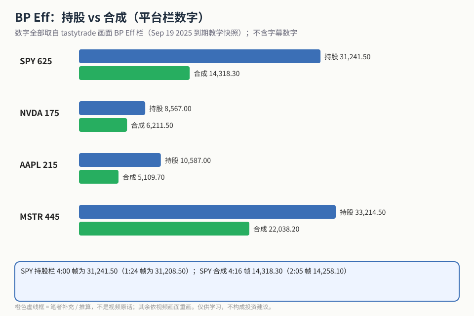
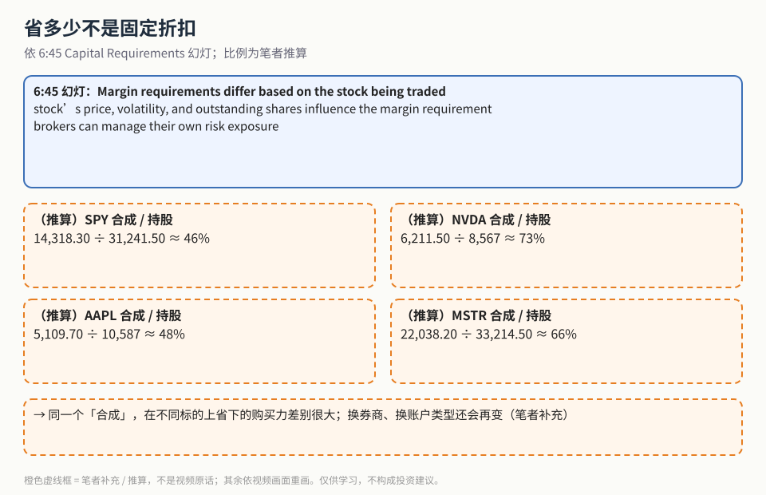
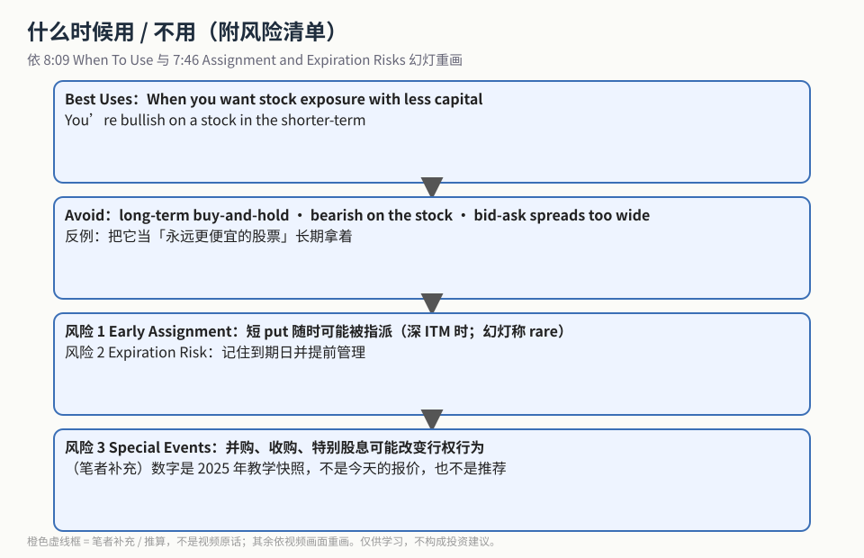

合成多头的结构（买 call + 卖 put，同 strike、同到期）见姊妹篇 [《合成多头股票》](./2026-10-20-synthetic-long-structure.md)。这一篇只回答一个问题：**相比直接买 100 股，合成多头能省多少购买力（BP Eff）？什么时候不该用？**

> 数字说明：下面所有 BP Eff 数字都取自视频里 tastytrade 平台画面的 BP Eff 栏（Sep 19 2025 到期的教学快照）。英文自动字幕把这些数字听错过好几次，**本文一律不用字幕数字**。

## 1. 四个标的的 BP Eff 对照

**读图**
- 每组上面蓝条 = 买 100 股的 BP Eff，下面绿条 = 同标的合成多头的 BP Eff；长度按同一比例画。
- SPY 625：持股 31,241.50（4:00 帧）vs 合成 14,318.30（4:16 帧）。
- NVDA 175：8,567.00（4:48）vs 6,211.50（5:04）。
- AAPL 215：10,587.00（5:37）vs 5,109.70（5:53）。
- MSTR 445：33,214.50（6:09）vs 22,038.20（6:27）。
- 底部蓝框：SPY 在不同帧的数字略有差别（31,208.50 / 14,258.10），是报价跳动造成的。

## 2. 省多少不是固定折扣

**读图**
- 顶部蓝框照抄 6:45 *Capital Requirements* 幻灯：保证金要求因标的而异；价格、波动、流通股数都会影响；券商用它管理自己的风险。
- 四个虚线框都是**（推算）**比例：SPY ≈ 46%、NVDA ≈ 73%、AAPL ≈ 48%、MSTR ≈ 66%（合成 / 持股）。视频没有算这些比例。
- 结论（笔者补充）：同样叫「合成多头」，省下的购买力差别很大；换券商、换账户类型还会变。

## 3. 什么时候用 / 不用

**读图**
- 第 1、2 格照抄 8:09 *When To Use Synthetic Long Stock*：Best Uses —— 要股票敞口但少用资金、短线看多；Avoid —— 长期 buy-and-hold、看空、买卖价差太宽。
- 第 3、4 格照抄 7:46 *Assignment and Expiration Risks*：短 put 提前指派（深 ITM 时；幻灯写 *This is rare, but can happen*）、到期管理、并购/特别股息等特殊事件。
- 最后一行（笔者补充）：这些都是 2025 年的教学快照，不是今天的报价，也不是推荐。

## 价值判断

| 判断 | 内容 |
|---|---|
| 采用 | 四标的 BP Eff 对照（画面数字）；保证金因标的而异；Best Uses / Avoid 边界；三类风险 |
| 观望 | 各券商保证金算法差异；提前指派的真实频率（幻灯只说 rare） |
| 弃用 | 当成「永远更便宜的股票」长期持有；在价差很宽的合约上硬上；采信自动字幕里的数字 |

## 参考来源

1. Nichol Hermel, *Synthetic Long Stock Explained*（https://www.youtube.com/watch?v=RIqZLO_iKT8 ；浏览器完整观看 9:56/9:56）。画面时间点：1:24 / 4:00 SPY 持股 BP Eff；2:05 / 4:16 SPY 合成；4:34–5:04 NVDA；5:37–5:53 AAPL；6:09–6:27 MSTR；6:45 Capital Requirements；7:46 Assignment and Expiration Risks；8:09 When To Use。
2. 配图 `synbp-bp-bars.svg`、`synbp-ratio-not-fixed.svg`、`synbp-use-avoid.svg` 依画面重画；橙色虚线框为笔者补充 / 推算。
3. 姊妹篇：[《合成多头股票》](./2026-10-20-synthetic-long-structure.md)

*仅供学习，不构成投资建议。文中标的只是视频里的教学例子，不是推荐。*
