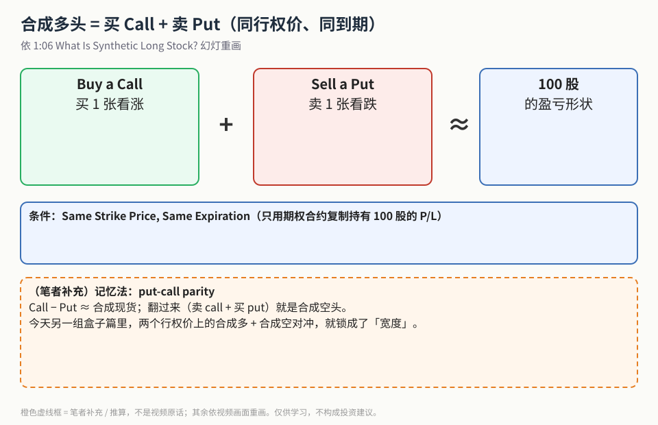
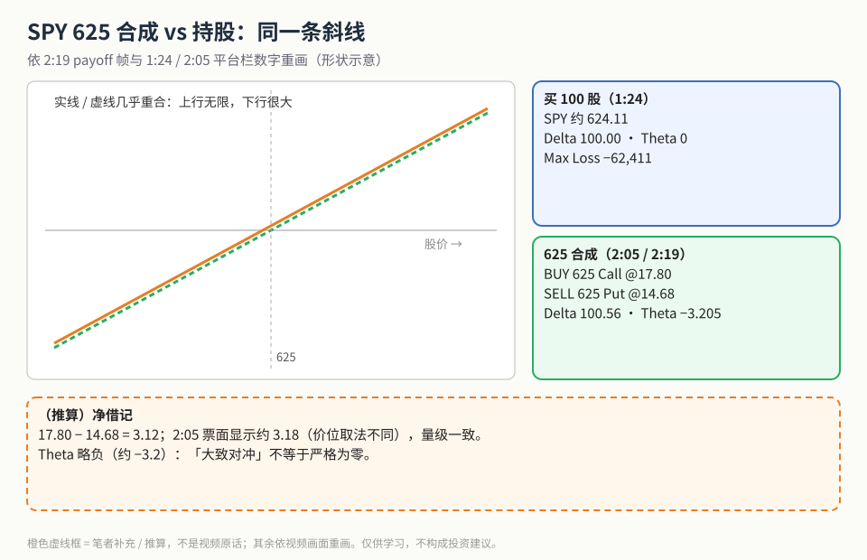
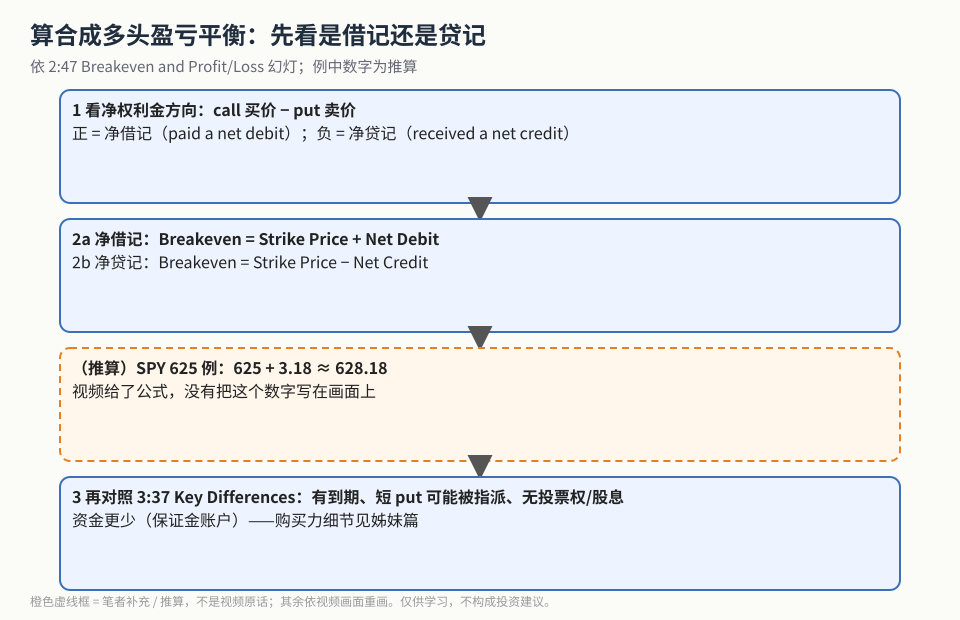

合成多头股票（Synthetic Long Stock）第一次学，只要记住视频 1:06 幻灯上的一行公式：

> **Synthetic Long Stock = Buy a Call Option + Sell a Put Option（Same Strike Price, Same Expiration）**

不买股票，只用两张期权，就能复制持有 **100 股** 的盈亏形状。这一篇讲结构、盈亏平衡和与持股的区别；购买力（BP Eff）对比和使用边界放在姊妹篇 [《合成多头省多少购买力？》](./2026-10-20-synthetic-long-buying-power.md)。

> 数字说明：本文所有数字都来自视频画面（幻灯与 tastytrade 平台栏）。英文自动字幕经常听错数字，**一律不用**。

## 1. 公式

**读图**
- 三个框就是 1:06 幻灯的公式：买 1 张 call + 卖 1 张 put ≈ 100 股的盈亏形状。
- 蓝条：两个条件 —— 同一行权价、同一到期。缺一个就不是合成多头。
- 橙色虚线框为**（笔者补充）**：用 put-call parity 记忆；同日 [盒子价差篇](./2026-10-20-box-spread-as-loan.md) 里，两个行权价上的合成多 + 合成空对冲，就锁成了宽度。

## 2. SPY 例：和持股是同一条斜线

**读图**
- 右上蓝框（1:24 平台栏）：买 100 股 SPY，价约 624.11，Delta 100.00、Theta 0、Max Loss −62,411。
- 右下绿框（2:05 / 2:19）：BUY 625 Call @17.80、SELL 625 Put @14.68；Delta 100.56、Theta −3.205。
- 左边两条线几乎重合，对应 2:33 *Risk Graph Comparison*：上行无限（same unlimited upside），下行风险也很大（substantial downside）。线条是形状示意。
- 底部虚线框是**（推算）**：17.80 − 14.68 = 3.12；2:05 票面显示约 3.18，量级一致。

6:58 幻灯 *Volatility and Time Decay*：同 strike、同 expiry 的多 call + 空 put，IV 变化和时间衰减都**大致**互相抵消。7:31 的 Greeks 例子里 Delta 100.58、Theta −5.41、Vega 可忽略 —— 所以「大致抵消」不是严格为零。

## 3. 盈亏平衡与和持股的区别

**读图**
- 第 1、2 步照抄 2:47 *Breakeven and Profit/Loss* 幻灯：净借记 → Strike + Net Debit；净贷记 → Strike − Net Credit。
- 第 3 格是**（推算）**：625 + 3.18 ≈ 628.18。视频只给了公式，没把这个数字写在画面上。
- 第 4 步对照 3:37 *Key Differences vs Owning Stock*：资金更少（保证金账户）、有到期、短 put 有指派风险（幻灯称 rare）、没有投票权和股息。

**（笔者补充）** 和本库的备兑看涨 / [PMCC](./2026-10-20-pmcc-vs-covered-call-capital.md) 区分：那些是「持股（或 LEAPS）+ 卖 call 收租」；合成多头是用 call + put **代替**持股，本身不收租，方向是纯看多。

## 价值判断

| 判断 | 内容 |
|---|---|
| 采用 | 同 strike、同 expiry 的买 call + 卖 put；Breakeven = Strike ± 净借/贷记；与持股的四点差异 |
| 观望 | Theta 不完全为 0 的量化（片中 −3.2 到 −5.41）；股息/利率如何嵌进定价 |
| 弃用 | 把它当长期股票；使用自动字幕里的数字（常听错） |

## 参考来源

1. Nichol Hermel, *Synthetic Long Stock Explained*（https://www.youtube.com/watch?v=RIqZLO_iKT8 ；浏览器完整观看 9:56/9:56）。画面时间点：1:06 定义公式；1:24 SPY 持股栏；2:05 / 2:19 SPY 625 合成与 payoff；2:33 Risk Graph Comparison；2:47 Breakeven；3:37 Key Differences；6:58 Volatility and Time Decay；7:31 Greeks。
2. 配图 `synlong-formula.svg`、`synlong-spy-payoff.svg`、`synlong-breakeven-steps.svg` 依画面重画；橙色虚线框为笔者补充 / 推算。
3. 姊妹篇：[《合成多头省多少购买力？》](./2026-10-20-synthetic-long-buying-power.md)

*仅供学习，不构成投资建议。SPY 报价为 2025 年教学快照，不是当前价格。*
