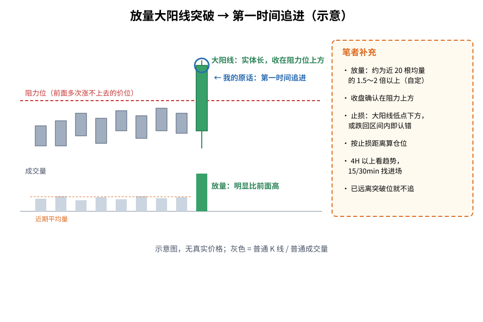
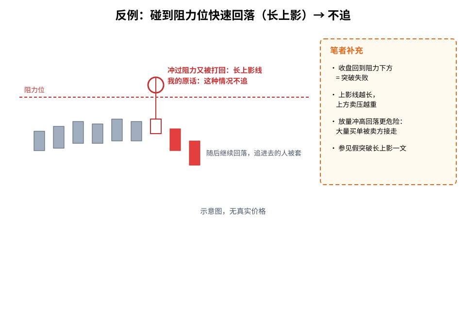
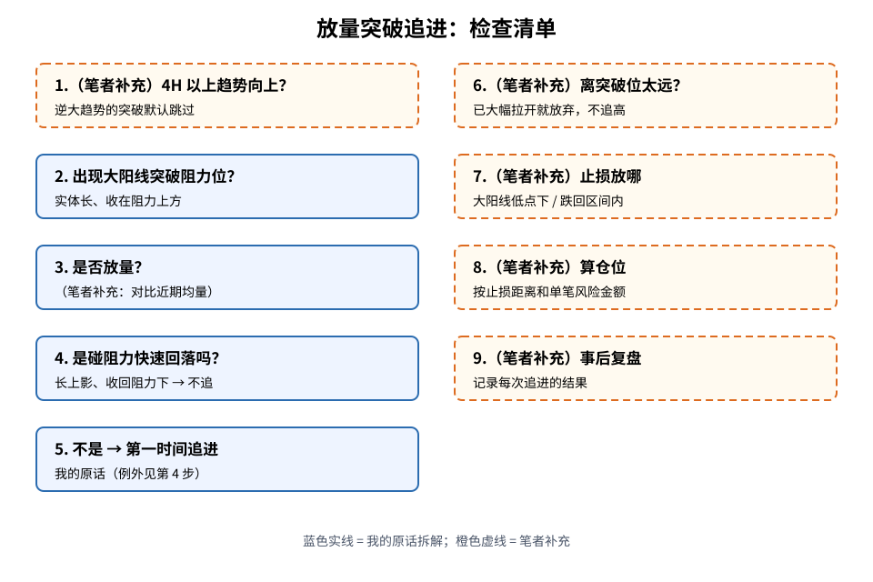

> 今天复盘的一句话教训：**「当出现大阳线放量突破时，只要不是触碰到阻力位快速下落，就第一时间追进去。」**
> 这是我自己的交易经验，**不是**统计结论，也没有胜率数字。文中凡标（笔者补充）的内容，都是我在原话之外补充的通用常识。

## 1. 先搞懂几个词

- **大阳线**：一根上涨的 K 线，而且「实体」（开盘到收盘那一段）特别长，说明这段时间里买方一路占上风。
- **放量**：这根 K 线的成交量明显比前面几根大，说明有很多人真的在参与，而不是少数单子拉出来的。
- **突破**：价格越过了之前一直过不去的位置，并且收盘也站在了它上面。
- **阻力位**：价格以前多次涨到这里就涨不上去、掉头向下的价位，可以理解为「天花板」，那里有很多人等着卖。
- **触阻快速回落**：价格刚碰到（或刚冲过）天花板，马上被砸回来，K 线上留下一根长长的「上影线」——这说明卖方力量很强，突破没成功。

## 2. 核心：放量大阳线突破 → 第一时间追

**读图**
- 灰色 K 线在红色虚线（阻力位）下方来回震荡，一直过不去。
- 绿色大阳线一口气穿过阻力位，并且收在上方；下方对应的绿色成交量柱明显高出前面的灰色柱——这就是「放量大阳线突破」。
- 蓝圈 + 箭头是我的原话：这种情况**第一时间追进去**，不要等它走远了再犹豫。
- 橙色虚线框（笔者补充）：放量的量化方式、收盘确认、止损位置、仓位计算、多周期配合、离突破位太远不追。

## 3. 反例：碰到阻力位快速回落 → 不追

**读图**
- 这根 K 线也往上冲过了阻力位，但很快被打回去，只留下一根长上影线，收盘回到阻力下方。
- 这就是我原话里的例外：「触碰到阻力位快速下落」——**不追**。随后价格继续回落，追进去的人会被套。
- 橙色虚线框（笔者补充）：收回阻力下 = 突破失败；上影越长卖压越重；放量冲高回落更危险。这个形态在 [假突破长上影 + 更低的高点](./2026-10-20-failed-breakout-upper-wick-lower-high-lesson.md) 里有更详细的讲解。

## 4. 我以后的流程

**读图**
- 蓝色实线框 2～5 是我原话的拆解：出现大阳线突破 → 确认放量 → 排除「碰阻力快速回落」→ 不是就第一时间追进。
- 橙色虚线框 1、6～9 都是（笔者补充）：先看大周期趋势、离突破位太远放弃、止损位置、仓位、事后复盘。

## 5. 补充说明（笔者补充，通用常识）

以下都不是复盘原话：
1. **怎么定义「放量」**：常见做法是和近期平均量比，例如当根成交量达到近 20 根 K 线均量的 1.5～2 倍以上。倍数没有标准答案，自己定一个并固定下来。
2. **止损放哪**：放在大阳线最低点下方；或者更紧一点——价格重新跌回原来的震荡区间内，就说明突破失败，认错离场。
3. **仓位**：大阳线本身很长，按它的低点放止损距离会比较宽，所以仓位要按「止损距离 × 手数 = 可接受的单笔亏损」来算，不能满仓追。参见 [风控仓位：先算手数再下单](./2026-09-16-%E9%A3%8E%E6%8E%A7%E4%BB%93%E4%BD%8D%EF%BC%9A%E5%8F%AA%E6%8B%BF%E9%A3%8E%E9%99%A9%E8%B5%84%E6%9C%AC%EF%BC%8C%E5%85%88%E7%AE%97%E6%89%8B%E6%95%B0%E5%86%8D%E4%B8%8B%E5%8D%95.md)。
4. **和多周期教训搭配**：按 [趋势看 4H 以上、进场看 15/30 分钟](./2026-10-20-multi-timeframe-4h-trend-15m-entry-lesson.md)，最好是 4H 以上趋势向上时，在 15/30min 上出现的放量突破才去追；逆大周期的突破默认跳过。
5. **已经拉远了不追**：「第一时间」的意思是突破刚确认时；如果看到时价格已经远离突破位好几根 K 线，止损会变得很远、盈亏比变差，宁可放弃或等回踩。
6. **快速回落的反例要果断放弃**：碰阻力后长上影、收回阻力下方，不管当时成交量多大都不追。

## 6. 采用 / 观望 / 弃用

| 结论 | 内容 |
|---|---|
| 采用 | 放量大阳线有效突破阻力位、且不是碰阻力快速回落时，第一时间追进 |
| 观望 | 放量倍数的具体阈值；突破后已拉远时是否等回踩再进，需要更多复盘 |
| 弃用 | 碰到阻力位快速回落（长上影、收回阻力下）还去追；不设止损、不算仓位就追 |

## 参考

- 个人交易复盘（2026-10-20）
- 相关旧文：[假突破长上影 + 更低的高点](./2026-10-20-failed-breakout-upper-wick-lower-high-lesson.md)、[趋势看 4H 以上，进场看 15/30 分钟](./2026-10-20-multi-timeframe-4h-trend-15m-entry-lesson.md)
- 放量定义、止损位置、仓位计算等为交易常识，属通用知识补充

> 学习笔记，仅供学习，不构成投资建议。
