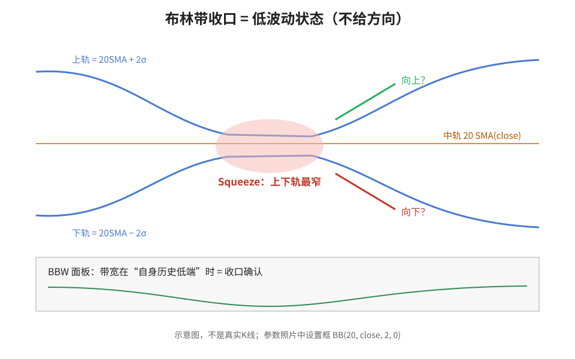
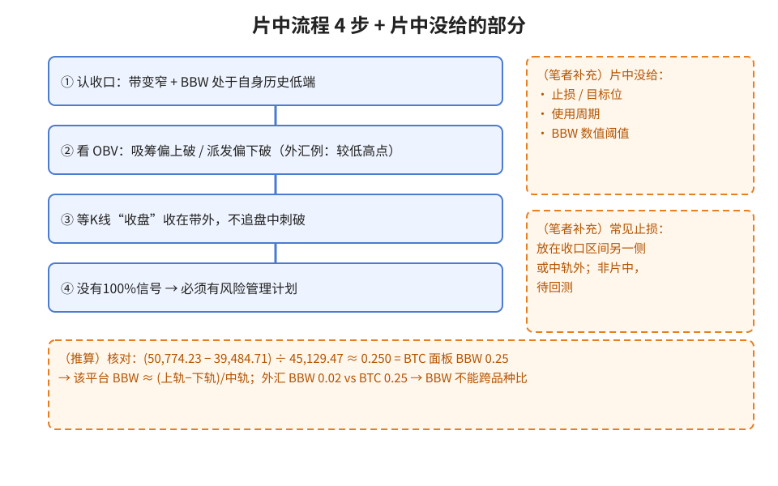
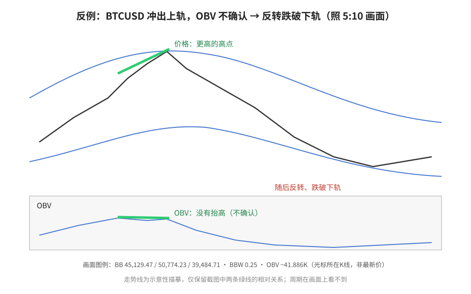
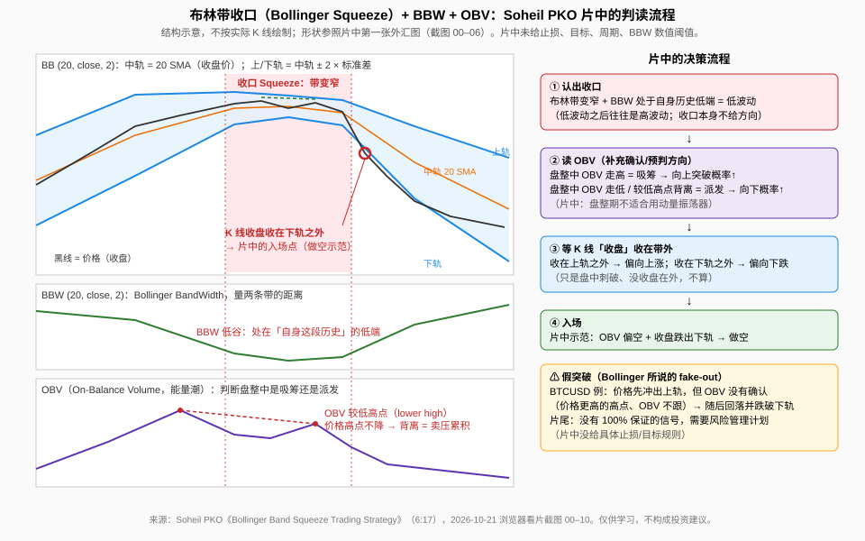

> 学习笔记：根据完整看片（6:17）和截图整理。片中图表是约 4 年前的教学画面，不是今天的行情。（笔者补充）和（推算）是我加的，不是视频原话。

## 一、先弄懂：什么是布林带「收口」

布林带有三条线：中轨是 **20 根K线收盘价的简单均线（SMA）**，上下轨是中轨 **±2 个标准差**。片中设置框（1:26）：Length 20、Source close、StdDev 2、Offset 0，口播说这些可以调。

上下轨挤到一起，叫 **Squeeze（收口）**，意思是现在**波动很小**。片中引用 John Bollinger 的话：**低波动之后常常跟着高波动**。但要记住片中说的重点：**收口不告诉你方向**。

**读图**
- 红圈对应片头画面（0:16）里「Bollinger Band Squeeze」红圈圈住的窄带区。
- 收口之后往上还是往下，图里两个箭头都画了问号：单看收口不知道方向。
- 这是结构示意图，不是真实K线。

## 二、BBW：怎么知道「够窄了」

**BBW（Bollinger BandWidth，布林带宽）**量的是上下轨之间的距离（1:52）。它**没有固定上下限**，所以只能跟**自己过去一段时间**比，找到这段时间的低端（2:10）。片中的外汇图 BBW 刻度是 0.00–0.02，最低处贴近 0.00，正好在收口红圈下方。

画面上的外汇图**看不到品种名**，本文不写具体货币对。

## 三、OBV：用量能猜方向

OBV（能量潮）是基于成交量的指标（2:45），片中把它当收口的补充工具：
- 盘整期间 **吸筹**（OBV 往上走）→ 更可能向上突破；
- 盘整期间 **派发**（OBV 往下走）→ 更可能向下突破；
- 片中还说，盘整期间动量振荡器不适合用来判断。

外汇例子（3:55）：收口期间 OBV 出现**较低高点**，提示卖压在累积 → 等K线**收盘收在下轨之外**再做空。注意：背离线画面上**没画出来**，是口播指认的。

**读图**
- 左边蓝框 ①–④ 是片中流程，按顺序来。
- 右边和下面的橙色虚线框是（笔者补充）/（推算），不是片中说的。
- 第 ③ 步是「收盘」收在带外，不是盘中刺破一下。

## 四、反例：BTC 假突破

片中第二张图是 BTCUSD（4:35、5:10）。主讲画了两条绿线：价格冲到上轨外、创出更高的高点，但同期 **OBV 没有跟着抬高**（CC：「doesn't confirm the upside breakout」）。之后价格反转，跌破下轨。片中也提到 Bollinger 本人提醒过会有假突破（fake-outs）。

**读图**
- 两条绿线的位置跟 5:10 截图一样：一条在价格高点，一条在 OBV 同期。
- 价格创新高、OBV 不跟 = 突破没有量能确认。
- 底部数字照抄画面图例；K线走势是简化描摹；周期画面上看不到。

下面这张是我笔记库里的决策结构图（示意，不按实际K线绘制）：

**读图**
- 这是旧笔记里的结构示意图，用来回顾整个流程，不是片中画面。

## 五、片中没给的东西

片中**没给**止损规则、目标位、使用周期、BBW 数值阈值；结尾（5:50）只说**没有 100% 的信号，必须有风险管理计划**。
- （笔者补充）常见的止损放法是放在收口区间的另一侧，或者中轨外面。片中没讲，我只当待回测的选项。
- （笔者补充）外汇没有集中成交量，平台一般用 tick volume，所以外汇上的 OBV 可信度要打个折扣。

## 六、核对截图（推算）

- 图例数字**不是最新价**：外汇图例 1.14215/1.15123/1.13306 不在可见价格区间（最新价 1.17408）里；BTC 图例中轨 45,129.47，右轴中轨标签是 48,875.08。应该是光标那根K线的值。
- （推算）(50,774.23 − 39,484.71) ÷ 45,129.47 ≈ 0.250，跟 BTC 面板 BBW 0.25 对得上，说明这个平台的 BBW ≈ (上轨 − 下轨) ÷ 中轨。
- 外汇 BBW 0.02、BTC BBW 0.25：差了十几倍，所以 **BBW 不能跨品种比**。

## 七、采用 / 观望 / 弃用

| 判断 | 内容 |
|---|---|
| 采用 | 把收口当「波动状态过滤器」；BBW 只跟自己的历史比、找低端；等K线收盘收在带外，不追盘中刺破 |
| 观望 | OBV 吸筹/派发、背离当方向提示的真实胜率（片中只有事后示范）；外汇 tick volume 下 OBV 靠不靠谱；不同周期效果如何 |
| 弃用 | 把收口当方向信号；没有止损就照搬；用固定 BBW 阈值、跨品种比较 BBW；把图例数字当最新价；「这是 CMS Trader 研讨会片段」的说法（截图和简介里没看到，未核实）；侧栏/片尾推荐的其他视频内容 |

## 参考

- Soheil PKO，《Bollinger Band Squeeze Trading Strategy》，6:17：https://www.youtube.com/watch?v=O7UAwPSQ7Kw
- 时间戳：0:16 收口标注 · 1:26 参数设置框 · 1:52 BBW · 2:10 BBW 低端 · 2:45 OBV · 3:20 窄带 + 低 BBW · 3:55 OBV 较低高点 · 4:35 BTCUSD 图 · 5:10 OBV 不确认 · 5:50 风险提示收尾

仅供学习，不构成投资建议。
