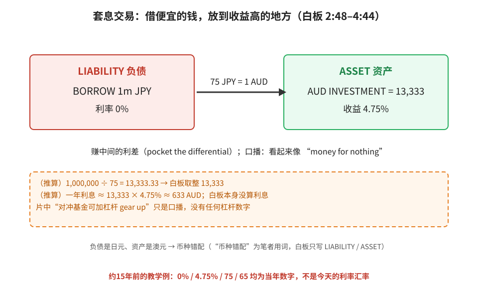
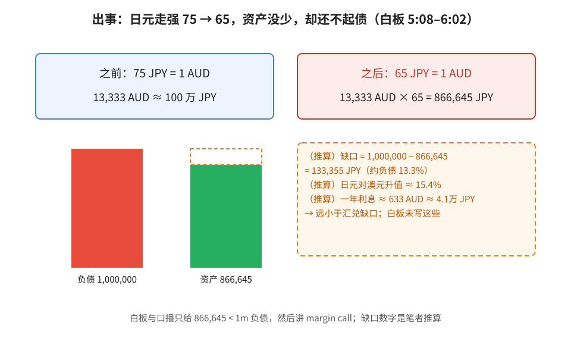
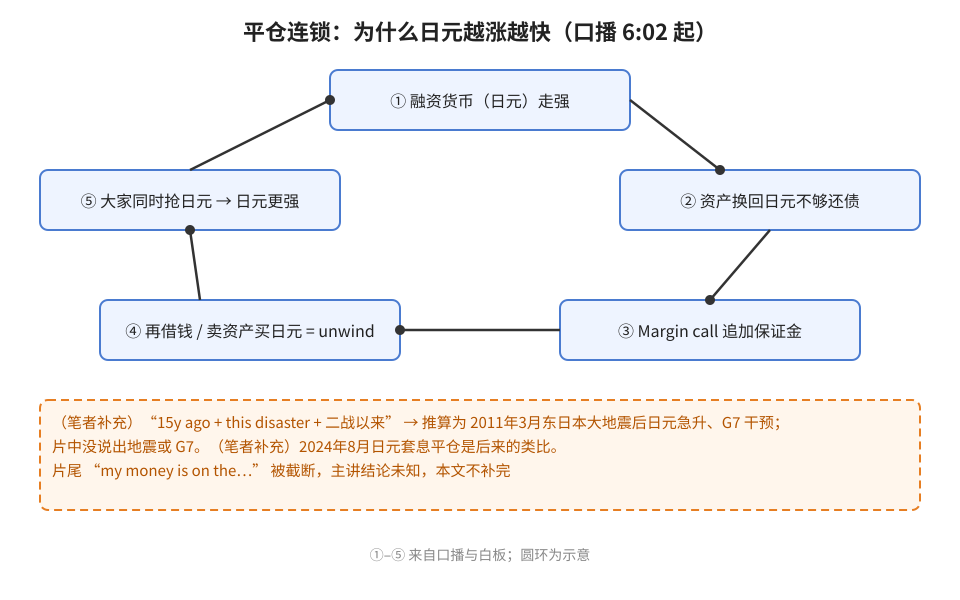
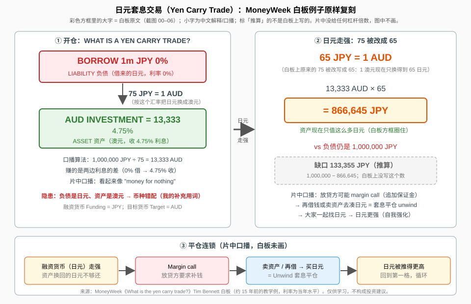

> **先说明：这个视频是大约 15 年前录的**（页面显示「15y ago」）。片中的利率（日元 0%、澳元 4.75%）和汇率（75、65）都只是**当年的教学例子**，不是今天的数字。（笔者补充）和（推算）是我加的，不是视频原话。

## 一、套息交易是什么

口播开场：日元最近几天对澳元、美元大涨，到了大约二战以来没见过的水平。有人说是「这场灾难」之后的资金回流，但主讲认为更大的推手是**对冲基金在平掉套息交易**。

**套息交易（carry trade）**：借一种**利息很低**的货币，换成**收益更高**的货币去投资，赚中间的利差（口播：pocket the differential）。日本利率接近 0%，所以日元是典型的「融资货币」。

白板例子（2:48–4:44）：借 **1m JPY，0%** → 按 **75 JPY = 1 AUD** 换 → 得到 **13,333 AUD**，收 **4.75%**。白板把 1m JPY 框成 **LIABILITY（负债）**，把 13,333 框成 **ASSET（资产）**。口播说这看起来像「money for nothing」，对冲基金还能加杠杆（gear up）放大——**但片中没给任何杠杆数字**，本文也不编。

**读图**
- 红框负债、绿框资产，数字照抄白板。
- 关键：负债是**日元**，资产是**澳元**，两边币种不同。
- 橙色虚线框是（推算），白板上没写利息。

## 二、出事：日元一涨，资产没少却还不起债

白板把汇率改成 **65 JPY = 1 AUD**（5:08），也就是日元变强了。算账（5:34）：**13,333 AUD × 65 = 866,645 JPY**，可是欠的还是 1,000,000 JPY。澳元资产一块没少，换回日元却不够还。

**读图**
- 上面两个框对应白板改汇率前后。
- 绿柱比红柱矮，虚线小框是差额。
- 缺口 133,355 JPY、15.4%、利息这些都是（推算），白板只写到 866,645。

（推算）一年利息约 633 AUD ≈ 4.1 万日元，远小于 13.3 万日元的汇兑缺口——一年的利差扛不住一次 13% 级别的反向波动。

## 三、平仓连锁：为什么越涨越快

6:02 白板圈出 866,645，口播：结果就是 **margin call（追加保证金）**。你得弄到日元：**再借钱，或者卖资产**，这就是平仓（unwind）。大家同时抢日元 → 日元更强 → 更多人被追保 → 继续平仓。

**读图**
- 按 ①→⑤ 顺时针看，⑤ 又回到 ①，所以会自我强化。
- 底部橙色虚线框是（笔者补充），不是片中说的。

下面是白板的完整整理图（照抄白板数字）：

**读图**
- 跟片尾白板（~7:35）对得上：65 JPY = 1 AUD、13,333、4.75%、866,645 JPY。
- 图中「缺口 133,355 JPY」是推算，白板上没写。

## 四、结尾：被截断的一句话

收尾（~7:35）主讲问日本央行和国际资本接下来怎么做，说接下来几天会是一场较量，然后说「today my money is on the…」——**这句话被截断了**，主讲押哪一边我们不知道，**本文不替他补完**。

## 五、笔者补充（非片中内容）

- （笔者补充/推算）「15y ago + this disaster + 二战以来」→ 推测是 **2011 年 3 月东日本大地震**后日元急升、G7 联合干预那段时间。片中没说地震，也没说 G7。
- （笔者补充）2024 年 8 月初日元走强，市场普遍认为套息平仓带动风险资产一起跌，是后来同类的例子。
- （笔者补充）散户能接触到的套息形态是外汇/CFD 的隔夜利息（swap/rollover），规则各券商不同。

## 六、采用 / 观望 / 弃用

| 判断 | 内容 |
|---|---|
| 采用 | 理解套息和平仓连锁；把融资货币（日元）急升当宏观风险信号；用「资产 / 负债 + 币种错配」框架看任何「借 A 买 B」的仓位 |
| 观望 | 散户加杠杆做套息（平时小赚利差、反向时一次亏光，像在压路机前捡硬币）；当下利差环境下套息还成不成立 |
| 弃用 | 「money for nothing」的说法；拿 15 年前的 0%/4.75%/75/65 当今天的参考；猜测片尾被截断的结论；auto-CC 听错的词（数字一律以白板为准；手写「INVFSTMENT」「13,33BAUD」按 INVESTMENT、13,333 AUD 读） |

## 参考

- MoneyWeek（Tim Bennett），《What is the yen carry trade? - MoneyWeek Investment Tutorials》，7:41：https://www.youtube.com/watch?v=pjnKAWT_Q0o
- 时间戳：2:48 借 1m JPY / 75 JPY = 1 AUD · 4:19 13,333 AUD @4.75% · 4:44 LIABILITY / ASSET · 5:08 65 JPY = 1 AUD · 5:34 13,333 × 65 = 866,645 JPY · 6:02 margin call · ~7:35 收尾（结尾句被截断）

仅供学习，不构成投资建议。
