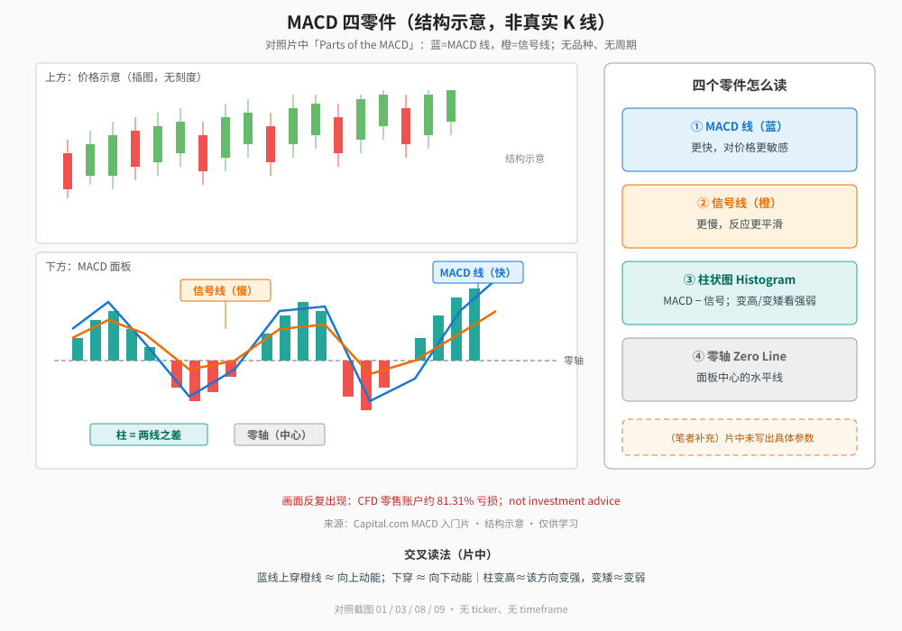
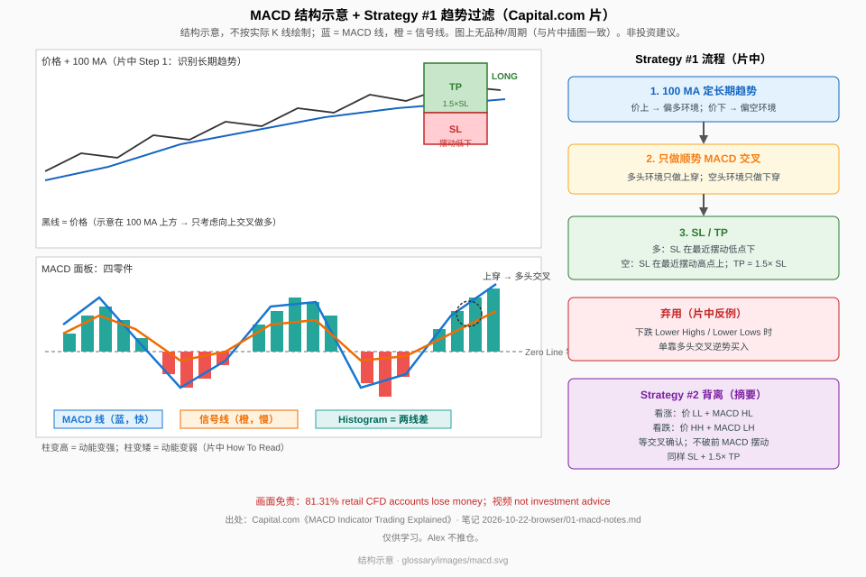
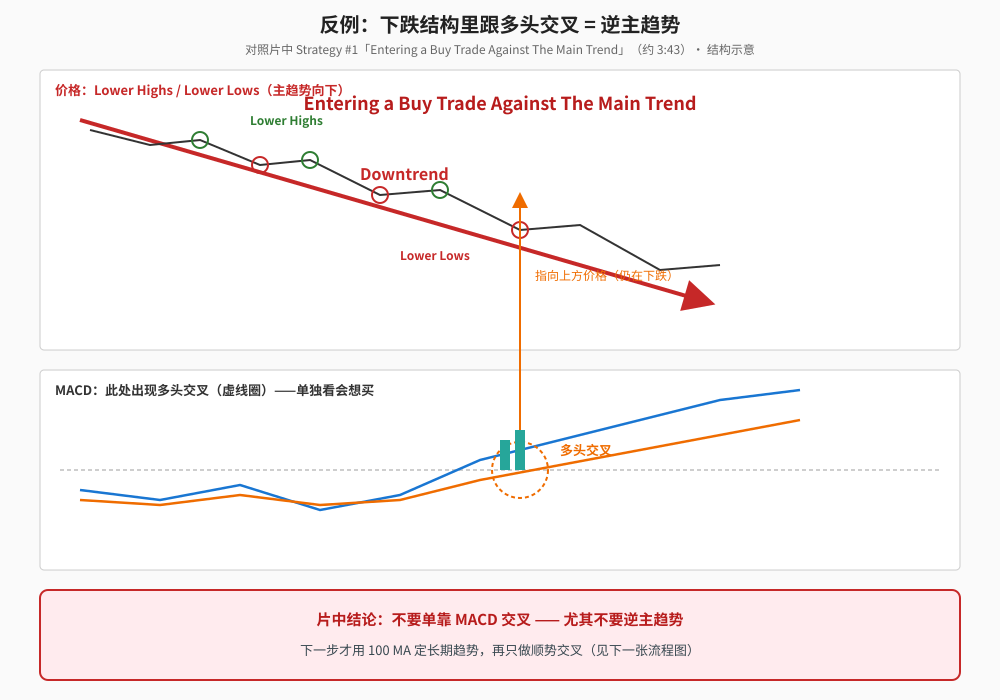
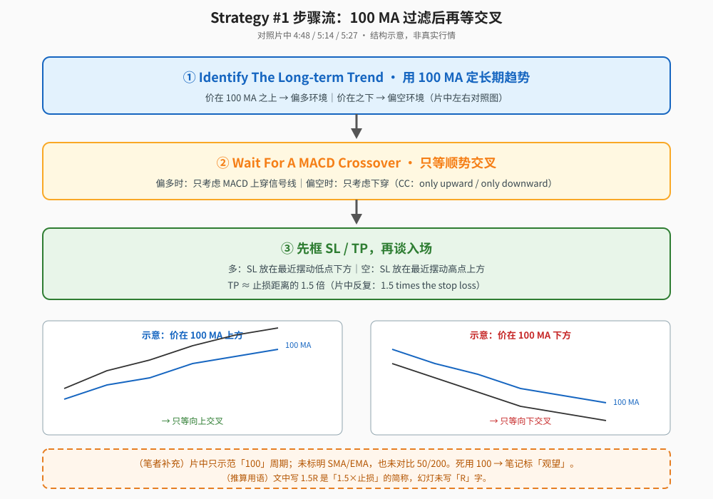

> 学习笔记：根据完整看片（10:07）和截图整理。片中全是 Capital.com **示意插图**——画面**没有**品种名、价格刻度、周期标签；也**没有**写出 MACD 的具体参数。文中不写具体标的、不写周期。（笔者补充）/（推算）是我加的，不是视频原话。画面反复出现 CFD 零售账户约 **81.31%** 亏损，以及 *not investment advice*。

## 一、先认四个零件

MACD 全称 Moving Average Convergence Divergence（移动平均收敛发散）。面板里片中标出四件：

1. **MACD 线（蓝）**：更快，对价格更敏感。
2. **信号线 Signal（橙）**：更慢，口播说 *moves slower and reacts more gradually*。
3. **柱状图 Histogram**：两线之差；青绿柱大致对应 MACD 在信号之上，红柱在之下（以画面配色为准）。
4. **零轴 Zero Line**：面板中心的水平线（口播：center of the MACD indicator）。

**读图**
- 左上是价格示意、左下是 MACD 面板；蓝线=MACD、橙线=信号、柱=两线差、虚线=零轴。
- 右侧四块是零件读法摘要，对照截图 `01`–`03`。
- 橙色虚线框是**（笔者补充）**：片中**未写出**具体参数；本文也不补写平台默认数字。
- 这是结构示意，**不是**真实 K 线；无 ticker、无 timeframe。

交叉与柱的读法（片中 How To Read）：

- MACD **上穿**信号线 → 向上动能；**下穿** → 向下动能（约 1:53 / 2:04，`04`/`08`）。
- 柱**变高** → 该方向动能变强（`09` *Upward Momentum is Becoming Stronger*）；柱**变矮** → 动能变弱（`07`）。

下面这张是笔记库里的总结构示意（含 Strategy #1 流程摘要），同样标为结构示意：

**读图**
- 标为**结构示意**，不按实际 K 线绘制；颜色约定与片中一致（蓝/橙）。
- 右侧流程与反例框对应片中 Strategy #1；背离摘要留给下一篇。

## 二、反例：下跌里跟多头交叉

Strategy #1 先给坏例子：主趋势是 **Lower Highs / Lower Lows** 时，仍跟 MACD 多头交叉去买 = **Entering a Buy Trade Against The Main Trend**（约 3:23–3:43，`11`/`12`）。

**读图**
- 上方价格沿 Lower Highs / Lower Lows 下行；下方 MACD 却出现多头交叉（虚线圈）。
- 橙色箭头指向上方「仍在下跌」的价格——单独看交叉会想买，但这是逆主趋势。
- 片中结论：不要单靠交叉，尤其不要逆势。

## 三、过滤：100 MA 定趋势，再只做顺势交叉

片中 Step 1：**用 100 MA 识别长期趋势**（约 4:48，`14`）。左右对照：价在 100 MA 之上 / 之下。

Step 2：**等 MACD 交叉**，但只做顺势的——偏多环境只考虑向上交叉（CC：*only upward MACD crossovers*，约 5:14，`15`）；偏空同理只做向下。

Step 3：风控——多单 SL 在最近摆动低点下，空单 SL 在最近摆动高点上；**TP ≈ 1.5× 止损距离**（CC 反复 *1.5 times the stop loss*，`16`/`17`）。片中把 MACD 定位成**择时/入场时机**，趋势先由 100 MA 定（`18`）。

**读图**
- ①→②→③ 对应片中 Step 1 / Step 2 / SL·TP。
- 下方左右两框：价在 100 MA 上只等上穿；在下只等下穿。
- 橙色虚线框是**（笔者补充）/（推算）**：片中只示范「100」、未标 SMA/EMA、未对比其他长度；「1.5R」是「1.5×止损」的简称，幻灯未写「R」。

## 四、片中没给的东西

- 具体品种、周期、价格刻度（示意插图）。
- MACD 数值参数（画面未见）；本文按 Alex 要求**不写**经典默认参数。
- 100 MA 用 SMA 还是 EMA、价源是什么。
- 固定 1.5× 止盈在各品种上的统计胜率。

## 五、采用 / 观望 / 弃用

| 判断 | 内容 |
|---|---|
| 采用 | 把 MACD 当动能/择时工具；交叉与柱强弱读法；必须有趋势过滤（片中示范 100 MA）再顺势做交叉；入场前先框 SL/TP |
| 观望 | 死用 100 周期而非其他均线；固定 1.5× 止盈是否普适；无标签示意盘的可迁移性 |
| 弃用 | 单靠 MACD 交叉、尤其逆主趋势开仓；把教学片当交易建议（无视 81.31% / not advice） |

## 参考

- Capital.com，《MACD Indicator Trading Explained (For Beginners)》，10:07：https://www.youtube.com/watch?v=xQYrUSRrLYo
- 时间戳：0:42 零件标注 · 1:05/1:33 柱与零轴 · 1:53/2:04 交叉与向下动能 · 2:19/2:39 柱变强/变矮 · 3:23–3:43 逆势反例 · 4:48 Step1 100 MA · 5:14 Step2 顺势交叉 · 5:27–6:01 SL/TP 1.5×
- 配图 `macdcomp-four-parts.svg`、`macdcomp-counter-against-trend.svg`、`macdcomp-flow-100ma-filter.svg`、`macdcomp-glossary-structure.svg`；橙色虚线框为笔者补充

仅供学习，不构成投资建议。
