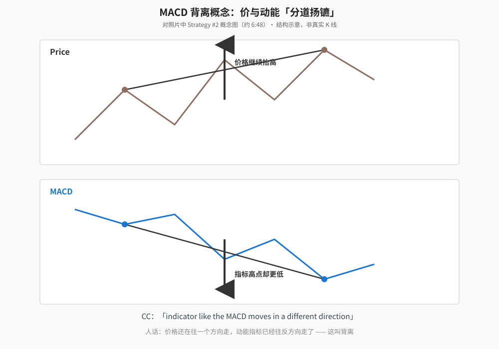
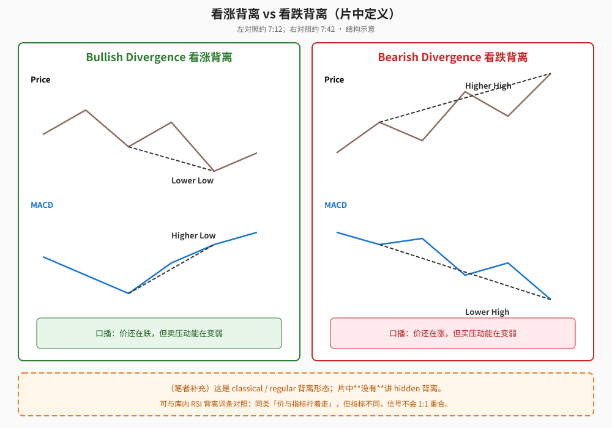
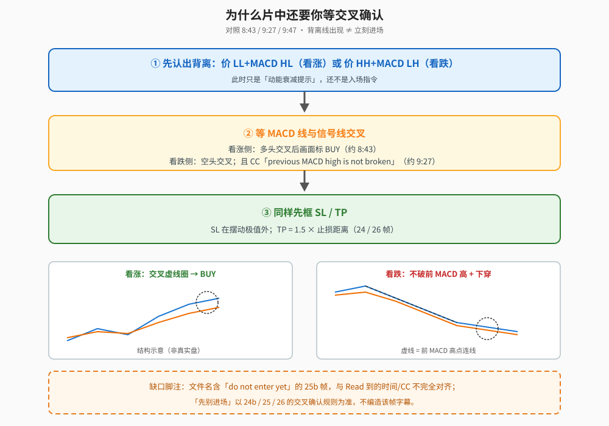

> 学习笔记：同一支 Capital.com MACD 入门片的 Strategy #2（约 6:48–9:47）。画面仍是**示意插图**——无品种、无周期、无价格刻度；也未写出 MACD 参数。本文不写具体标的与周期。（笔者补充）是我加的。CFD **81.31%** 与 *not investment advice* 同样适用。姊妹篇见 [《MACD 入门别只看金叉…》](./2026-10-22-macd-components-crossover-100ma.md)。

## 一、概念：价与动能分道

片中概念图（约 6:48，`19`）：上方 Price 箭头向上抬高，下方 MACD 箭头向下走低——CC：*indicator like the MACD moves in a different direction*。

**读图**
- 上：价格高点抬高；下：MACD 高点降低。这是「拧着走」的示意，不是真实盘。
- 人话：价格还在往一边走，动能指标已经往另一边走了。

## 二、两种定义（片中）

**看涨背离（Bullish Divergence）**（约 7:12，`20`）：价格 **Lower Low**，MACD **Higher Low**。口播：价格还在跌，但卖压动能在变弱。

**看跌背离（Bearish Divergence）**（约 7:42，`23`）：价格 **Higher High**，MACD **Lower High**。口播：价格还在涨，但买压动能在变弱。

**读图**
- 左绿框：价 LL + MACD HL；右红框：价 HH + MACD LH。虚线连的是片中标注的两个点。
- 底部橙色虚线框是**（笔者补充）**：这是 classical / regular 一类；片中**没有**讲 hidden 背离。可与库内 [RSI 背离](./2026-10-20-rsi-classical-vs-hidden.md) 对照——同类形态、不同指标，信号不会 1:1 重合。

实盘示意帧（仍无品种名）：`24b` 看涨侧画出 Lower Low / Higher Low，并在 MACD 多头交叉处虚线圈后标 **BUY**；`26` 看跌侧 Higher High / Lower High + 空头交叉后标 **SELL**，并框出 SL / 1.5× TP。

## 三、为什么还要等交叉

片中不是「画出背离线就进场」：

1. 先认出背离（动能衰减提示）。
2. **等 MACD 与信号线交叉**再谈入场；看跌侧 CC 还强调 *previous MACD high is not broken*（不突破前一个 MACD 高点，约 9:27，`25`）。
3. 风控仍是 SL 在摆动极值外 + TP = 1.5× SL（`24`/`26`）。

**读图**
- ① 认出背离 → ② 等交叉（看跌侧加「不破前 MACD 高」）→ ③ 框 SL/TP。
- 左下/右下是看涨交叉圈、看跌下穿的结构示意。
- 橙色虚线框是**缺口脚注**：文件名含「do not enter yet」的 `25b` 帧，与 Read 到的时间/CC 不完全对齐；「先别进场」以 `24b`/`25`/`26` 的交叉确认规则为准，**不编造**该帧字幕。

## 四、片中没给的东西

- 背离的历史胜率、样本外统计。
- Hidden 背离。
- 具体品种/周期；MACD 参数（画面未见，本文不补写）。
- 「前 MACD 高点」量化多远算「破」。

## 五、采用 / 观望 / 弃用

| 判断 | 内容 |
|---|---|
| 采用 | 背离当作动能衰减提示；等交叉确认（看跌侧留意不破前 MACD 摆动）；入场前先框 SL/TP |
| 观望 | 背离真实胜率；无标签示意盘的可迁移性；固定 1.5× TP |
| 弃用 | 一出现背离线就进场；把示意成功例当成保证反转 |

## 参考

- Capital.com，《MACD Indicator Trading Explained (For Beginners)》，10:07：https://www.youtube.com/watch?v=xQYrUSRrLYo（同链，主题拆出）
- 时间戳：6:48 概念图 · 7:12 看涨背离 · 7:42 看跌背离 · 8:43 看涨交叉确认 BUY · 8:49 SL/TP · 9:27 不破前 MACD 高 · 9:47 看跌 SELL + 1.5×
- 配图 `macddiv-concept.svg`、`macddiv-bullish-vs-bearish.svg`、`macddiv-wait-crossover-flow.svg`
- 姊妹篇：[《MACD 入门别只看金叉…》](./2026-10-22-macd-components-crossover-100ma.md)；RSI 对照：[《Classical 还是 Hidden？…》](./2026-10-20-rsi-classical-vs-hidden.md)

仅供学习，不构成投资建议。
