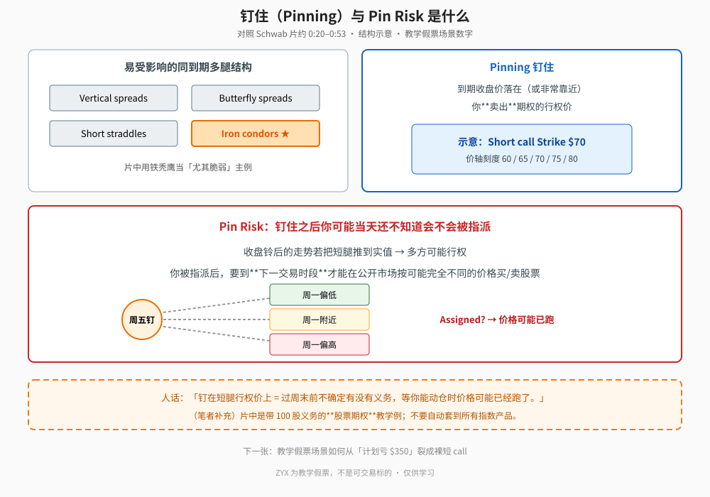
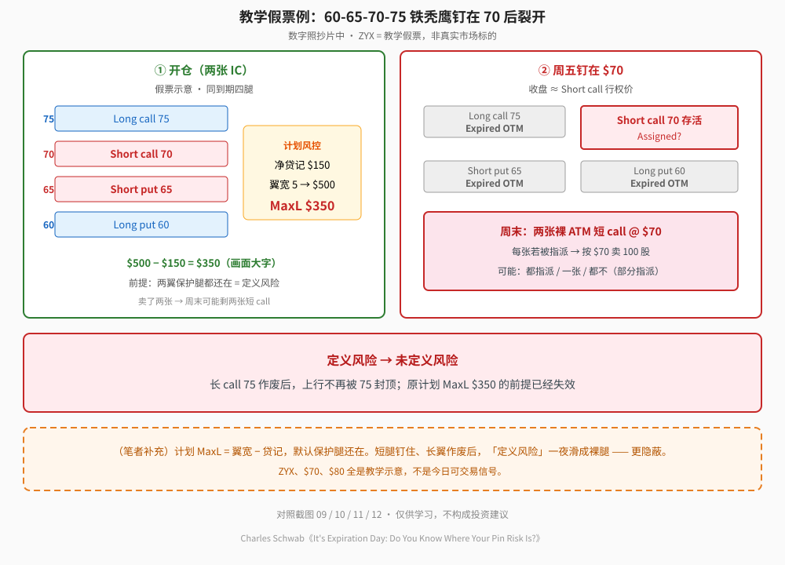
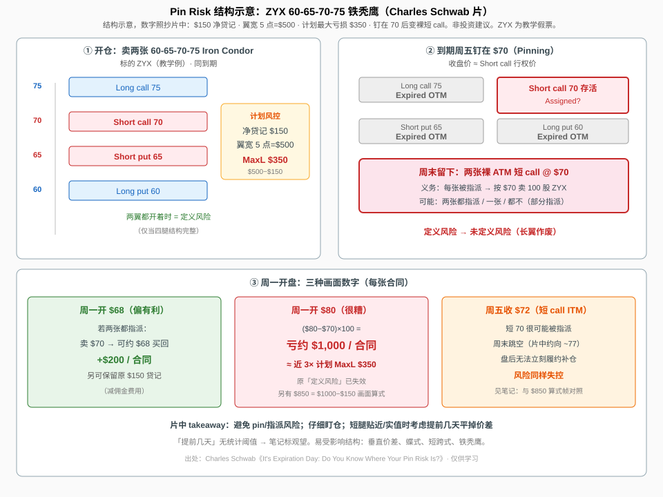
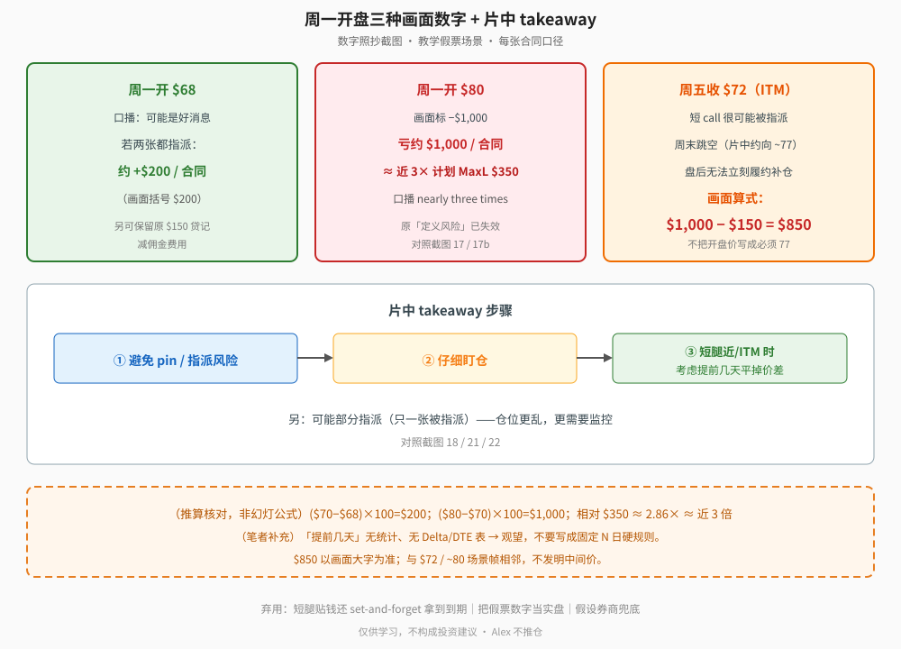

> 学习笔记：根据完整看片（6:50）和截图整理。片中主例用的 **ZYX 是教学假票**，不是可交易标的；文中所有 strike / 贷记 / 开盘价都是教学示意数字，**不要当成真实市场例子**。（笔者补充）/（推算）是我加的。仅供学习，不构成投资建议。

## 一、谁怕 Pin Risk；钉住是什么

片中列出易受影响的同到期多腿结构（约 0:20，`00`）：**Vertical spreads / Butterfly spreads / Short straddles / Iron condors**。铁秃鹰被标成「尤其脆弱」的主例（`00b`）。

**钉住（Pinning）**：标的到期收盘价落在（或非常靠近）你**卖出**期权的行权价。示意短 call **Strike $70**，价轴 **60 / 65 / 70 / 75 / 80**（约 0:35，`04`）。

**Pin Risk**：到期日当天你可能**还不知道**短腿会不会被指派。收盘铃后若把期权推到实值，多方可能行权；你被指派后，要到**下一交易时段**才能在公开市场按可能完全不同的价格买/卖股票（约 0:43–1:16，`02`/`03`/`05`）。

**读图**
- 左：易受影响结构列表，IC 高亮。
- 右：钉住定义——收在卖出行权价附近。
- 下方：周五钉住后通向周一的三条虚线路径；关键是「Assigned?」。
- 橙色虚线框是**（笔者补充）**：片中是带 100 股义务的**股票期权**教学例，不要自动套到所有指数产品。

## 二、教学假票例：计划 MaxL $350 如何裂开

片中说卖了 **两张** **60-65-70-75** 铁秃鹰（教学假票场景）：Long call **75** / Short call **70** / Short put **65** / Long put **60**。净贷记 **$150**；翼宽 **5** 点 → **$500**；计划最大亏损 **$500 − $150 = $350** / 张 IC（约 2:26–2:45，`09`/`08`/`10`）。这 **$350 只有在两翼保护腿都还开着时**才成立。

若周五**钉在 70**：Long put / Short put / Long call 标 **Expired**（OTM 作废）；Short call 留下 → 周末变成 **两张裸 ATM 短 call @ $70**（约 2:59–3:17，`11`/`12`）。每张若被指派，有义务按 **$70** 卖出 **100** 股；两张可能都指派、一张、或都不（`13`）。

**读图**
- 左：开仓四腿 + 计划 $150 / $500 / MaxL $350。
- 右：钉 70 后三腿 Expired，剩 Short call；红框写明「两张裸 ATM 短 call」。
- 中条：定义风险 → 未定义风险（长 call 75 作废，上行不再被封顶）。
- 橙色虚线框是**（笔者补充）**：MaxL 默认保护腿还在；ZYX/$70/$80 全是示意，不是今日信号。

笔记库总结构图（同样标结构示意）：

**读图**
- 标为**结构示意**；数字照抄片中。ZYX 为教学假票。

## 三、周一三种画面数字

| 场景（片中） | 画面/口播要点 |
|---|---|
| 周一开 **$68** | 口播「可能是好消息」；两张都指派时例示约 **+$200** / 合同（减佣金），另可保留原 $150 贷记（`14`/`15`） |
| 周一开 **$80** | 画面 **−$1,000** / 合同；口播 ≈ **近 3 倍**计划 MaxL $350（`16`/`17`/`17b`） |
| 周五收 **$72**（短 call ITM） | 很可能被指派；周末跳空（`19b` 约向 ~77）；盘后无法立刻履约。随后画面大字 **$1,000 − $150 = $850**（`20`）——以算式为准，**不把开盘价写成必须 77** |
| 部分指派 | 可能只一张被指派（`18`） |

**读图**
- 上排三框对应 $68 / $80 / $72+$850 三种画面数字。
- 中排 ①避免 pin ②盯仓 ③短腿近/ITM 考虑提前几天平 —— 来自 `21`/`22`。
- 橙色虚线框是**（推算）/（笔者补充）**：($70−$68)×100=$200、($80−$70)×100=$1,000 是核对用，非幻灯公式；「提前几天」无统计 → 观望，不写成固定 N 日。

## 四、片中没给 / 缺口

- 「提前几天」的固定日数、Delta/DTE 表。
- 不同券商指派通知时点；个股 vs 指数差异细节。
- Schwab「可能代为平仓」——本次关键帧**未见**大字保证卡，不写成画面已核实口号。
- 无真实 ticker、无真实期权链。

## 五、采用 / 观望 / 弃用

| 判断 | 内容 |
|---|---|
| 采用 | 理解同到期多腿「定义风险」在短腿钉住/一翼作废后可变成隔夜未定义风险；到期前监控；短腿贴近/实值时考虑提前平仓 |
| 观望 | 把「提前几天」写成固定 N 日硬规则；不同券商/产品上的指派时点细节 |
| 弃用 | 短腿贴钱还 set-and-forget 拿到到期；把教学假票数字当实盘信号；假设券商兜底所以无风险 |

## 参考

- Charles Schwab，《It's Expiration Day: Do You Know Where Your Pin Risk Is?》，6:50：https://www.youtube.com/watch?v=EEY3G86cFpI
- 时间戳：0:20 易受影响结构 · 0:35 钉住定义 · 0:43 Pin Risk · 2:26–2:45 两张 IC 与 $350 · 2:59 钉 70 三腿 Expired · 3:13 两张裸 ATM 短 call · 3:52 +$200 · 4:18 −$1,000 · 5:05 $72 · 5:49 $850 · 6:19–6:25 takeaway
- 配图 `pinrisk-concept-pinning.svg`、`pinrisk-ic-breaks-to-naked.svg`、`pinrisk-monday-scenarios-flow.svg`、`pinrisk-glossary-structure.svg`

仅供学习，不构成投资建议。
