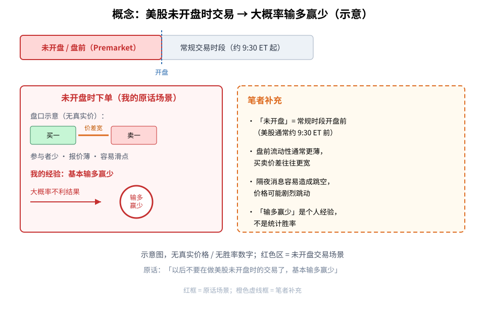
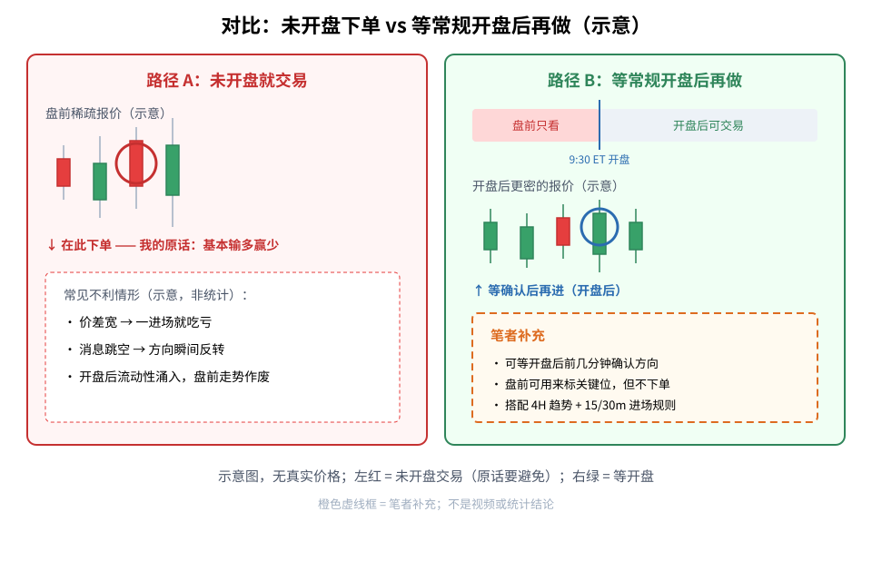
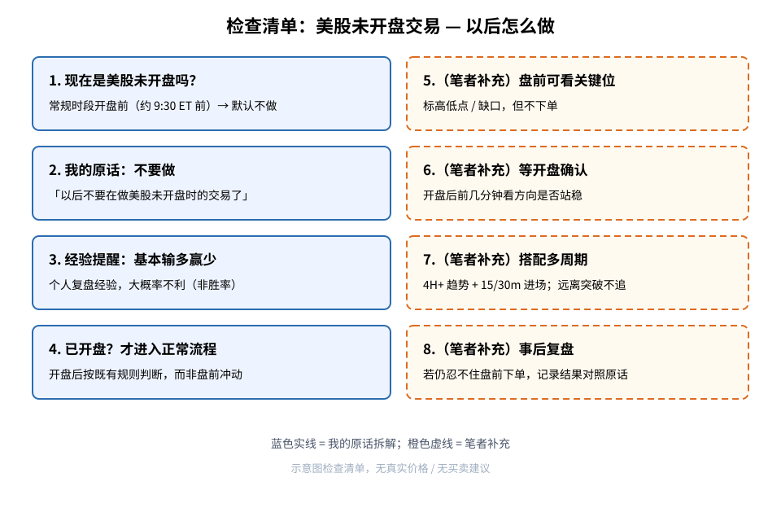

> 今天复盘的一句话教训：**「以后不要在做美股未开盘时的交易了，基本输多赢少」**
> 这是我自己的交易经验，**不是**统计结论，也没有胜率数字。文中凡标（笔者补充）的内容，都是我在原话之外补充的通用常识。

## 1. 先搞懂几个词

- **美股未开盘 / 盘前（Premarket）**：美股常规交易时段一般从美东时间约 **9:30** 开始；在这之前买卖，就叫「未开盘时」或「盘前」交易。对亚洲时区的人来说，往往是深夜或凌晨。
- **常规交易时段（Regular session）**：开盘之后、收盘之前的主力交易时间，参与的人最多、报价最密。
- **流动性**：市场上愿意买、愿意卖的人多不多。人多 → 容易按接近报价成交；人少 → 成交变难。
- **买卖价差（Spread）**：买一价和卖一价之间的空隙。空隙越大，你一进场就可能「贵买」或「贱卖」。
- **跳空 / 消息缺口**：隔夜新闻出来后，开盘价可能和前一晚收盘差一大截，中间没有连续成交。

## 2. 核心：未开盘时不要做 → 基本输多赢少

**读图**
- 上方时间轴：左侧红色区是「未开盘 / 盘前」，右侧是常规交易时段；蓝虚线标出开盘分界。
- 左侧红框是我原话的场景：在盘前下单；图里用「价差宽、报价薄」示意当时盘口更差（无真实价格）。
- 蓝圈 +「输多赢少」对应原话里的经验：**基本输多赢少**——这是我自己的感受，用「大概率不利」理解即可，**不是**胜率统计。
- 橙色虚线框（笔者补充）：什么叫未开盘、为何流动性/价差/跳空不同、「输多赢少」不是数字结论。

一句话：**以后默认不做美股未开盘时的交易。**

## 3. 对比：未开盘下单 vs 等开盘后再做

**读图**
- 左红「路径 A」：在盘前稀疏报价里下单 → 我的原话经验是基本输多赢少；框内列的是常见不利情形的示意（价差、跳空、开盘后走势作废），不是统计表。
- 右绿「路径 B」：盘前只看、开盘后再做；蓝圈标在开盘后的确认位置。
- 橙色虚线框（笔者补充）：可等开盘后前几分钟确认；盘前可标关键位但不下单；进场仍要搭配 [4H 以上看趋势、15/30 分钟找进场](./2026-10-20-multi-timeframe-4h-trend-15m-entry-lesson.md)，并避免 [远离突破位还去追](./2026-10-20-volume-breakout-chase-lesson.md)。

## 4. 我以后的流程

**读图**
- 蓝色实线框 1～4 是我原话的拆解：判断是否未开盘 → 不做 → 记住「基本输多赢少」→ 已开盘才走正常流程。
- 橙色虚线框 5～8 都是（笔者补充）：盘前可看关键位、等开盘确认、搭配多周期与不追远、事后复盘对照。

## 5. 补充说明（笔者补充，通用常识）

以下都不是复盘原话：
1. **为什么盘前更容易难受**：参与者通常更少，报价簿更薄，买卖价差往往更宽；同一笔单，滑点成本可能比开盘后大。这是市场机制上的常识，不是我的统计。
2. **隔夜消息与跳空**：财报、宏观数据、个股新闻常在常规时段外发布，开盘前后价格可能剧烈跳动；盘前成交稀疏时，一根「假信号」就够打乱计划。
3. **等常规开盘 / 开盘后前几分钟确认**：我的做法倾向是——等到约 9:30 ET 开盘后，看价格是否站稳、方向是否还和盘前想象一致，再决定做不做。
4. **盘前可以「看」但不「做」**：盘前高低点、缺口边界可以先标成关键位，留给开盘后的计划用；关键位观察 ≠ 下单。
5. **和旧教训搭配**：方向与止盈止损仍看 [4H 以上](./2026-10-20-multi-timeframe-4h-trend-15m-entry-lesson.md)；进场仍在 15/30 分钟找；出现放量突破时也不要 [离突破位太远还追](./2026-10-20-volume-breakout-chase-lesson.md)。盘前冲动下单，往往这两条都顾不上。
6. **「输多赢少」怎么读**：这是我个人复盘的经验表述，等价于「大概率结果不好」；文中没有、也不应发明具体胜率、票名或价格。

## 6. 采用 / 观望 / 弃用

| 结论 | 内容 |
|---|---|
| 采用 | 以后默认不做美股未开盘（盘前）交易；记住个人经验「基本输多赢少」 |
| 观望 | 开盘后要等多久才算「确认」、哪些品种盘前流动性相对好一点，需要更多复盘 |
| 弃用 | 在美股未开盘时冲动下单；把盘前短暂波动当成常规时段的突破信号去追 |

## 参考

- 个人交易复盘（2026-10-23）
- 相关旧文：[趋势看 4H 以上，进场看 15/30 分钟](./2026-10-20-multi-timeframe-4h-trend-15m-entry-lesson.md)、[放量大阳线突破追进教训](./2026-10-20-volume-breakout-chase-lesson.md)
- 盘前流动性、价差、跳空等为交易常识，属通用知识补充

> 学习笔记，仅供学习，不构成投资建议。
