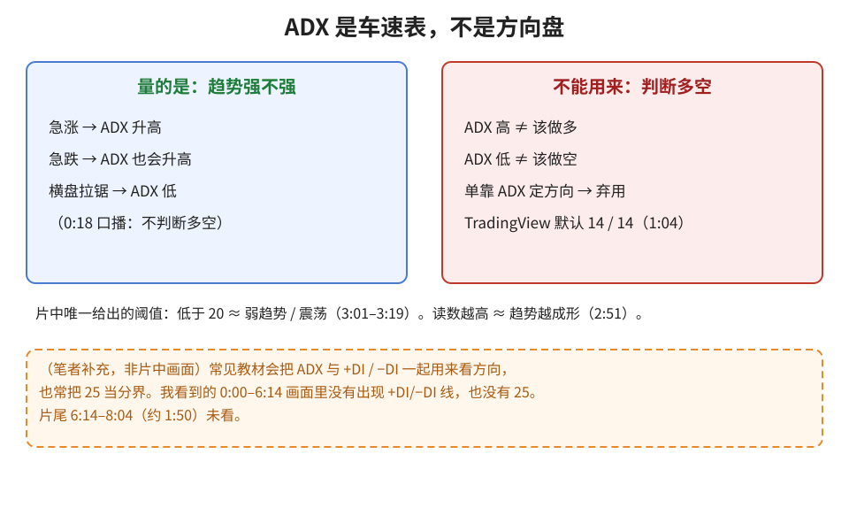
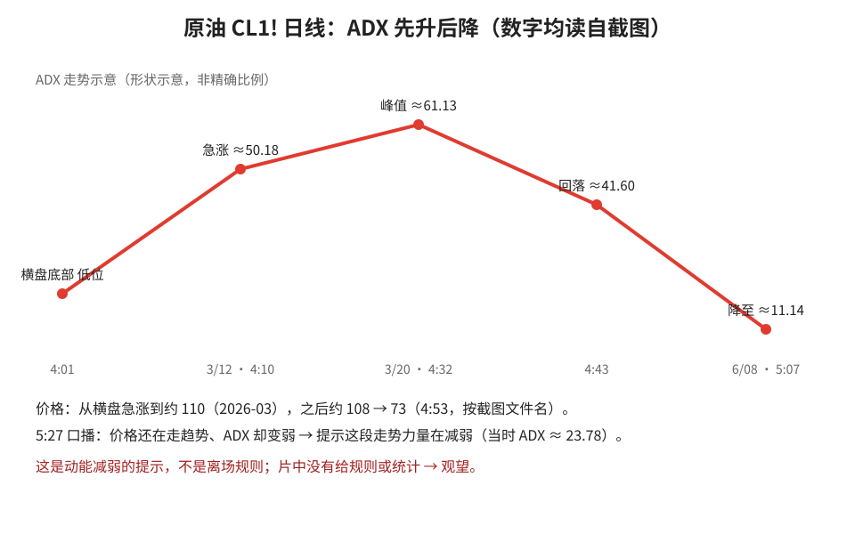
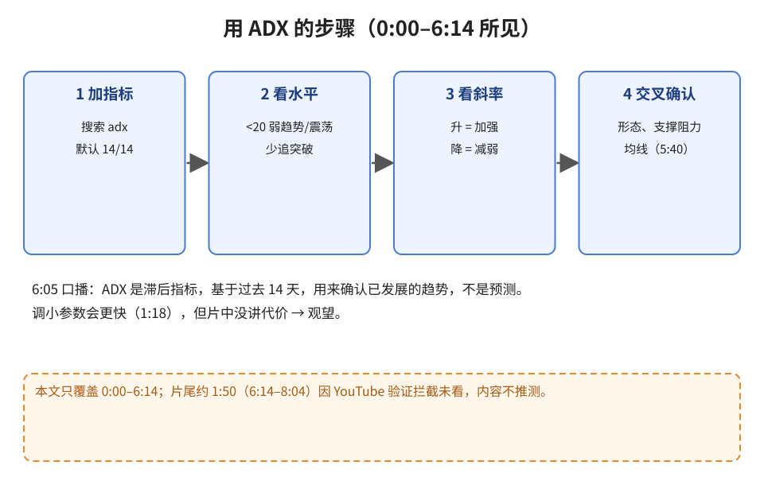

> 学习笔记：TradingView 视频（8:04），**只看到 6:14**。片尾约 **1:50（6:14–8:04）没看**（YouTube 弹出机器人验证、按规定不登录），那段可能有的内容本文不推测。

## 1. ADX 量什么

**读图**
- ADX 只量**趋势有多强**，不分多空（0:18）：急涨、急跌都会让它升高。
- TradingView 默认 ADX Smoothing 14、DI Length 14（1:04）；调小会更快（1:18）。
- 片中给的唯一阈值：**低于 20 ≈ 弱趋势 / 震荡**（3:01–3:19）。
- 橙框（笔者补充）：+DI / −DI 与 25 这个分界**不是我看到的片中画面内容**。

## 2. 原油例子：先升后降

**读图**
- 原油从横盘底部急涨（4:01），ADX 一路升到约 50.18（3/12）、峰值约 61.13（3/20，4:32）。
- 动能消退后 ADX 回落到约 41.60（4:43），6/08 附近降到约 11.14（5:07）。
- 5:27 口播：价格还在走、ADX 却变弱 → 提示力量在减弱。这只是提示，不是离场规则。
- 折线是形状示意，点位数字读自截图。

## 3. 使用步骤

**读图**
- 加指标 → 看是否低于 20 → 看斜率（升/降）→ 用形态、支撑阻力、均线交叉确认（5:40）。
- 6:05 口播：ADX 是**滞后指标**，基于过去 14 天，确认已在发展的趋势，而不是预测。
- 3:30 口播：很多交易者更看重 ADX 在升还是在降，而不是具体数字。

## 判断

| 内容 | 判断 | 理由 |
|---|---|---|
| ADX 当“有没有趋势”的过滤器（低于 20 少追突破） | 采用 | 画面与口播一致 |
| 看 ADX 的升降而不是死盯数字 | 采用 | 原油例画面清楚 |
| 调小参数求快 | 观望 | 没讲代价 |
| “价格还在走、ADX 回落”当离场信号 | 观望 | 只有口播提示 |
| 单靠 ADX 决定多空 | 弃用 | ADX 不分方向 |
| 6:14 之后的内容 | 未看 | 不下判断 |

## 参考

- TradingView, *Identify Trend Strength Using The Average Directional Index (ADX)*：https://www.youtube.com/watch?v=BNP11NjQgM8 （0:18 不分方向；1:04–1:18 参数；2:51 读数越高；3:01–3:19 低于 20；3:30 看升降；4:10–5:27 原油例；5:40 搭配；6:05 滞后。6:14–8:04 未看）

> 仅供学习，不构成投资建议。
