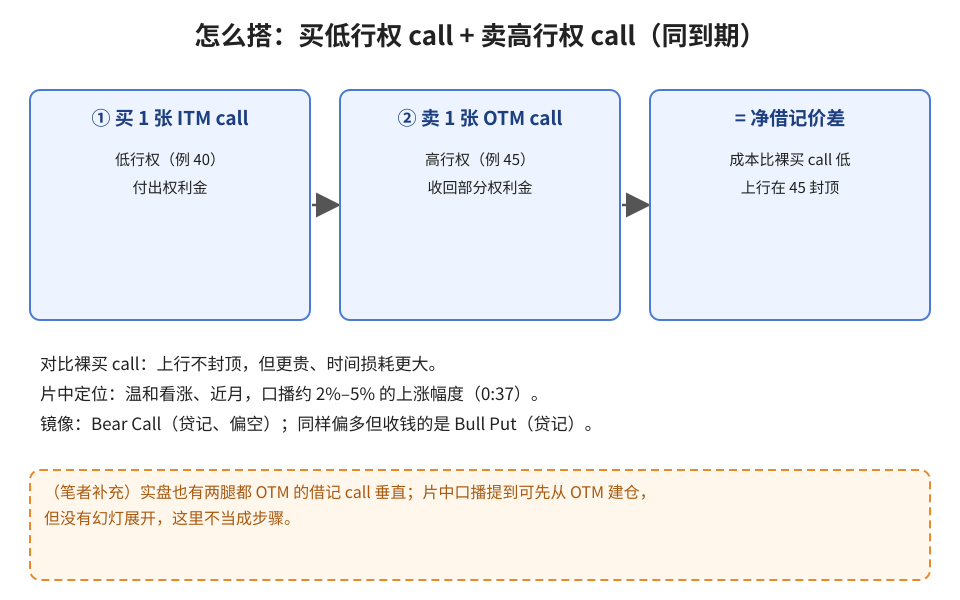
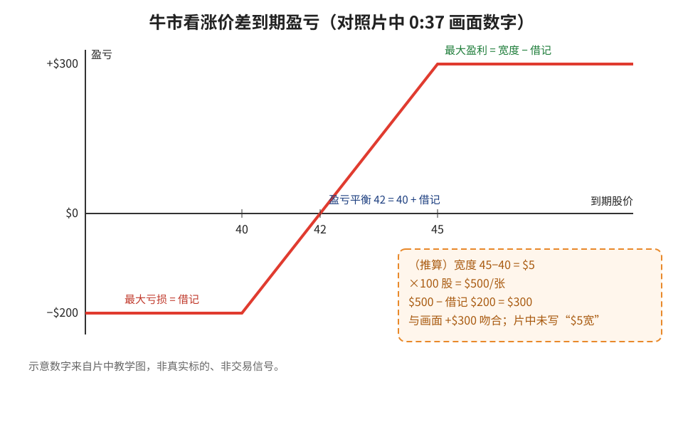
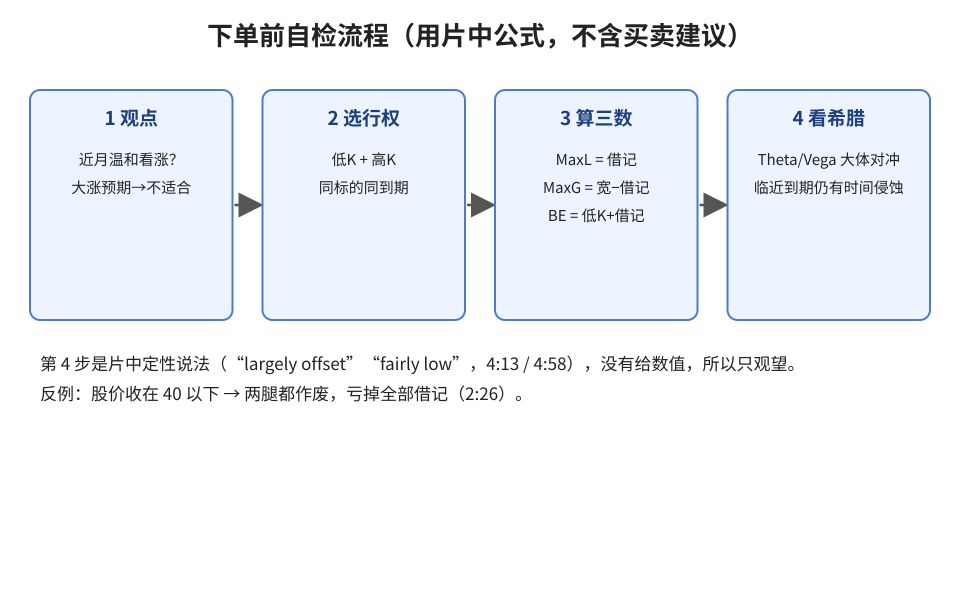

> 学习笔记：Option Alpha 视频，已看完 8:31/8:31。图里的数字都来自片中同一张教学盈亏图（40 / 42 / 45；−$200 / +$300），不是真实标的。

## 1. 什么时候用

片中 0:37：你认为标的**近期会温和上涨**（口播约 2%、3%、5%），但不想裸买 call。代价是放弃一部分上行，换来**更便宜**的组合。

## 2. 怎么搭

**读图**
- 同标的、同到期：买 1 张低行权 call（片中是 ITM）+ 卖 1 张高行权 call（OTM）（1:37）。
- 卖出那条腿收回部分权利金，所以整体是净借记（debit spread）。
- 上行在高行权价封顶，这是“便宜”的代价。
- 橙色虚线框是笔者补充，不是片中步骤。

## 3. 风险与收益：三个数

**读图**
- **最大亏损 = 净借记**（例 −$200）：股价收在 40 以下，两腿都作废（2:26、2:51）。
- **最大盈利 = 两行权价之差 − 借记**（例 +$300）（3:39）。
- **盈亏平衡 = 低行权价 + 借记**（例 42 = 40 + 借记，5:54 口播）。
- （推算）$5 宽 × 100 = $500，减 $200 借记得 $300，与画面一致；“$5 宽”字样片中没出现。

## 4. 自检流程与时间、波动

**读图**
- 先确认观点是“温和看涨”，预期大涨就不是这个工具的场景。
- 三个数在下单前就能算出来，这是这个结构最适合新手的地方。
- 片中说两腿 Theta / Vega 大体对冲（“largely offset”），波动风险 “fairly low”（4:13、4:58），但没有给数值，所以只观望。
- 反例：股价跌破低行权价 → 亏掉全部借记。

## 5. 和已学策略对照

- **Bear Call Spread**：镜像结构，收钱（贷记）、偏空。
- **Bull Put Spread**：同样偏多，但是收钱（贷记）。
- 牛市看涨价差：偏多、**付钱**（借记），风险从一开始就锁定为借记金额。

片后半段口播 tips（例如可以先从 OTM 建仓、便宜不等于更好、稍后再卖 45 那条腿）**没有单独幻灯**，这里只做概括，不写成可照做的步骤。

## 判断

| 内容 | 判断 | 理由 |
|---|---|---|
| 温和看涨时用借记 call 垂直，换成本、封顶利润 | 采用 | 画面结构清晰 |
| MaxL = 借记、MaxG = 宽 − 借记、BE = 低行权 + 借记 | 采用 | 图与口播互相印证 |
| Theta/Vega “largely offset / fairly low” | 观望 | 定性说法，无数值 |
| 口播 tips（先 OTM、稍后卖短腿等） | 观望 | 没有幻灯与完整步骤 |
| 把示意 40/45 或 2–5% 当交易信号 | 弃用 | 教学示意 |

## 参考

- Option Alpha, *Bull Call Spread Option Strategies*：https://www.youtube.com/watch?v=r9xG4PaDmho （0:37 市场观点与盈亏图；1:37 搭建；2:26/2:51 最大亏损；3:39 最大盈利；4:13 波动；4:58 时间衰减；5:54 盈亏平衡）

> 仅供学习，不构成投资建议。
