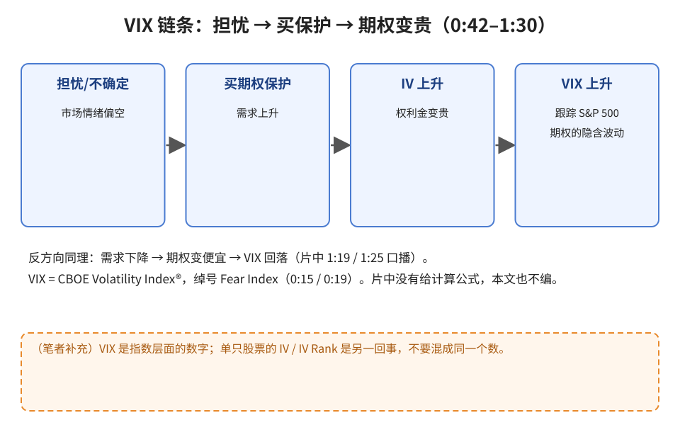
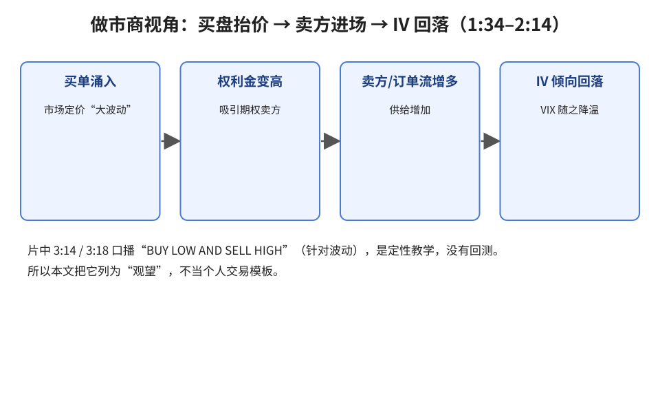
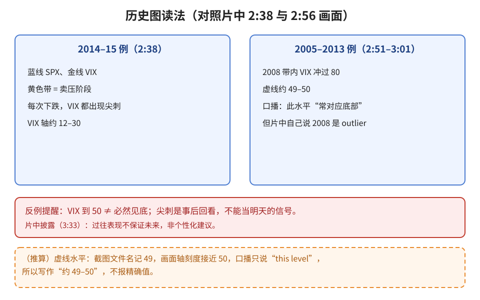

> 学习笔记：Charles Schwab（Cameron May）视频，已看完 3:49/3:50。片中**没有**讲 VIX 的计算公式，本文也不写公式。

## 1. VIX 是什么

CBOE Volatility Index®，绰号 **Fear Index**（0:15、0:19），**跟踪 S&P 500® 期权**（1:30）。它反映的是整个市场的期权贵不贵，不是某只股票的涨跌分数。

## 2. 为什么市场一怕，VIX 就涨

**读图**
- 担忧 → 大家买期权做保护 → 需求上升 → 隐含波动（IV）和权利金变贵（0:42–1:04）。
- VIX 升 ↔ 期权贵；VIX 降 ↔ 期权便宜（1:19、1:25 口播）。
- 橙框是笔者补充：VIX 是指数层面的，别和单票 IV Rank 混为一谈。

## 3. 做市商：为什么高 VIX 不会一直高

**读图**
- 买单涌入 → 做市商把“大波动”定进价格 → 权利金变高（1:34–1:54）。
- 高权利金吸引卖方 → 卖方订单流增多 → IV 倾向回落（2:10、2:14）。
- “买低卖高波动”（3:14、3:18）是定性讲法，没有回测数据。

## 4. 看历史图：尖刺与“底部”

**读图**
- 2014–15 例：每次下跌（黄带），VIX 都冲出尖刺（2:38）。
- 2005–2013 例：2008 年 VIX 冲过 80；虚线约 49–50，口播说这个水平“常对应底部”（2:56）。
- 但片中紧接着说 **2008 是 outlier**（3:01），披露页也说过往不代表未来（3:33）——所以“到 50 就见底”不成立。

## 判断

| 内容 | 判断 | 理由 |
|---|---|---|
| VIX = 跟踪标普期权的市场波动/情绪温度计 | 采用 | 画面标签清晰 |
| VIX 升 ↔ 期权更贵；卖压时尖刺 | 采用 | 口播与历史图一致 |
| VIX 约 49–50 “偏底部” | 观望 | 片中自标 outlier |
| 做市商“买低卖高波动”当个人模板 | 观望 | 无执行细则与数据 |
| 把历史尖刺当明日信号 | 弃用 | 事后回看 |

## 参考

- Charles Schwab, *What Is the VIX®?*：https://www.youtube.com/watch?v=GzuvRC623a0 （0:15–0:19 定义；0:42–1:30 需求链条；1:34–2:14 做市商；2:38 尖刺；2:51–3:01 2008 与 outlier；3:14 买低卖高；3:33 披露）

> 仅供学习，不构成投资建议。
