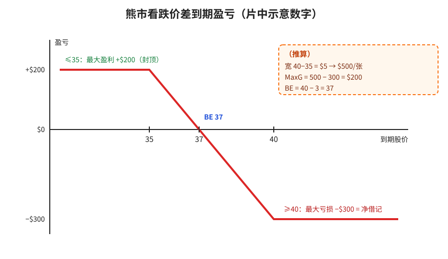
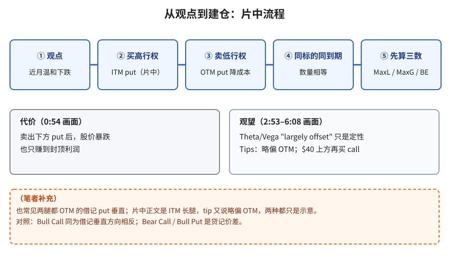
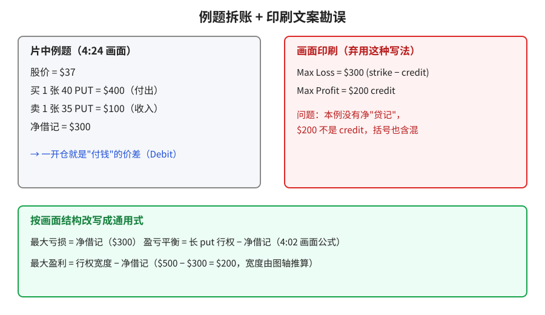

> 学习笔记：Option Alpha 视频，已看完 7:11/7:11。全片几乎都用同一张示意盈亏图（35 / 37 / 40；+$200 / −$300），没有真实标的或期权链。

## 1. 什么时候用

片中（0:18–0:54）：觉得标的**近期会温和下跌**时用。和直接买一张 put 比，多卖一张更低行权价的 OTM put 能**降低开仓成本**；代价是股价暴跌时利润**封顶**。

**读图**
- 红线照片中示意图画：≤35 平在 +$200，≥40 平在 −$300，在 37 穿过零轴。
- 左边封顶 = 跌破低行权价后再跌也不多赚（2:39）；右边封底 = 高于高行权价两腿都作废，亏掉借记（2:04）。
- 橙色虚线框是（推算）：宽度 $5 与 BE=37 是按图轴和例题算出来的，片中没有写"$5 宽"这几个字。

## 2. 怎么搭

片中（1:07）：同一标的、同一到期日，**买 1 张较高行权价 put（片中是 ITM）+ 卖 1 张较低行权价 put（OTM）**，数量相等。一开仓是付钱的，所以属于借记价差（debit spread），也是垂直价差（vertical）。

**读图**
- 蓝色五步按片中顺序：观点 → 买高 → 卖低 → 同到期等数量 → 先算三个数。
- 灰框是观望内容：Theta/Vega "largely offset" 只是定性说法（2:53、3:25）；Tips 三条（6:08）没有算例。
- 橙色虚线框是（笔者补充）：两腿都 OTM 的搭法、以及与 Bull Call / Bear Call / Bull Put 的对照，不是片中原话。

## 3. 例题和三个关键数

片中例题（4:24）：股价 $37；买 1 张 40 PUT = $400；卖 1 张 35 PUT = $100；**净借记 $300**。

- **最大亏损 = 净借记** = $300
- **最大盈利 = 行权宽度 − 净借记** = $500 − $300 = $200（宽度为（推算））
- **盈亏平衡 = 长 put 行权价 − 净借记**（4:02 画面公式）= 40 − 3 = 37（（推算），例题页没单独印 BE）

**读图**
- 左框照抄例题画面数字。
- 右框是画面印刷文案："Max Loss = $300 (strike − credit)"、"Max Profit = $200 credit"——本例没有净贷记，这种写法**弃用**。
- 绿框是按画面结构改写的通用式，初学者记这一版。

## 4. 采用 / 观望 / 弃用

| 内容 | 判断 | 理由 |
|---|---|---|
| 温和看跌用借记 put 垂直，换低成本、封顶利润 | 采用 | 画面结构清楚 |
| MaxL = 借记；MaxG = 宽 − 借记；BE = 长 put − 借记 | 采用 | 图、公式页、例题互相印证 |
| Theta/Vega 大体对冲 | 观望 | 定性，无数值 |
| Tips：略偏 OTM；$40 上方再买 call 对冲 | 观望 | 无完整步骤或算例 |
| 印刷 "strike − credit" / "$200 credit" 文案 | 弃用 | 用词错，本例是借记 |
| 把示意数字当交易信号；片尾推荐视频 | 弃用 | 教学示意；推荐未看 |

## 参考

- Option Alpha, *Bear Put Spread Option Strategy - Put Debit Spreads*：https://www.youtube.com/watch?v=i0VmJUQP1N8 —— 0:18 盈亏图；0:54 适用场景；1:07 搭法；2:04 风险；2:39 盈利；2:53 波动率；3:25 时间衰减；4:02 盈亏平衡；4:24 例题；6:08 Tips

仅供学习，不构成投资建议。
