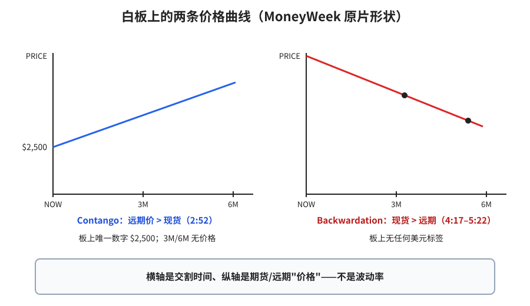
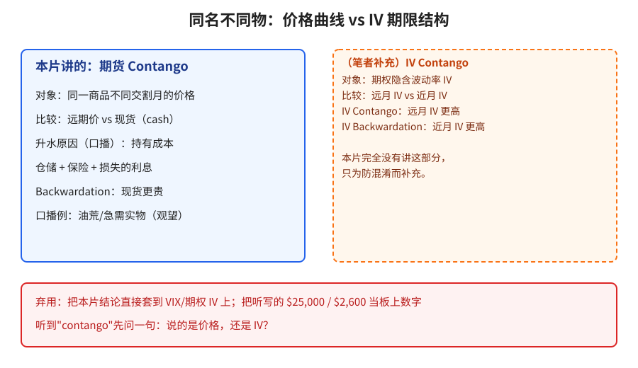
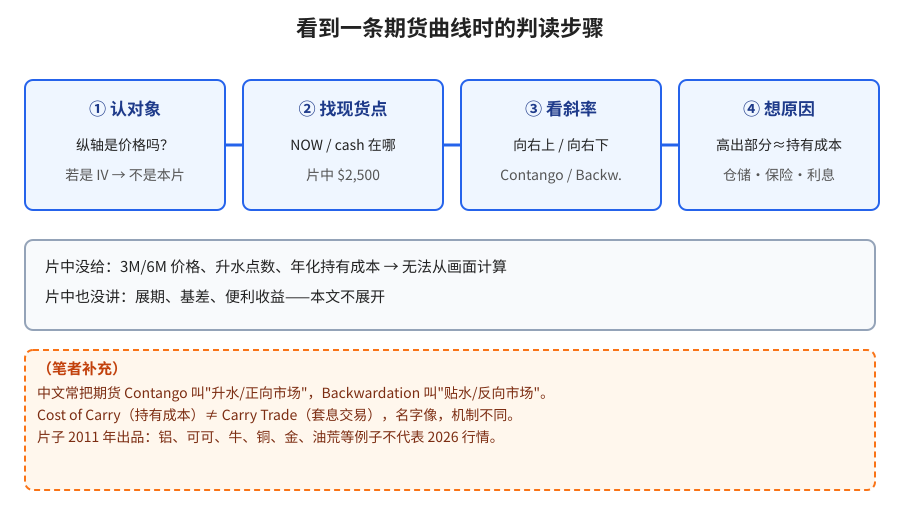

> 学习笔记：MoneyWeek 白板课（© 2011），已看完 6:18/6:18；视频无字幕轨（CC unavailable），以白板为准。**本片只讲期货/远期价格曲线 vs 现货，没有讲期权隐含波动率（IV）**；文中凡涉及 IV 的内容都是（笔者补充）。

## 1. 本片在比什么

横轴是**交割时间**（NOW / 3M / 6M），纵轴是**价格**（2:35–2:50）。问题很朴素：现在拿货贵，还是三个月、六个月后拿货贵？

**读图**
- 左：Contango，从 NOW 的 **$2,500** 向右上斜（2:52）。$2,500 是全片白板上**唯一的数字**，3M/6M 没有价格。
- 右：Backwardation，从价格轴高处向右下斜，线上点了两个远期点，并圈出 NOW（4:17–5:22）。**板上没有任何美元标签**，本文也不编。
- 两图形状照白板画；"contango/backwardation"这两个词只写在标题上，曲线旁没有标签。

## 2. 为什么远期会更贵

口播（白板没有拆项数字）：Contango 是常见的正常状态，高出现货的那一截大致就是**持有成本（cost of carry）**——仓储、保险、钱压在货上损失的利息。Backwardation 相对少见、往往短命，口播例子是油荒或突然急需实物（观望：无数据，且是 2011 年的片子）。

## 3. 和 IV Contango 的区别

**读图**
- 蓝框是本片内容：对象是同一商品不同交割月的**价格**。
- 橙色虚线框整块是（笔者补充）：IV 期限结构比较的是远月 vs 近月的**隐含波动率**，本片完全没讲，放这里只为防混淆。
- 红框：自动听写里的 "$25,000"、"$2,600" 不在白板上，属 ASR 误听 → 弃用。

## 4. 看到一条曲线时怎么读

**读图**
- 四步：认对象（是价格吗）→ 找现货点 → 看斜率 → 想原因（持有成本）。
- 灰框：片中没给 3M/6M 价格，所以算不出升水点数或年化持有成本。
- 橙色虚线框是（笔者补充）：中文"升水/贴水"叫法、Cost of Carry ≠ Carry Trade、2011 年的例子不代表现在行情。

## 5. 采用 / 观望 / 弃用

| 内容 | 判断 | 理由 |
|---|---|---|
| 远期价 > 现货 = Contango；现货 > 远期 = Backwardation（价格曲线） | 采用 | 白板形状清楚 |
| 高出部分 ≈ 持有成本（仓储、保险、利息） | 采用（概念框架） | 口播核心机制 |
| 铝/可可/牛/铜/金、油荒等例子；"Backwardation 少见短命" | 观望 | 无数据；2011 年片 |
| 把本片结论当成期权 IV 期限结构 | 弃用 | 对象完全不同 |
| ASR 的 $25,000 / $2,600 | 弃用 | 不在白板上 |
| 给 Backwardation 曲线编美元数字 | 弃用 | 板上没有 |

## 参考

- MoneyWeek, *What are 'contango' and 'backwardation'?*：https://www.youtube.com/watch?v=FwzUzFhyo00 —— 2:35 坐标轴；2:50 $2,500 @ NOW；2:52 上斜线；4:07 擦除；4:17 下斜线；5:20 两个远期点；5:22 圈出 NOW

仅供学习，不构成投资建议。
