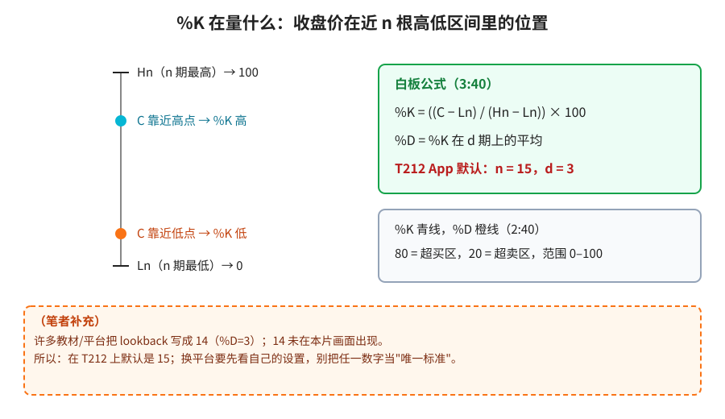
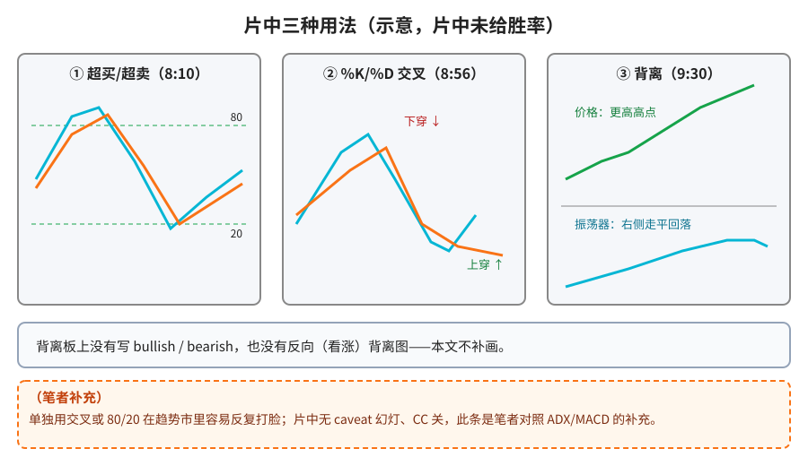
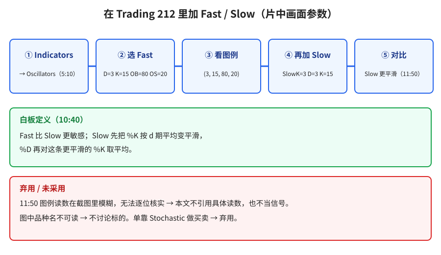

> 学习笔记：Trading 212（Peter Martin）视频，已看完 12:35/12:35；无字幕轨（CC unavailable），口头的风险提示可能漏掉，以画面为准。片中没有专门讲局限性的幻灯。

## 1. 它是什么

白板（1:10–2:00）：1950 年代 George Lane 提出的**动量振荡器**，和 RSI、ROC 同类；看当前价相对回看区间的位置，数值在 **0–100** 之间。人话：收盘价更靠近近 n 根的高点还是低点。

**读图**
- 左侧竖条：区间顶 = n 期最高价（→100），底 = n 期最低价（→0），收盘价在哪，%K 就在哪。
- 绿框照抄白板公式（3:40、4:20）：%K = ((C − Ln)/(Hn − Ln)) × 100；%D = %K 的 d 期平均；**Trading 212 App 默认 n=15、d=3**。
- 灰框：%K 青线、%D 橙线，80 超买、20 超卖（2:40）。
- 橙色虚线框是（笔者补充）：很多教材写 14，但 14 没在本片出现。

## 2. 三种用法

**读图**
- ① 超买/超卖（8:10）：线冲过 80 再回落、跌到 20 附近——片中作"可能反转"的提示。
- ② 交叉（8:56）：%K 下穿 %D、%K 上穿 %D，板标题叫 *Crossovers as signals*。
- ③ 背离（9:30）：价格不断创更高高点，下方振荡器右侧走平回落。板上**没写** bullish/bearish，也**没有**反向的背离图，本文不补画。
- 橙色虚线框是（笔者补充）：单独用在趋势市容易反复打脸，这是笔者对照 ADX/MACD 的看法，不是片中原话。

## 3. Fast 和 Slow

**读图**
- 五步按平台操作画面：Indicators → Oscillators → Fast（D=3、K=15、OB=80、OS=20，5:40）→ 图例 (3, 15, 80, 20) → 加 Slow（Slow K=3、D=3、K=15，11:40）。
- 绿框照抄白板（10:40）：Fast 更敏感；Slow 先把 %K 按 d 期平均平滑，%D 再对平滑后的 %K 取平均。
- 红框：11:50 图例读数截图里太模糊，无法逐位核实，本文不引用；品种名不可读，不讨论标的。

## 4. 采用 / 观望 / 弃用

| 内容 | 判断 | 理由 |
|---|---|---|
| 0–100 动量振荡器；%K 公式；%D 为 %K 平均；80/20 | 采用（概念） | 白板清楚 |
| T212 默认 n=15、d=3（作该 App 的事实） | 采用 | 板上写明 |
| Fast 更敏感、Slow 更平滑 | 采用（概念） | 白板 + 设置画面 |
| 超买超卖 / 交叉 / 背离作独立信号 | 观望 | 无胜率、无回测、无 caveat |
| 把 15 当全球唯一标准 | 弃用 | 平台默认而已 |
| 单靠 Stochastic 做买卖；把 11:50 读数当信号 | 弃用 | 教学示意；读数不可核实 |
| 把背离写成"片中标注 bearish"或补画看涨背离 | 弃用 | 画面没有 |

## 参考

- Trading 212, *The Stochastic Oscillator Explained*：https://www.youtube.com/watch?v=SrCENnDVHRk —— 1:10 定义；2:00 0–100；2:40 %K/%D 与 80/20；3:40 公式；4:20 默认 n=15、d=3；5:40 Fast 设置；6:40 三种用法；8:10 超买超卖；8:56 交叉；9:30 背离；10:40 Fast vs Slow；11:40 Slow 设置；11:50 快慢同图

仅供学习，不构成投资建议。
