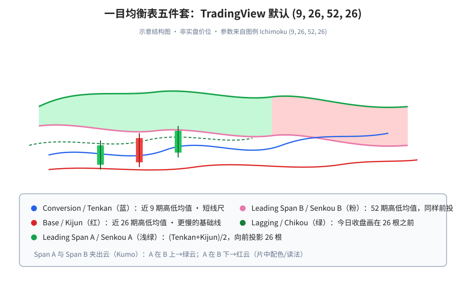
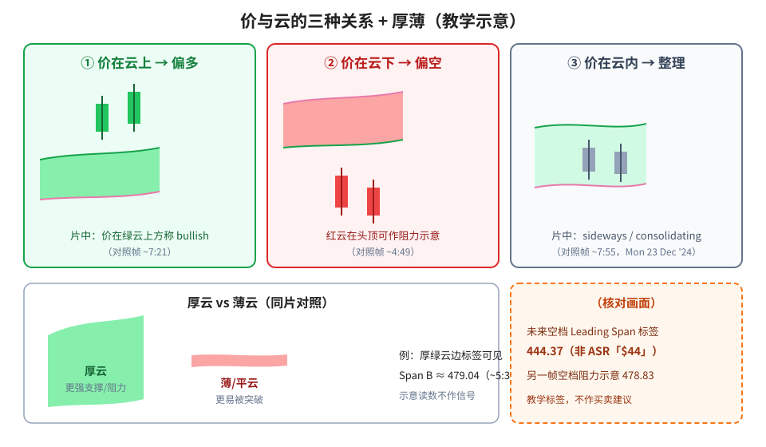
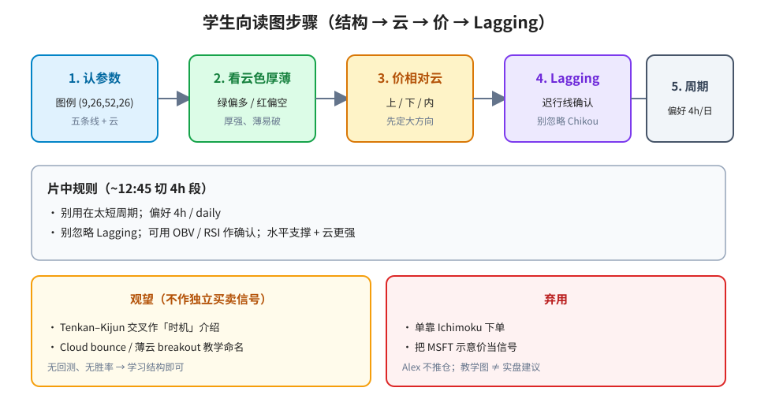

> 学习笔记：TradingView 视频，已看完 17:10/17:10；以画面为准。示意标的为片中 MSFT 日线/4h 教学图，不作买卖建议。

## 1. 它是什么：一眼叠支撑、趋势和动量

片中把日文名口播成 *one glance equilibrium chart*（一目均衡）。不是单线，而是把支撑/阻力、趋势、动量叠在同一张图上的系统。TradingView 图例默认：**Ichimoku (9, 26, 52, 26)**。

**读图**
- 蓝线 = Conversion / Tenkan：近 **9** 期最高与最低的均值（短线尺）。
- 红线 = Base / Kijun：同算法、**26** 期（更慢的基础线）。
- 浅绿 / 粉 = Leading Span A / B（Senkou A / B）：向前投影 **26** 根，两线夹出云（Kumo）。
- 绿虚线 = Lagging / Chikou：今日收盘画在 **26** 根之前，用来确认趋势强弱。
- Style 对话框（~1:36）配色：Conversion 蓝、Base 红、Span A 浅绿、Span B 粉；该帧右侧标签例：Span B **442.91** / Base **441.01** / Span A **439.52** / Conversion **438.03**（瞬时读数，不作信号）。

（笔者补充，非片中原话）日文常用名：转换线 Tenkan-sen、基准线 Kijun-sen、先行带 Senkou Span、迟行线 Chikou Span、云 Kumo。片中用英文 TradingView 标签。

## 2. 云色、厚薄，以及价在云上/下/内

Span A **在** Span B **之上** → **绿云**（片中偏多支撑区）；Span A **在** Span B **之下** → **红云**（偏空阻力区）。**厚云** = 更强支撑/阻力；**薄/平云** = 弱区、更易被突破。

**读图**
- ① 价在云上 → 偏多（~7:21）；② 价在云下 → 偏空，红云在头顶可作阻力（~4:49）；③ 价在云内 → 整理 / sideways（~7:55，交叉丝 Mon 23 Dec '24）。
- 厚 vs 薄：~5:39 交叉丝指着薄云区（Thu 02 Jan '25），右侧可见厚绿云；该段厚云边有 Span B 标签约 **479.04**（示意读数）。
- 云还画在**未来**空档。~6:09 空档 Leading Span 标签为 **444.37**——ASR/字幕把该数念成「$44」，**以画面 444.37 为准**。另一帧空档阻力示意标签 **478.83**（~10:52）。
- ~6:42 黄线示意：价在云下仍可能先上探云再跌；该帧 Span B **445.58**。

## 3. 交叉、bounce，以及怎么按步骤读

片中把 **Tenkan–Kijun 交叉**（蓝快 vs 红慢）当作「时机」介绍；可叠加多周期（日线看云方向，4h 找交叉）；可对云边/线设 alert（例右键 alert at **485.41**，~9:19）。另有教学命名：**Cloud bounce**（强升势回踩云边再起）、**Cloud breakout**（穿过薄云 + 云变色）。

规则段（切 **4h**，~12:45）：**别用在太短周期**，偏好 **4h / daily**；别忽略 Lagging；可用 OBV / RSI 作确认。该帧图例例：Span B **441.02** / Base **437.92** / Span A **422.56** / Lagging **408.69** / Conversion **407.20**。

Lagging 警示（~15:15–16:33）：价还在冲高，但 Lagging 已掉到云下 → 片中解读为趋势变弱 / 潜在反转预警（教学示意，无胜率）。强势示意：价与 Lagging 都在云上（同段可见 Span A **537.24** / Span B **529.76** / Base **508.02** / Conversion **500.14**）。

**读图**
- 五步：认参数 → 云色厚薄 → 价相对云 → Lagging 确认 → 周期偏好 4h/日。
- 黄框：交叉 / bounce / breakout **观望**作独立买卖信号（无回测）。
- 红框：**弃用**单靠 Ichimoku、把 MSFT 示意价当信号。

## 4. 采用 / 观望 / 弃用

| 内容 | 判断 | 理由 |
|---|---|---|
| Ichimoku = 多线系统；默认 (9,26,52,26)；五组件与云由 Span A/B 夹出 | 采用（概念） | 设置框 + 图例 + 口播一致 |
| 绿云/红云 = Span A 相对 Span B；厚强薄弱；价上/下/内云 | 采用（概念框架） | ~3:50/~4:49/~5:39/~7:21/~7:55 |
| 云投影到未来作「前方」S/R 参考 | 采用（概念） | 空档标签 444.37、478.83 |
| 偏好 4h/日线、短周期慎用；Lagging 作确认 | 采用（片中规则） | ~12:45/~13:11/~16:33 |
| Tenkan–Kijun 交叉作「时机」；Cloud bounce / thin-cloud breakout | 观望（作独立信号） | 仅示意；无统计 |
| 单靠 Ichimoku / MSFT 示意价当信号；片尾推荐；Paper Trading 推销 | 弃用 | Alex 不推仓；未验证 |
| 把 ASR「$44」或口播未印数字写成画面事实 | 弃用 | 以图上 444.37 等为准 |

## 参考

- TradingView, *Ichimoku Cloud for Trend, Impulse, and Signals*：https://www.youtube.com/watch?v=owKD6tLfNdw —— 0:00 MSFT 日线开场；1:36 Style 配色；2:30 Tenkan；3:50 绿红云；4:06 Lagging；4:49 红云阻力；5:39 厚薄；6:09 未来 Span **444.37**；7:21 价在云上；7:55 云内；8:22 交叉；12:45 4h 规则；15:15–16:33 Lagging 警示/强势；17:10 结束。片长 **17:10**。

仅供学习，不构成投资建议。
