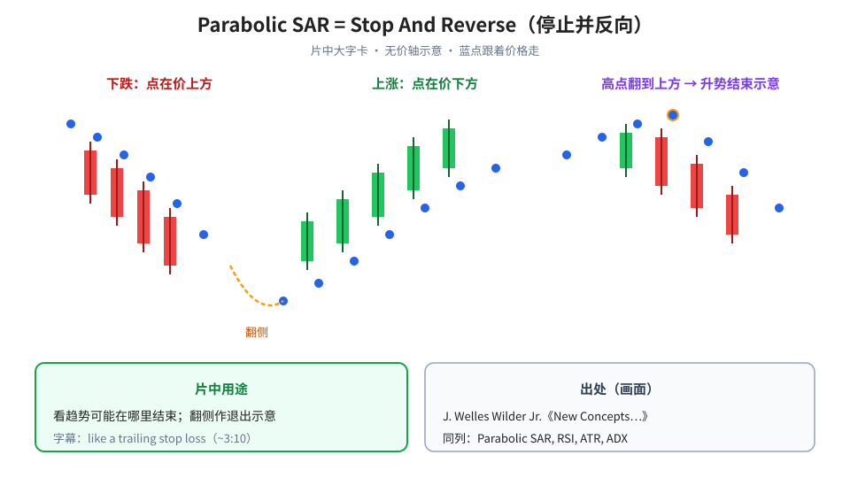
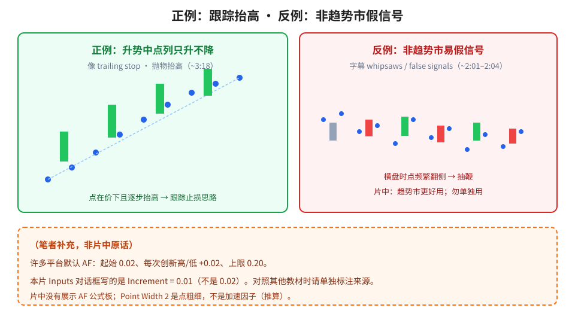
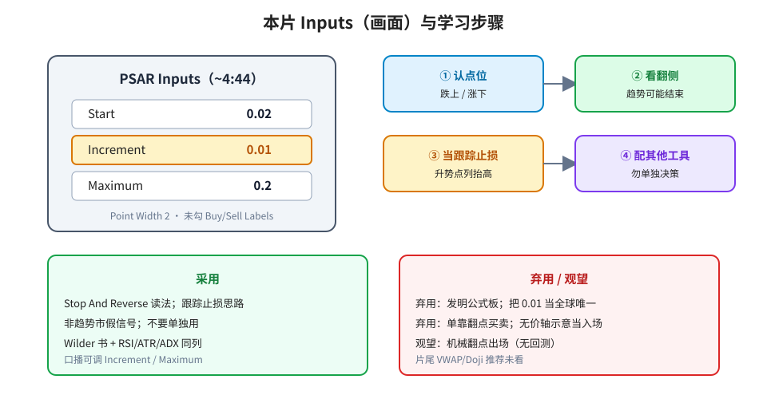

> 学习笔记：Soheil PKO 视频，已看完 5:30/5:30；以画面为准。全片基本同一张静态示意行情图（指针移动），**无价轴、无品种名**——不讨论具体标的。

## 1. SAR = Stop And Reverse

开场品红色标题卡：**Parabolic SAR**，用途是看趋势何处结束。约 0:59 大字：**SAR Stands For “Stop And Reverse”**（停止并反向）。

出处卡（~0:42）：**Welles Wilder**；书封面 *NEW CONCEPTS IN TECHNICAL TRADING SYSTEMS* / J. Welles Wilder Jr.；同屏一行 **Parabolic SAR, RSI, ATR, ADX**。（口播年份未印在该帧，本文不写。）

**读图**
- 左：下跌时蓝点在价**上方**；中：上涨时点在价**下方**；右：高点处点翻到价上方 → 升势结束、退出多头示意。
- 绿框：片中用途是看趋势可能结束；字幕 *like a trailing stop loss*（~3:10）。
- 灰框：与 RSI / ATR / ADX 同源作者（画面同列）。

## 2. 跟踪止损思路 vs 非趋势市假信号

升势中点列**只升不降**（抛物抬高，~3:18）——像跟踪止损。对称逻辑用于跌势/空头（~4:16）。点从一侧翻到另一侧 → 片中当作趋势可能结束 / 退出示意（~3:51–4:05）。

局限（~2:01–2:04 / ~4:53）：非趋势市易 *whipsaws*（ASR 误打 *web saws*）与 **false signals**；趋势市更好用；**不要只凭本指标做决定**，须配其他技术工具。

**读图**
- 绿框正例：点在价下且逐步抬高 → trailing stop 思路。
- 红框反例：横盘时点频繁翻侧 → 抽鞭 / 假信号。
- 橙色虚线框是（笔者补充）：许多平台默认 AF 起始 0.02、每次创新高/低 **+0.02**、上限 0.20；**本片 Inputs 写的是 Increment = 0.01**，勿混写成片中公式。片中**没有** AF 公式板；Point Width 2 是点粗细（推算），不是加速因子。

## 3. 本片 Inputs 与学习步骤

设置框（~4:44）**PSAR Inputs**：**Start 0.02**、**Increment 0.01**、**Maximum 0.2**、**Point Width 2**；未勾 Highlight Start Points / Show Buy/Sell Labels / Highlight State。口播可调 Increment / Maximum 去适应市场。

**读图**
- 左卡照抄片中对话框：注意 Increment 高亮为 **0.01**。
- 右四步：认点位 → 看翻侧 → 当跟踪止损 → 配其他工具（勿单独决策）。
- 绿框采用 / 红框弃用·观望：与文末表一致。

（笔者补充）片中只说「配其他工具」，**没有**点名 ADX；把「必须配 ADX」写成片中原话 → 弃用。

## 4. 采用 / 观望 / 弃用

| 内容 | 判断 | 理由 |
|---|---|---|
| SAR = Stop And Reverse；点在价上/下表示空/多侧；翻侧作趋势可能结束的示意 | 采用（概念） | 标题卡 + 指针演示清楚 |
| 当跟踪止损思路（trailing stop） | 采用（概念框架） | 字幕明确；无回测 |
| 非趋势市假信号；不要单独用 | 采用（片中 caveat） | ~2:01/~2:04/~4:53 |
| Wilder 书 + 与 RSI/ATR/ADX 同列 | 采用（出处事实） | ~0:42 封面与文字行 |
| 机械翻点出场作交易规则 | 观望 | 无回测、无品种轴 |
| 把本片 Inputs（0.02 / **0.01** / 0.2）当成全球唯一标准，或把未上屏「步长恒为 0.02」写成片中原话 | 弃用 | 只见该对话框；无公式板 |
| 单靠点翻转买卖；把无价轴示意当入场信号；片尾推荐 | 弃用 | Alex 不推仓；品种不可读 |

## 参考

- Soheil PKO, *Parabolic SAR Indicator Explained For Beginners*：https://www.youtube.com/watch?v=ARQSqbdzIcc —— 0:10 标题卡；0:42 Wilder 书；0:59 Stop And Reverse；2:01–2:04 假信号；2:11/2:18 点在上/下；3:10 trailing stop；3:18 点列抬高；3:51–4:05 翻侧退出；4:44 Inputs **0.02 / 0.01 / 0.2**；4:53 勿单独用；5:30 结束。片长 **5:30**。

仅供学习，不构成投资建议。
