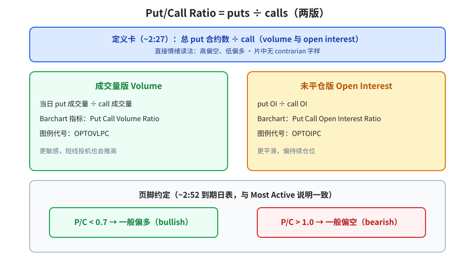
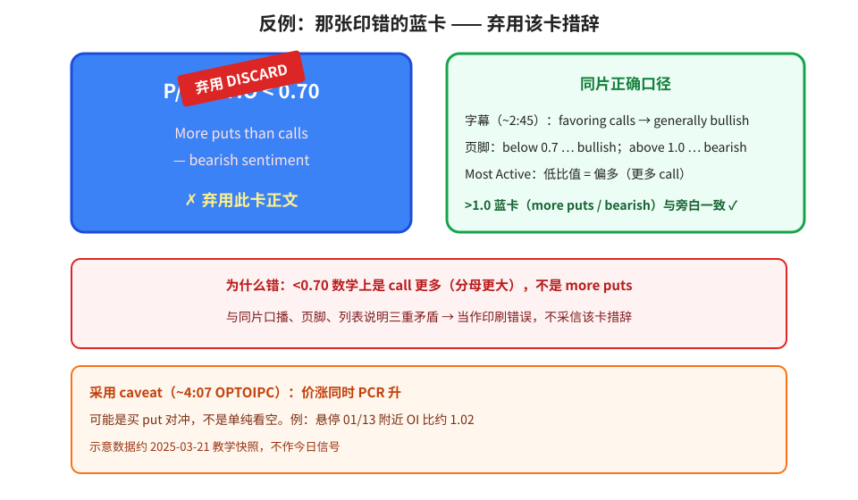
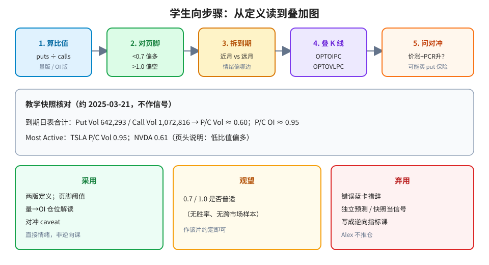

> 学习笔记：Barchart 视频，已看完 4:59/4:59；以画面为准。片头有投资决策免责声明。示意数据约 **2025-03-21** 教学快照，不作今日实盘信号。

## 1. 定义：puts ÷ calls，成交量版与 OI 版

定义卡（~2:27）：把 put 总数 ÷ call（**volume 与 open interest**）。图上可见蓝价线、绿 Volume Ratio、红 OI Ratio。

片中是**直接**情绪读法：高比值偏空、低比值偏多——**没有**出现单词 *contrarian*，不要把它写成逆向指标课。

**读图**
- 绿框：成交量版 → Barchart **Put Call Volume Ratio**（图例 **OPTOVLPC**），更敏感。
- 黄框：未平仓版 → **Put Call Open Interest Ratio**（**OPTOIPC**），更平滑。
- 页脚（到期日表 ~2:52）与 Most Active 说明一致：**&lt; 0.7 bullish**，**&gt; 1.0 bearish**。
- **&gt;1.0** 蓝卡正文「more puts — bearish」与旁白一致（✓）；下一节专门弃用 **&lt;0.70** 那张印错的卡。

## 2. 反例：&lt;0.70 蓝卡正文写反了 —— 弃用

约 2:41–2:45：蓝卡标题 **P/C RATIO &lt; 0.70**，正文却印着 *More puts than calls — bearish sentiment*。同帧字幕说 favoring calls → **generally bullish**；页脚与 Most Active 说明也是低比值偏多。

数学上 &lt;0.70 是 call 更多（分母更大），不可能是「more puts」。三重矛盾 → **弃用该卡措辞**，以口播 + 页脚 + 列表说明为准。

**读图**
- 左蓝卡照抄错误正文，盖「弃用」章。
- 右绿框：同片正确口径（字幕 / 页脚 / Most Active / &gt;1.0 卡）。
- 红框：为何错。
- 橙框：采用 caveat——价涨同时 PCR 升，可能是买 put 对冲（~4:07，OPTOIPC 例约 1.02），不是单纯看空。

## 3. 怎么读：拆到期、叠图、问对冲

Most Active Options（标注约 Sat Mar 22, 2025 / Time 03/21/25）：页头写明高 P/C Vol=偏空、低=偏多。教学例：**TSLA** P/C Vol **0.95**；**NVDA** **0.61**（示意，不作信号）。

到期日表合计（~2:52）：Put Vol **642,293** / Call Vol **1,072,816** → P/C Vol **0.60**；P/C OI **0.95**。可按到期拆开看情绪偏近月还是远月。

Volume vs OI（~2:14 一带）：高成交若沉淀成高 OI → 更像持续仓位；高成交但 OI 低 → 更像短线投机或平仓。

叠加到 K 线（~3:42–4:14）：Add Indicator 搜 *put call* → 上述两个指标名。OPTOIPC 例：12/20 约 **0.96**；01/13 约 **1.02**（价升时 PCR 升 → 对冲 caveat）；03/21 约 **0.88**。

**读图**
- 五步：算比值 → 对页脚阈值 → 拆到期 → 叠 OPTOIPC/OPTOVLPC → 问「价涨+PCR升是否对冲」。
- 灰框教学快照数字仅供核对画面，不作信号。
- 三色判断框与文末表一致。

（笔者补充，非片中）业界常有人把极端 PCR 当**逆向**情绪；**本片没教这一套**。若提逆向，必须标其他来源。

## 4. 采用 / 观望 / 弃用

| 内容 | 判断 | 理由 |
|---|---|---|
| PCR = puts÷calls；分 volume / OI 两版 | 采用（概念） | 定义卡清楚 |
| 页脚/列表：&gt;1.0 偏空、&lt;0.7 偏多（**直接**情绪读法） | 采用（片中约定） | 与 Most Active、&gt;1.0 卡、口播一致 |
| 高量→高 OI vs 高量低 OI；按到期拆开 | 采用（概念框架） | ~2:14/~2:52 |
| 价涨+PCR 升可能是对冲 | 采用（caveat） | ~4:07 字幕明确 |
| 0.7 / 1.0 是否普适到所有市场 | 观望 | 无胜率、无跨样本 |
| `&lt;0.70` 蓝卡正文「more puts / bearish」 | **弃用** | 与同片口播、页脚、列表矛盾 |
| 把 PCR 当独立预测器 / 表内数字当信号 / 写成逆向课 / 片尾课 | 弃用 | Alex 不推仓；教学快照；画面无 contrarian |

## 参考

- Barchart, *How to Use the Put/Call Ratio to Predict Market Moves*：https://www.youtube.com/watch?v=H3J4zC1FUVw —— 0:40 Disclaimer；0:57–1:12 Most Active（TSLA 0.95 / NVDA 0.61）；2:27 定义卡；2:31 **&gt;1.0** 卡；2:41–2:45 **&lt;0.70 错误蓝卡**；2:52 到期日表与页脚；3:45 Add Indicator；3:51–4:14 OPTOIPC 与对冲 caveat；4:29 双指标；4:59 结束。片长 **4:59**。

仅供学习，不构成投资建议。
