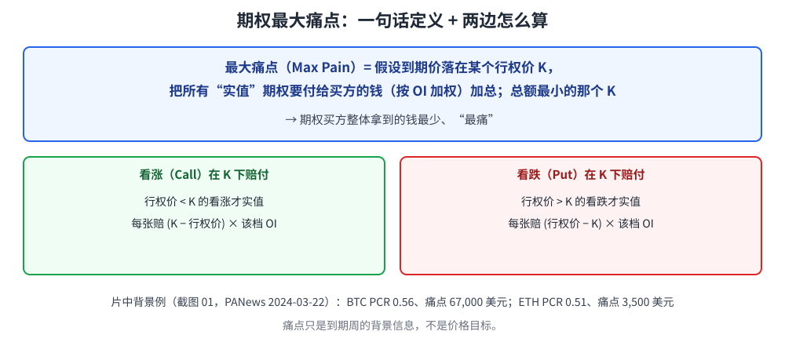
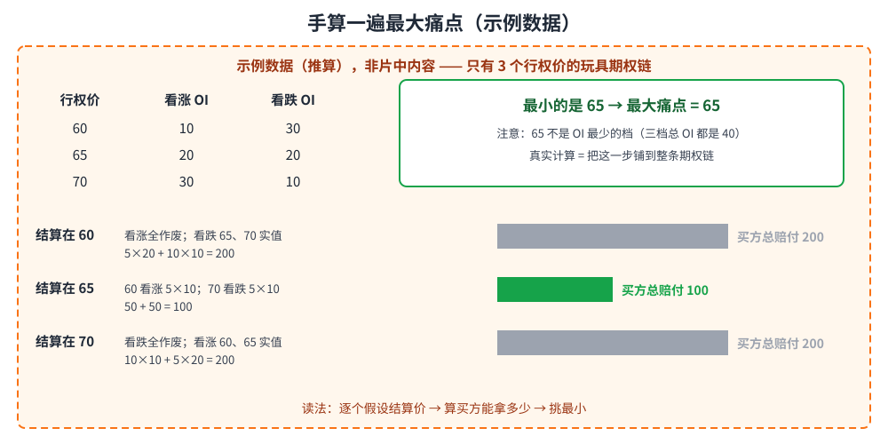
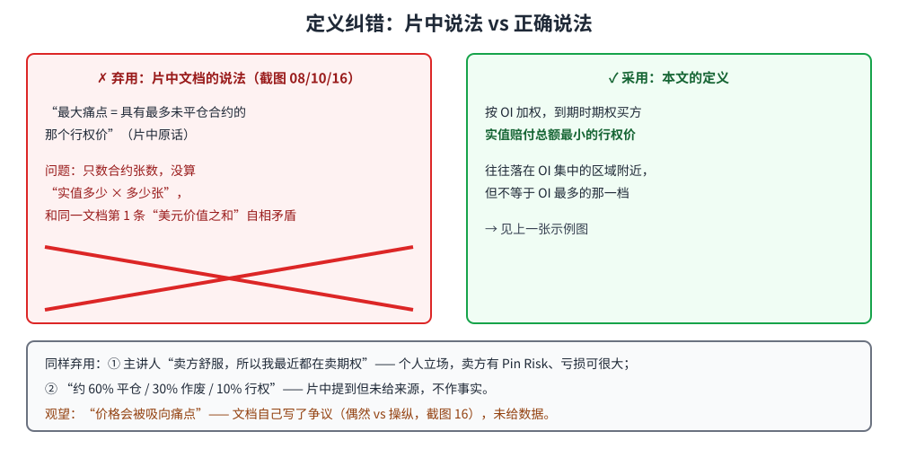
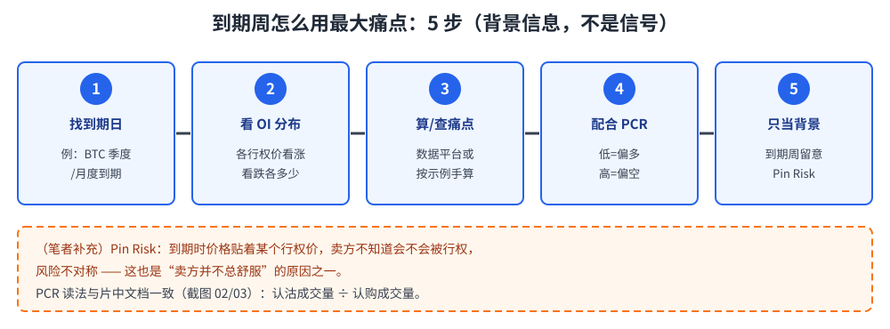

> 学习笔记：来源为 B 站「高朋8分钟区块链」《期权的最大痛点价格是怎么回事（期权课8）》（13:33）。文中标（笔者补充）/（推算）的内容不是片中原话。仅供学习，不构成投资建议。

## 1. 从一条新闻说起

片中开头（0:26）引用 PANews 2024-03-22 的消息：约 2.5 万张 BTC 期权、25 万张 ETH 期权即将到期，名义价值约 25.9 亿美元；**BTC 期权 PCR 0.56、最大痛点 67,000 美元；ETH 期权 PCR 0.51、最大痛点 3,500 美元**。

新闻里的“最大痛点”到底是什么？

## 2. 定义：买方赔付最少的那个价

**最大痛点（Max Pain）**：按未平仓量（OI）加权，假设到期结算在某个行权价，把所有实值期权要付给买方的钱加起来；**总额最小**的那个行权价就是最大痛点。片中文档的计算描述也是“把实值行权价看涨、看跌未平仓合约的美元价值相加”。

**读图**
- 看涨只在结算价高于行权价时实值，看跌相反。
- “痛”指期权**买方**整体拿到的钱最少。
- PCR（认沽成交量 ÷ 认购成交量）是另一个指标，片中文档读法：低偏多、高偏空。

## 3. 手算一遍

> 下面是**示例数据（推算），非片中内容**。片中没有给出带数字的计算示例。

**读图**
- 三个行权价 60/65/70，逐个假设结算价，算买方能拿多少：200 / 100 / 200。
- 最小的是 65，所以最大痛点 = 65。
- 三档总 OI 都是 40，可见痛点跟“哪档合约最少”无关。

## 4. 纠错：片中的定义说错了

片中飞书文档 2.2 第 2 条和“主要要点”（截图 4:51、6:13、10:04）把最大痛点说成“具有**最多**未平仓合约的行权价”。这个说法不对：最大痛点看的是**按 OI 加权后，期权买方实值赔付总额最小**的行权价。它常落在 OI 集中的区域附近，但不等于“OI 最多的那一档”，只数张数、不算“实值多少 × 多少张”是挑不出来的。同一份文档第 1 条“美元价值之和”的说法才是对的。

**读图**
- 左边红框是弃用的说法，右边绿框是本文采用的定义。
- 底部灰框：主讲人“卖方舒服所以卖期权”的结论和 60/30/10 统计都不作依据。

## 5. 价格真会被“吸”过去吗？

片中文档（10:04）自己写了：最大痛点理论**备受争议**，一派认为价格靠近痛点是偶然，一派认为是市场操纵。文档还提到“约 60% 期权被平仓、30% 作废到期、10% 被行权”——**片中提到但未给来源，不作事实**。

所以“价格会趋向痛点”只能观望，要自己拿历史到期数据验证。

**读图**
- 痛点是到期周的背景信息，配合 OI 分布和 PCR 一起看。
- 虚线橙框为笔者补充：到期价贴着行权价时卖方有 Pin Risk，“卖方很舒服”并不成立。

## 采用 / 观望 / 弃用

| 判断 | 内容 |
|---|---|
| 采用 | 最大痛点定义（按 OI 加权的买方实值赔付总额最小）；计算思路；作为到期周背景信息，与 PCR、OI 分布一起看 |
| 观望 | “价格会被吸向最大痛点”（片中自己承认有争议，无数据） |
| 弃用 | 片中按“未平仓合约数量”定义的说法；主讲人“卖方舒服所以卖期权”的结论；60/30/10 统计（片中提到但未给来源，不作事实） |

## 参考来源

- 高朋8分钟区块链《期权的最大痛点价格是怎么回事（期权课8）》，B 站，时长 13:33：https://www.bilibili.com/video/BV1Ei421978A
  - 0:26 PANews 新闻（PCR、痛点数字）；2:06–2:34 PCR 解释；4:51–6:13 计算与定义；10:04 争议与 60/30/10 段落
  - 说明：笔者看到 13:29；**最后约 18 秒（13:15–13:33）只看到一部分**（被自动连播切走后重开）。
- 手算示例为笔者构造的示例数据。

**仅供学习，不构成投资建议。**
