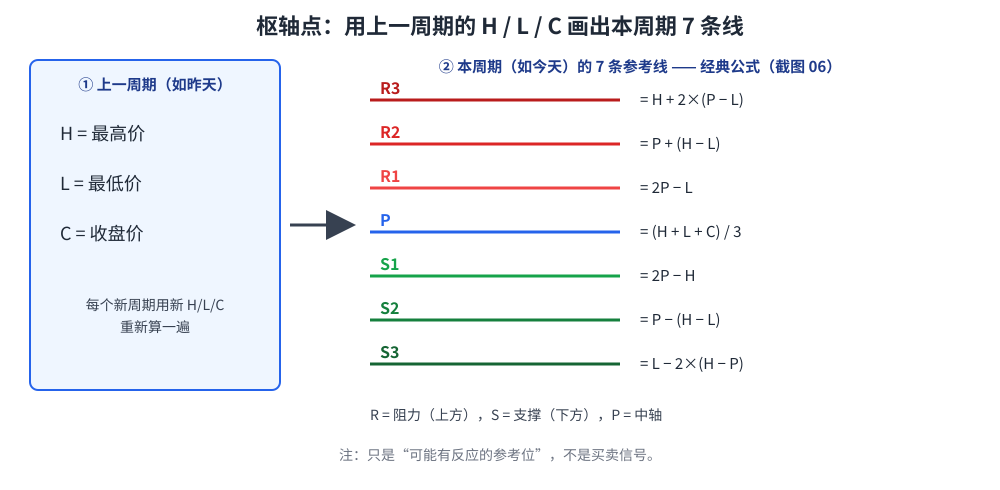
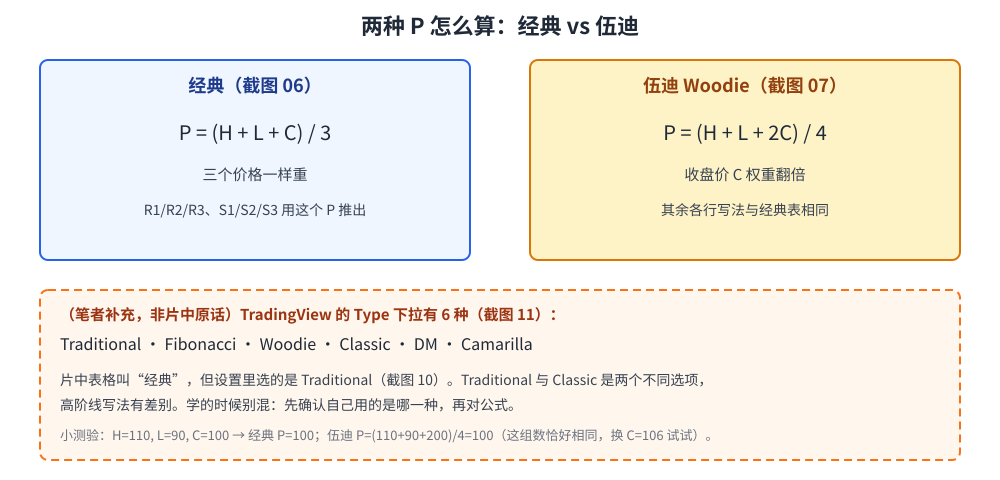
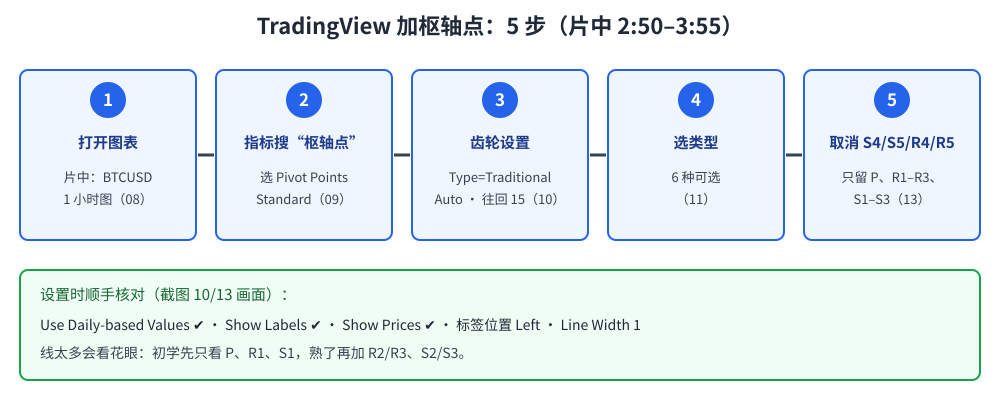
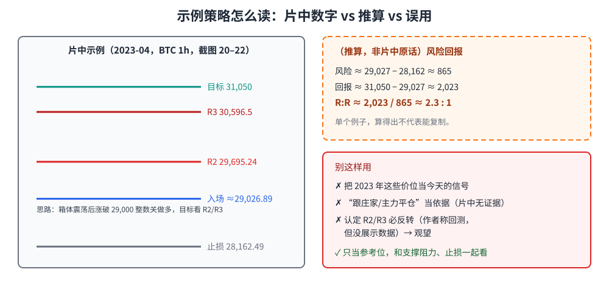

> 学习笔记：来源为 B 站「浩哥涨涨」《Pivot Point 枢轴点交易法》（6:45）。文中标（笔者补充）/（推算）的内容不是片中原话。仅供学习，不构成投资建议。

## 1. 枢轴点是什么？

枢轴点（Pivot Points）是一组**用上一周期最高价 H、最低价 L、收盘价 C 算出来的水平线**：中间一条 P，上面三条阻力 R1–R3，下面三条支撑 S1–S3。每到新周期就用新的 H/L/C 重新算一遍。片中提到它常被日内交易者使用。

**读图**
- 左边是“原料”：上一周期的 H、L、C 三个数。
- 右边是“成品”：7 条线，公式取自片中「经典枢轴点计算方法」表（2:14）。
- 这些线只是“价格可能有反应”的参考位，不是买卖信号。

## 2. 公式：经典 vs 伍迪

片中给了两张公式表：

| 关键点 | 经典（2:14） |
|---|---|
| R3 | H + 2×(P − L) |
| R2 | P + (H − L) = P + (R1 − S1) |
| R1 | 2P − L |
| **P** | **(H + L + C) / 3** |
| S1 | 2P − H |
| S2 | P − (H − L) = P − (R1 − S1) |
| S3 | L − 2×(H − P) |

伍迪（Woodie，2:35）：其余行与经典相同，只是 **P = (H + L + 2C) / 4**，收盘价权重更大。

**读图**
- 两种方法唯一的区别在 P 的算法；P 变了，R/S 跟着变。
- 虚线橙框是笔者补充：TradingView 的 Traditional 和 Classic 是两个不同选项，片中表格叫“经典”，设置里选的却是 Traditional，学的时候别混。
- 小测验的数字是笔者举例，不是片中数字。

## 3. 在 TradingView 里加上枢轴点

片中 2:50–3:55 的操作：

**读图**
- 指标搜「枢轴点」，选「Pivot Points Standard」，可以点星收藏。
- 设置框里的默认值：Type = Traditional、Pivots Timeframe = Auto、往回 15 组、勾选 Use Daily-based Values。
- Type 下拉里有 6 种：Traditional / Fibonacci / Woodie / Classic / DM / Camarilla（片中没讲后几种的公式）。
- 为了让图干净，把 S4/S5/R4/R5 取消，只留 P、R1–R3、S1–S3。

## 4. 片中的交易思路，以及该怎么看

- 片中 BTC 2023-02 的例子：价格碰到 R3（约 24,988）受阻，回落途中经过的枢轴线也起过支撑/阻力作用。
- 作者说“通过大量回测，反转常出现在 R2 或 R3”（5:10），但**画面里没展示回测数据** → 观望。
- 作者用“大资金、庄家平仓导致反转，跟随主力思维”来解释（5:25）→ 没有证据，**弃用**。
- 示例：箱体震荡后涨破 29,000 整数关做多，目标看 R2、R3。

**读图**
- 左边价位都来自画面（截图 20–22）：入场约 29,026.89、止损 28,162.49、目标 31,050，R2 29,695.24、R3 30,596.5。
- 右上虚线橙框是（推算）：R:R 约 2.3:1，片中没这么说。
- 这是 2023 年的单个例子，这些价位**不是**今天的信号。

## 5. 新手练习

1. 拿任意一天的 H/L/C，用经典公式手算 7 条线，再和 TradingView 的 Traditional 对一下。
2. 记录 20 次价格碰到 R2/R3 后的走势，自己验证“容易反转”是不是真的。

## 采用 / 观望 / 弃用

| 判断 | 内容 |
|---|---|
| 采用 | 枢轴点定义；经典 / 伍迪公式；把 P/R/S 当日内参考位；只留 R1–R3、S1–S3 让图干净 |
| 观望 | “R2/R3 容易反转”（未见回测数据）；突破 29,000 做多看 R2/R3 的示例策略（单个例子；R:R 2.3:1 为推算） |
| 弃用 | “跟庄家/主力”叙事当依据；拿片中 2023 年价位当信号 |

## 参考来源

- 浩哥涨涨《苦于找不准支撑阻力？Pivot Point 枢轴点交易法》，B 站，时长 6:45：https://www.bilibili.com/video/BV1au4y1k79w
  - 2:14 经典公式表；2:35 伍迪公式；3:15–3:55 TradingView 设置；4:10–4:55 R3 受阻示例；5:10–5:25 反转说法；5:40–6:10 BTC 突破示例
- 片中金价图、BTC 图清晰度低，部分价位为近似，本文只引用画面清楚的数字。

**仅供学习，不构成投资建议。**
