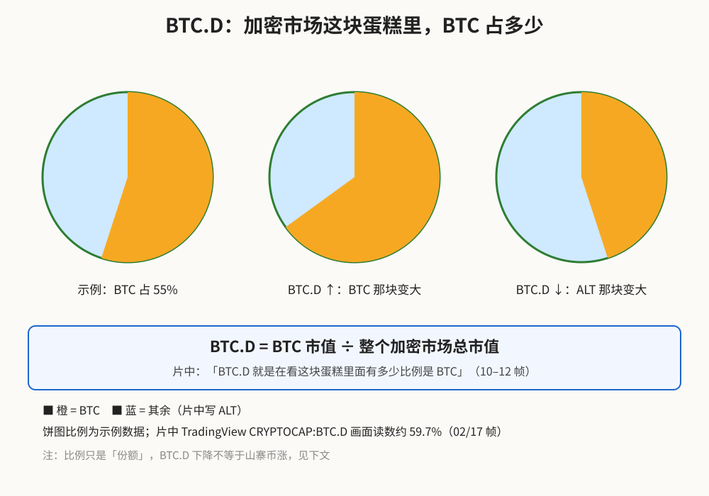
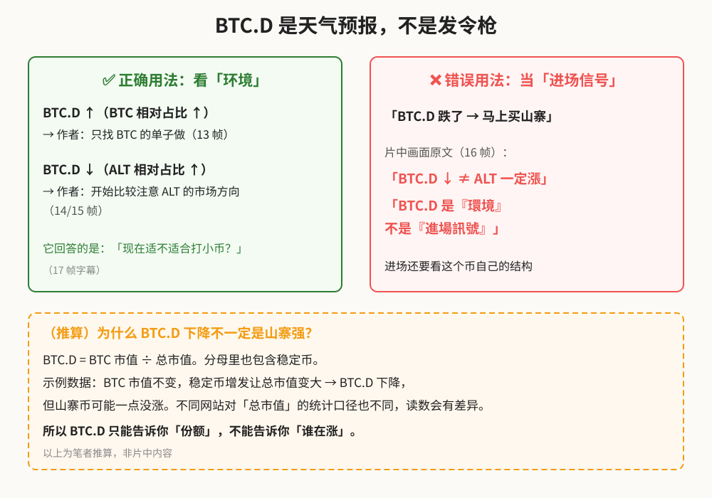
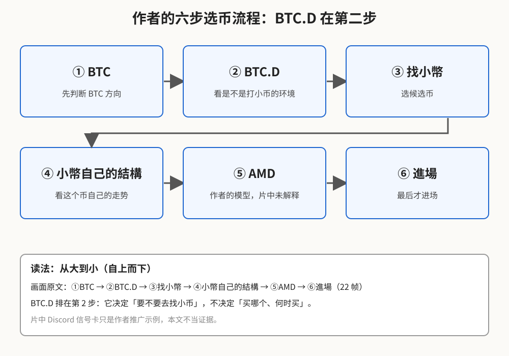
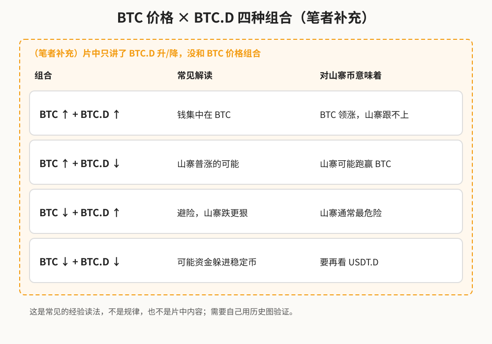

> 学习笔记：AMD_Trader_M《【找小幣 EP1】找小幣第一步，不是看排行榜，是先看 BTC｜BTC 偏見 + BTC.D》（B 站，4:16）。这不是专门的 BTC.D 教程，BTC.D 部分约在 1:20–3:00。凡是「（笔者补充）」「（推算）」都不是片中原话。**仅供学习，不构成投资建议。**

## 一、为什么做山寨币前要先看 BTC？

片头就列出三个错误做法：「❌直接找小幣 ❌看哪顆漲很多 ❌隨便挑一顆做」，标题是「選幣先看BTC」（0:04）。作者的理由是：BTC 偏空时，其他小币可能被带着一起跌（0:41）；但他也反问「BTC 偏空，那是不是所有小幣都可以空？」——答案不是，所以还要看「市场对小币的环境」，这时就用到 BTC.D（1:14–1:21）。

## 二、BTC.D 是什么？一块蛋糕

**读图**
- BTC.D（Bitcoin Dominance，比特币市占率）= BTC 市值 ÷ 整个加密市场总市值。
- 片中在 TradingView 上画了一个圆圈当「加密市場」，用一条红线分成 BTC / ALT 两块；BTC 强势就分到更大一块；字幕：「BTC.D 就是在看这块蛋糕里面有多少比例是 BTC」（1:35–1:55）。
- 三个饼图的比例是示例数据。片中真实读数：TradingView `CRYPTOCAP:BTC.D` 画面显示约 59.7%（0:20 的 4 小时图 59.67%，2:52 的 5 分钟图 59.71%）。

## 三、片中读法：环境，不是信号

**读图**
- 绿框：BTC.D ↑（BTC 相对占比 ↑），作者「只找 BTC 的单子去做」（2:11）；BTC.D ↓（ALT 相对占比 ↑），作者「开始比较注意 ALT 的市场方向」（2:17–2:27）。
- 红框是本片最重要的一句，画面原文（2:42）：「BTC.D ↓ ≠ ALT 一定漲」「BTC.D 是『環境』不是『進場訊號』」。
- 橙色虚线框是（推算）：分母里有稳定币，稳定币增发也会让 BTC.D 下降，这和山寨强不强无关；不同网站的统计口径不同，读数也会不同。以示例数据说明，非片中内容。

## 四、作者的六步流程

**读图**
- 画面原文（3:44）：① BTC → ② BTC.D → ③ 找小幣 → ④ 小幣自己的結構 → ⑤ AMD → ⑥ 進場。
- BTC.D 只占第 2 步：决定「要不要去找小币」，不决定「买哪个、何时买」。
- 「AMD」是作者自己的模型，片中没解释，本文不展开。
- 片中 3:14 之后的 Discord 信号卡是作者频道的示例，本文不把它当证据。

## 五、（笔者补充）把 BTC 价格也加进来

片中只讲了 BTC.D 的升和降，没有和 BTC 价格放在一起看。一个常见的经验读法是四种组合：

**读图**
- 整张图都是（笔者补充），不是片中内容，也不是铁律。
- BTC 跌 + BTC.D 涨，通常对山寨最不友好；BTC 跌 + BTC.D 也跌，可能是资金躲进稳定币，要再看 USDT.D。
- 先拿历史图自己验证，再决定要不要用。

## 采用 / 观望 / 弃用

| 判断 | 内容 | 理由 |
|---|---|---|
| 采用 | BTC.D 的定义；「环境、不是进场信号」的定位；做山寨前先看 BTC 方向和 BTC.D 的自上而下流程 | 片中画面原文清楚，逻辑简单 |
| 观望 | 「BTC.D 上升只做 BTC」这条硬规则 | 没给周期、阈值，也没区分 BTC 跌时的情况 |
| 弃用 | 把作者 Discord 机器人信号当参考 | 小字看不清、没有统计，带频道推广 |

## 参考来源

- AMD_Trader_M《【找小幣 EP1】找小幣第一步，不是看排行榜，是先看 BTC｜BTC 偏見 + BTC.D》：https://www.bilibili.com/video/BV1pQhT6zEHD/ （时长 4:16，已看完）
- 未截帧、只靠前后字幕的时段：0:00–0:04、0:57–1:01、1:55–2:11、3:36–3:44、约 4:00–4:14，本文没有引用这些时段的独有内容。
- 片中没有公式、市占率阈值或山寨季结论；本文的公式写法和四种组合是笔者补充。

*仅供学习，不构成投资建议。*
