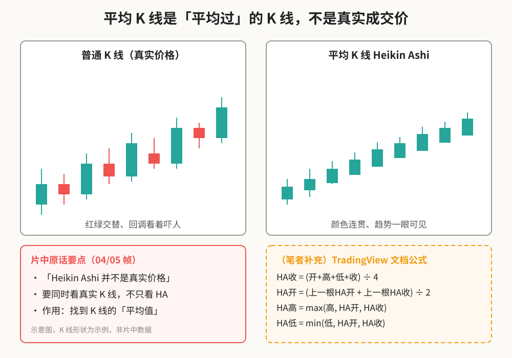
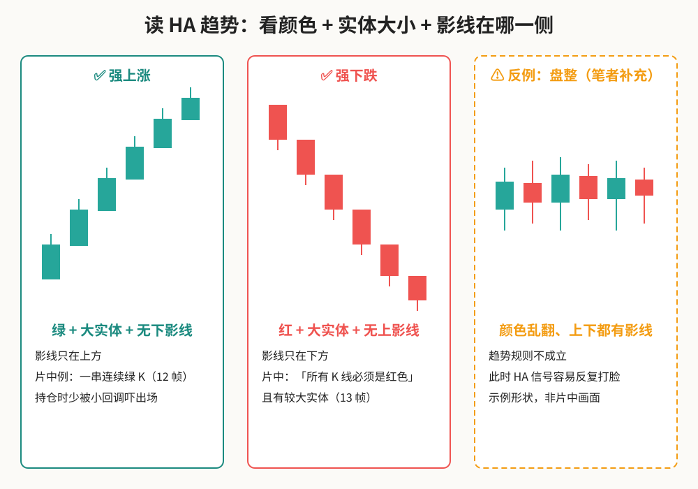
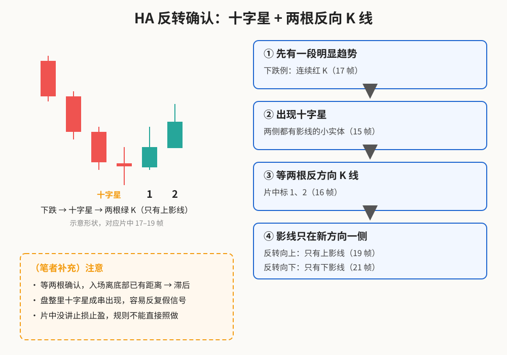
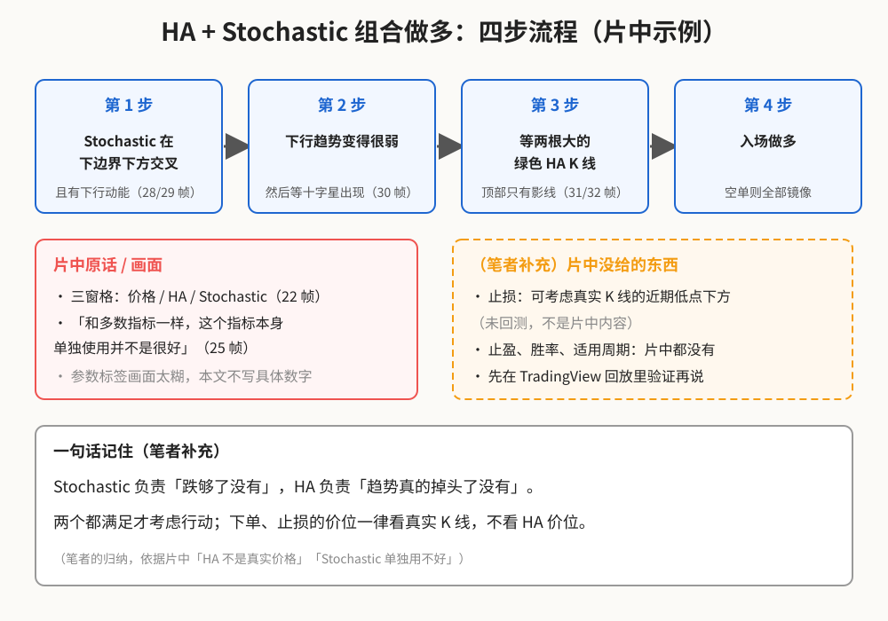

> 学习笔记：TradingLab《平均 K 线图（Heikin Ashi）比传统K线图好用100倍》（B 站搬运，6:03）。只写片中画面和字幕里出现的内容；凡是「（笔者补充）」「（推算）」都不是片中原话。**仅供学习，不构成投资建议。**

## 一、Heikin Ashi 是什么？

Heikin Ashi（日语「平均足」，常译作平均 K 线）是把普通 K 线「平均」一下画出来的图。片中字幕说它的作用是「找到 K 线的平均值」（0:34），并在 0:45 明确提醒：**「Heikin Ashi 并不是真实价格」**；0:50 又说要同时看真实 K 线，而不是只看 HA。

**读图**
- 左边是普通 K 线：同一段上涨里红绿交替，小回调看着吓人；右边 HA 颜色连贯，趋势一眼可见（对应片中 03 帧左右对比图）。
- 红框是片中原话：HA 不是真实成交价，要和普通 K 线一起看。
- 橙色虚线框是（笔者补充）的公式，片中没讲，取自 TradingView 帮助文档。因为 HA 的开盘取「上一根 HA 实体的中点」，所以 HA 图上几乎不会出现跳空缺口。
- 图中 K 线形状是示例，不是片中数据。

片中在 TradingView 里演示了用法：ETHUSD 15 分钟图，在 Indicators 里搜 Heikin Ashi，加到普通 K 线下面的窗格，上下对照（0:59–1:10）。强上涨中几根小红回调「可能会让你恐慌」，而 HA 那一格平滑得多（1:22–1:46）。

## 二、趋势规则：颜色 + 实体 + 影线

**读图**
- 强上涨：绿色、实体大、**没有下影线**（片中 2:07 青色框里一串连续绿 K）。
- 强下跌：片中字幕「所有的 K 线图必须是红色的，并且有较大的 K 线实体」，且没有上影线（2:16）。
- 右边虚线橙框是（笔者补充）的反例：盘整时颜色来回翻、上下都有影线，趋势规则就不成立了。

## 三、反转规则：十字星 + 两根反向 K 线

**读图**
- 片中十字星的定义是「两侧都有影线的 K 线」（2:42）。
- 出现十字星后，「等待两个相反方向的 K 线」，画面上标了 1、2（2:57）。
- 下跌例：底部出现十字星，接着两根绿 K「只有上影线出现以确认反转」（3:04–3:18）；上涨例镜像：十字星后两根「只有下影线」的红 K（3:34–3:42）。
- 橙框是（笔者补充）：要等两根确认，入场时往往已离底部一段距离；震荡里十字星会成串出现。

## 四、加一个过滤器：HA + Stochastic

片中从 3:50 开始加了随机指标 Stochastic（价格 / HA / Stoch 三个窗格），并坦白说「和多数指标一样，尽管这个指标本身单独使用并不是很好」（4:32）。

**读图**
- 第 1 步：Stochastic 两条线在下边界下方交叉，并且有下行动能（5:08）。
- 第 2 步：下行趋势变得很弱，然后等十字星（5:17）。
- 第 3 步：等两根大的绿色 HA K 线，顶部只有影线（5:26–5:35）。
- 第 4 步：入场做多；空单把以上全部镜像。
- 画面上的 Stochastic 参数标签很糊，本文不写具体参数。
- 「一句话记住」和止损思路都是（笔者补充），片中没有止损、止盈和胜率。

## 五、缺点与提醒（笔者补充）

- **滞后**：HA 本身是平均值，反转又要等两根确认，信号天然慢半拍。
- **盘整失灵**：没趋势时颜色乱翻，规则会反复打脸。
- **没有缺口、不是真实价格**：挂单、止损要看普通 K 线的价位。
- **标题党**：「好用 100 倍」片中没有任何数据支撑。

## 采用 / 观望 / 弃用

| 判断 | 内容 | 理由 |
|---|---|---|
| 采用 | 把 HA 当「趋势还在不在」的辅助视图（颜色 + 影线位置） | 持仓时少被小回调吓出场；下单看真实价格 |
| 观望 | 十字星 + 两根反向 K 线的反转规则；HA + Stochastic 组合入场 | 片中没有止损止盈、没有回测，需自己在 TradingView 回放里验证 |
| 弃用 | 「比传统 K 线好用 100 倍」；用 HA 价位直接设止损或挂单 | 无数据支撑；HA 不是真实价格 |

## 参考来源

- TradingLab《平均 K 线图（Heikin Ashi）比传统K线图好用100倍》，B 站搬运：https://www.bilibili.com/video/BV1HDkUYHErr/ （时长 6:03，已看到 6:02 片尾；文中时间戳约 ±2 秒）
- 未逐句核对的部分：0:00–0:25 片头、2:08–2:25、4:06–4:22、5:44–6:02 的口播，本文没有引用这些时段的内容。
- HA 公式：TradingView 帮助中心 Heikin Ashi 说明（笔者补充，非片中内容）。

*仅供学习，不构成投资建议。*
