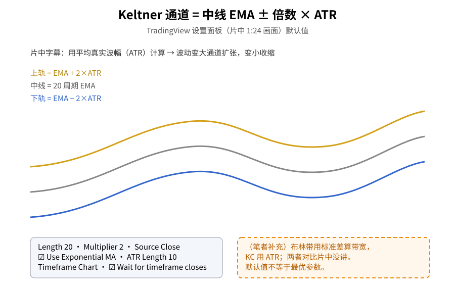
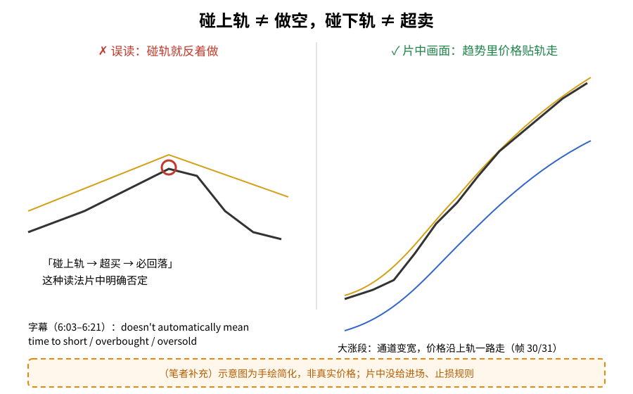
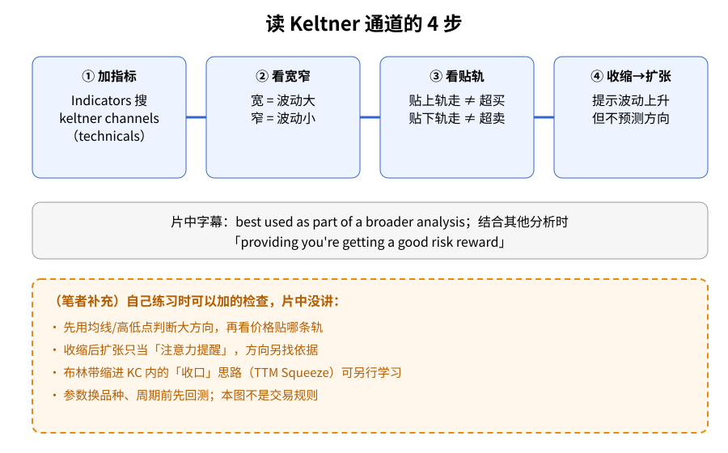

> 学习笔记：TradingView 官方《Keltner Channels: How to Spot Trends & Volatility》（YouTube，10:20）。正文只写片中画面和字幕里出现的内容；凡标「（笔者补充）」「（推算）」的都不是片中原话。**仅供学习，不构成投资建议。**

## 一、先认识它：三条线 + 一片填充

第一次接触 Keltner 通道（简称 KC），可以把它想成「给价格套上的一条有弹性的跑道」：

- **中线**：一条均线（TradingView 默认是 20 周期的指数均线 EMA）；
- **上轨 / 下轨**：中线往上、往下各加减「倍数 × ATR」。ATR（平均真实波幅）衡量的是「最近一根 K 线平均上下晃多少」。

片中演示用的是黄金期货日线（GC1!，COMEX）：在指标对话框搜「keltner channels」，从 technicals 里点一下，图上就出现三条线和中间的填充。字幕说得很直白：通道用 ATR 计算，**波动变大就扩张，波动变小就收缩**，给你一个波动率的视觉。

**读图**
- 中线是 20 周期 EMA，上下轨 = EMA ± 2 × ATR；面板里 ATR Length 默认 10（片中 1:24 设置面板画面）。
- 通道宽窄完全由 ATR 决定：波动大 → 宽，波动小 → 窄。
- 橙色虚线框是笔者补充：与布林带的对比片中没讲，默认参数也不代表最优。

## 二、设置面板里每一项是干什么的

片中打开设置（约 1:24 起），Inputs 页画面上是：

| 选项 | 画面上的默认值 | 片中说明（字幕/画面） |
|---|---|---|
| Length | 20 | 字幕：更短的长度会让通道反应更快 |
| Multiplier | 2 | 上下轨离中线几倍 ATR |
| Source | Close | 可换成别的价格来源 |
| Use Exponential MA | ☑ | 取消勾选会换成另一种均线 |
| Bands Style | Average…（文字被截断） | 下拉可改，片中有一帧显示为 Range |
| ATR Length | 10 | ATR 的计算周期 |
| Timeframe | Chart | 可选别的周期 |
| Wait for timeframe closes | ☑ | 字幕：等所选周期那根 K 线收盘才更新 |

Style / Visibility 页只是改颜色和透明度（片中把上轨改黄、中线白、下轨蓝），不影响计算。

## 三、片中最重要的一句：碰轨不等于反转

很多新手第一眼看到通道，会想「碰上轨就卖，碰下轨就买」。片中 6:03–6:21 一连几帧专门否定这一点：字幕说价格碰到上轨「doesn't automatically [mean it's] time to necessarily short or that it's overbought」，碰下轨也「doesn't automatically mean that this is oversold」。

7:21–7:30 的画面就是反例：一段窄通道横盘之后出现一波大涨，**通道明显变宽，价格沿着上轨一路往上走**。如果每次碰上轨就做空，这一段会一直逆势。

**读图**
- 左边是误读：把「碰上轨」直接当成超买、必回落——片中字幕明确说不能自动这么理解。
- 右边对应片中大涨段（帧 30/31）的形态：通道变宽、价格贴着上轨走。
- 两边曲线都是手绘示意，不是真实价格，也不是进出场规则（橙色虚线框）。

## 四、收缩后扩张：波动来了，方向未知

8:30–8:51 字幕讲：通道收缩之后开始扩张，可能代表波动在上升；但紧接着一句「indicator doesn't predict the direction of the breakout by itself」——**指标本身不预测突破方向**。

9:33 起字幕总结：Keltner 通道「best used as part of a broader analysis」。6:42–6:51 也提到可以和别的分析结合，前提是「providing you're getting a good risk reward」。9:51 有一帧在高点附近提到一个做空机会「had a nice invalidation」（失效位清楚），但画面上没有给出入场价、止损和样本数。

**读图**
- 蓝框 ①–④ 是片中出现过的读法顺序：加指标 → 看宽窄 → 看贴轨 → 看收缩后扩张。
- 灰框是片中字幕原话：放进更大的分析里，并看盈亏比。
- 橙色虚线框全是笔者补充（方向过滤、TTM Squeeze 收口、回测），片中没讲。

## 五、（笔者补充）和布林带有什么不同

- 布林带的带宽来自**标准差**，KC 来自 **ATR**。标准差对单根大 K 线更敏感，所以布林带通常伸缩得更剧烈。
- 有一类做法把「布林带缩进 KC 里面」叫收口（TTM Squeeze 思路）。片中完全没讲，这里只作延伸阅读提示，没做回测。
- 在一些趋势跟随方法里，「收在上轨外」反而被当作顺势信号，这和片中「碰上轨≠做空」方向一致，但同样不是片中内容。

## 六、采用 / 观望 / 弃用

| 内容 | 结论 | 理由 |
|---|---|---|
| KC 当波动率/趋势背景图（宽窄、贴轨） | **采用** | 定义清楚，设置画面可核对 |
| 「碰轨≠反转」的读法 | **采用** | 片中字幕明说，大涨段画面可证 |
| 收缩后扩张找突破 | **观望** | 片中明说不给方向，需要另配方向过滤并自行回测 |
| 片中高点做空例子 | **弃用（作为规则）** | 只有一句「失效位清楚」，无入场/止损/样本 |

## 参考来源

- TradingView：[Keltner Channels: How to Spot Trends & Volatility](https://www.youtube.com/watch?v=EFl2yXj4BNU)，时长 10:20，已看完。
- 文中时间戳来自截图文件名，约 ±3 秒（全屏播放时钟被隐藏，后段偏晚）。重点帧：0:30 加指标、0:51–1:03 ATR 扩张收缩、1:24 / 3:00 / 4:15 设置面板、6:03–6:21 碰轨、6:42–6:51 结合分析、7:21–7:30 大涨贴轨、8:30–8:51 收缩扩张、9:33–9:51 总结与做空例子。
- 缺口：画面为连续播放中定时采帧后挑选；均线类型完整列表、「Bands Style」完整文字没截到；片中没有进场、止损、止盈规则和胜率。

> 学习笔记，仅供学习，不构成投资建议。
