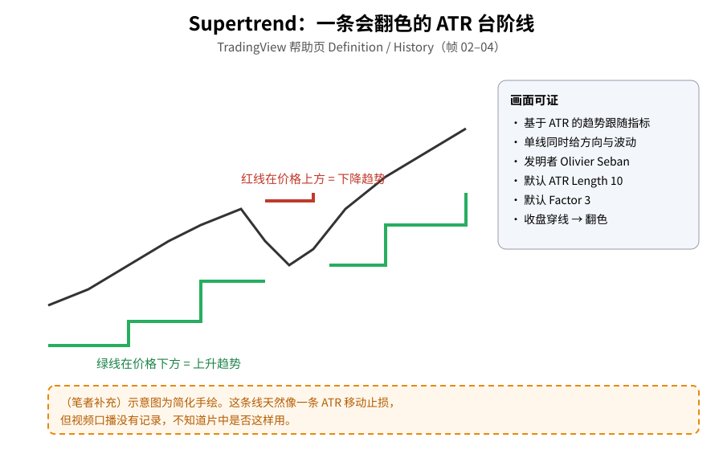
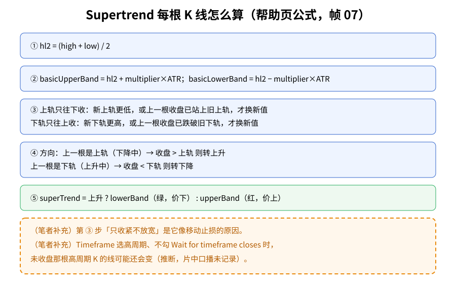
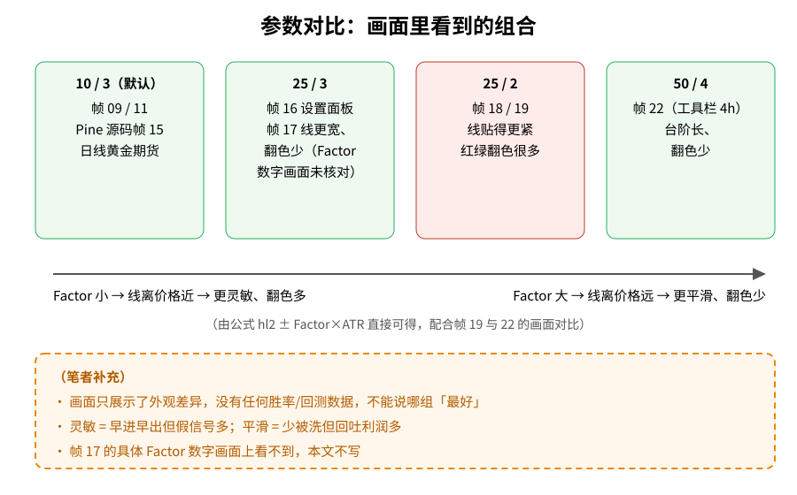

> 学习笔记：TradingView 官方《The SuperTrend Indicator: Tutorial》（YouTube，13:54）。**这次只有画面记录，没有口播/字幕记录**，所以本文只写画面上能看到的内容（帮助页文字、设置面板、Pine 源码、图表形态），不转述视频里讲了什么观点。凡标「（笔者补充）」「（推算）」的都是笔者自己的理解。**仅供学习，不构成投资建议。**

## 一、它长什么样

Supertrend 是一条贴着价格走的「台阶线」，而且会变色：

- **绿色、在价格下方** → 上升趋势；
- **红色、在价格上方** → 下降趋势。

画面上 TradingView 帮助页的 Definition 写着：Supertrend 是基于平均真实波幅（ATR）的趋势跟随指标，单线同时给出趋势方向和波动；History 写着它由 **Olivier Seban** 发明（帧 02–04）。片中把它加在黄金期货日线（GC1!）上，可以看到绿线托在价格下面、红线压在价格上面，中间有浅色填充。



**读图**
- 黑线是价格，绿色台阶在价下 = 上升，红色台阶在价上 = 下降。
- 右侧灰框里每一条都能在帮助页、设置面板或源码画面里找到。
- 「像移动止损」是笔者补充，片中是否这么讲没有记录。

## 二、把公式拆成 5 步

帮助页 Calculations（帧 05–07，07 全尺寸核对）给了完整算法。不用怕，拆开就是：

1. 取每根 K 线的中点 `hl2 = (high + low) / 2`；
2. 上下各推出去 `multiplier × ATR`，得到基础上轨、基础下轨；
3. **上轨只往下收、下轨只往上收**：新的上轨更低才换（或上一根收盘已经站上旧上轨）；下轨同理反过来；
4. 用收盘价判断方向：下降中收盘高于上轨 → 转上升；上升中收盘低于下轨 → 转下降；
5. 上升时画下轨（绿），下降时画上轨（红）。

画面上还写着：ATR 还没算出来之前，trendDirection 默认是 isDownTrend。



**读图**
- 蓝框 ①–④、绿框 ⑤ 逐条对应帮助页公式（帧 07）。
- 第 ③ 步决定了线「只收紧不放宽」，所以它是一级一级的台阶。
- 橙色虚线框是笔者补充：止损联想、以及不勾「Wait for timeframe closes」时可能变动（推断）。

## 三、默认参数与 Pine 源码

设置面板 Inputs（帧 09、11）：**ATR Length 10、Factor 3**、Timeframe Chart、☑ Wait for timeframe closes。Style 页可以改 Up Trend / Down Trend / Body Middle 和背景填充颜色。

Pine 源码（帧 15，全尺寸核对）和面板一致：

```pine
atrPeriod = input.int(10,    "ATR Length", minval = 1)
factor =    input.float(3.0, "Factor",     minval = 0.01, step = 0.01)
[supertrend, direction] = ta.supertrend(factor, atrPeriod)
```

`direction < 0` 时画绿色「Up Trend」，`> 0` 时画红色「Down Trend」。

## 四、参数换一换，线会怎么变

画面里依次出现过这些组合：

- **25 / 3**（帧 16 面板）；
- 一张线明显更宽、翻色更少的日线图（帧 17）——**画面上看不到具体 Factor 数值，未核对，本文不写这个数字**；
- **25 / 2**（帧 18/19）：线贴价格更紧，红绿来回翻很多次；
- 工具栏切到 4h 后 **50 / 4**（帧 21/22）：台阶更长，翻色少。



**读图**
- 四个框只列画面里出现过的组合和对应帧号；红框（25/2）是翻色最多的一组。
- 下方箭头由公式直接推出：Factor 越小线离价格越近、越灵敏。
- 橙色虚线框：画面没有任何胜率数据，不能说哪组最好；帧 17 的数字不写。

（笔者补充）灵敏和平滑是一对取舍：灵敏的参数早进早出，但横盘时会被反复「打脸」；平滑的参数少被洗，但趋势结束时回吐更多。

## 五、把日线 Supertrend 叠到小周期图上

帧 24、25：在 1h 图上把 Timeframe 设为「1 day」，且**没有勾选** Wait for timeframe closes（面板同时显示 ATR 50 / Factor 4），图上出现的就是日线级别的 Supertrend。帧 26 又把同样设置放到周线图上。

- （推算）一种常见用法是只做与日线 Supertrend 同色的方向，用它过滤 1h 信号。画面只演示了「怎么叠」，没有记录片中是否这样建议。
- （笔者补充）不勾 Wait for timeframe closes 时，当天日线还没收盘，叠加的那段线可能还会变动；回看历史图时要小心这种「看起来很准」的错觉。

## 六、采用 / 观望 / 弃用

| 内容 | 结论 | 理由 |
|---|---|---|
| 定义、公式、默认参数 10/3 | **采用** | 帮助页公式与 Pine 源码画面可核对 |
| 当趋势方向/移动止损参考线 | **观望** | 结构合理，但口播未记录、无回测 |
| 参数组合（25/3、25/2、50/4） | **观望** | 只有画面对比，没有绩效数据 |
| 高周期叠加到低周期 | **观望** | 只看到演示操作；注意未收盘时的变动 |
| 「翻色即进场」的机械规则 | **弃用（暂）** | 画面里没看到这类规则，横盘假信号多 |

## 参考来源

- TradingView：[The SuperTrend Indicator: Tutorial](https://www.youtube.com/watch?v=cwl88klshU8)，时长 13:54，播放到片尾。
- 时间戳为暂停时读取的播放器时间：0:16 搜索指标、0:54–1:40 帮助页定义与图表、2:34–4:05 公式、4:23–5:51 设置面板、8:14 Pine 源码、8:32–10:03 参数对比、10:41–11:42 4h 图、12:18–13:24 高周期叠加。
- 未完整记录的部分：**全片口播/字幕没有记录**；暂停之间的短段画面没截；13:24–13:54 只看未截图；帧 17 的 Factor 数值未核对。

> 学习笔记，仅供学习，不构成投资建议。
