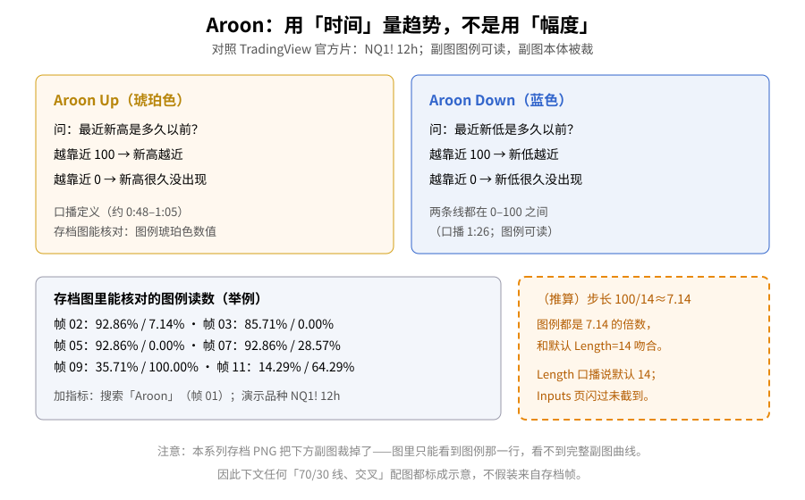
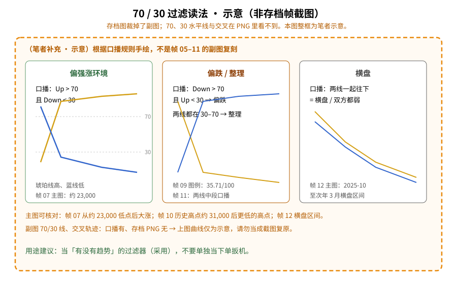
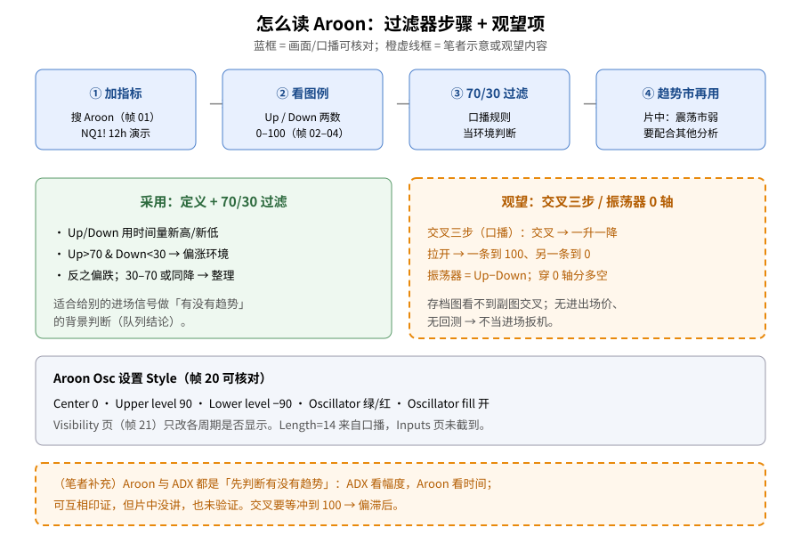

> 学习笔记：TradingView 官方《Aroon Indicator: Identify Trend Changes》（YouTube，7:48）。正文只写片中画面和字幕里出现的内容；凡标「（笔者补充）」「（推算）」「示意」的都不是存档截图的复原。**重要限制**：本批存档 PNG 把下方 Aroon 副图裁掉了，帧里通常只能看到图例那一行（如「Aroon 92.86% 28.57%」），**看不到** 70/30 水平线、两线交叉或振荡器红绿填充；文中凡涉及这些结构的配图一律标成示意。**仅供学习，不构成投资建议。**

## 一、它量的是「多久以前」创新高/新低

第一次接触 Aroon（阿隆），可以把它和「涨了多少」区分开：它问的是**时间**——在默认回看期里，最近一次新高/新低发生在多久以前。两条线都在 **0–100** 之间。

片中演示：TradingView 打开 **NQ1!**（纳斯达克 100 E-mini）**12 小时**图，指标搜索「Aroon」（0:17，帧 01），Technicals 下有 **Aroon** 和 **Aroon Oscillator**。加上后，图例会出现类似 `92.86%` / `7.14%` 的读数（帧 02）。

口播（约 0:48–1:26）：

- **Aroon Up（琥珀色）**：多久前创了新高；越靠近 100，新高越近；
- **Aroon Down（蓝色）**：多久前创了新低；越靠近 100，新低越近；
- 靠近 0 = 新高/新低已经很久没出现。

**读图**
- 左琥珀框 / 右蓝框对应口播定义；颜色与片中图例一致（Up 琥珀、Down 蓝）。
- 左下灰框列出存档图**能核对**的图例读数（帧 02/03/05/07/09/11），不声称副图曲线可见。
- 右下橙虚线框是推算：读数都是 100/14≈7.14 的倍数，与默认 Length 14 吻合；Inputs 页闪过未截到，14 来自口播。

## 二、70 / 30：当「有没有趋势」的过滤器

口播规则（约 1:43–3:53）：

| 条件（口播） | 读法 |
|---|---|
| Up &gt; 70 且 Down &lt; 30 | 偏强上升趋势环境 |
| Down &gt; 70 且 Up &lt; 30 | 可能下跌环境 |
| 两线都在 30–70 | 整理、方向不清 |
| 两线一起往下 | 横盘，买卖方都不占优 |

**主图**可以核对的例子：帧 07 从约 **23,000** 低点后大涨；帧 10 历史高点约 **31,000** 后走出更低的高点；帧 12 缩到 2025-10 至 2026-07，可见 10 月到次年 3 月横盘区间。这些是价格行为，不是副图截图。

片中口播说画了 70、30 线，但**存档 PNG 裁掉了副图**，本文**不**写「从图中可以看到 70/30 线」。下面这张是按口播规则手绘的示意：

**读图**
- 整图外框是橙色虚线，标题已标明「示意（非存档帧截图）」。
- 三栏分别对应口播的偏涨 / 偏跌·整理 / 横盘；曲线是手绘，**不是**帧 05–12 副图的复原。
- 用途：当过滤器给别的进场信号做环境判断（采用）；不要单独当成下单扳机。

## 三、交叉三步与振荡器：先记在「观望」

口播把**交叉**说成最常被关注的信号，并拆成三步（约 4:13–4:49）：① Up 与 Down 交叉；② 一条继续升、另一条明显降；③ 一条靠近 100、另一条靠近 0（多头）或反过来（空头）。

随后换成 **Aroon Oscillator**（约 5:07 起）：口播定义为 **Up − Down**，单线落在 −100~+100；**大于 0 偏多、小于 0 偏空**；穿 0 轴可能换趋势。帧 15–19 图例可读到如 −78.57、−71.43、50.00、35.71 等数值，但副图本体仍被裁。

设置 Style 页（6:46，帧 20，已全尺寸核对）：**Center 0**、**Upper level 90**、**Lower level −90**，Oscillator 绿/红，Oscillator fill 开。Visibility 页（帧 21）只改各周期是否显示。默认 Length **14** 来自口播；Inputs 页 6:56–7:03 闪过未截到。

片尾（7:19）口播：在**趋势市**最有效，震荡市信号弱，要配合其他分析；不要单独用。

**读图**
- 上行四个蓝框：加指标 → 看图例 → 70/30 过滤 → 趋势市再用（对应帧 01 与片尾定位）。
- 左绿框 = 本文采用项；右橙虚线框 = 交叉三步与 0 轴穿越，因滞后、无进出场价、无回测，且存档图看不到副图交叉 → **观望**。
- 底栏灰框照抄帧 20 Style 默认；最底橙框是与 ADX 的笔者补充对比。

## 四、（笔者补充）和 ADX 怎么分工

- [ADX](./2026-10-26-adx-trend-strength.md) 看的是趋势**强度（幅度感）**；Aroon 看的是新高/新低有多**近（时间）**。两者都常被当成「先判断有没有趋势」的过滤器，片中没做对比，也未验证。
- 交叉三步要等一条线冲到 100，等于要等价格真的再创新高/新低，信号天然偏滞后。

## 五、采用 / 观望 / 弃用

| 内容 | 结论 | 理由 |
|---|---|---|
| Aroon 定义与 0–100 读法（Up/Down、时间维度） | **采用** | 官方片讲清楚；图例读数与 14 根步长吻合 |
| 70/30 判断趋势、30–70 / 同降判断整理（当过滤器） | **采用** | 简单、可规则化；适合给别的进场信号做环境判断 |
| 交叉三步当进场信号 | **观望** | 滞后；片中无进出场价、无回测；存档图看不到副图交叉 |
| Aroon 振荡器 0 轴穿越当换趋势信号 | **观望** | 只是 Up−Down 的简化，震荡市易来回穿；无回测 |

## 参考来源

- TradingView 官方：[Aroon Indicator: Identify Trend Changes](https://www.youtube.com/watch?v=iqVkx-HaSlE)，时长 **7:48**，已看完 7:48/7:48（播放器出现 Replay）。
- 文中时间戳来自截图文件名（`screenshots/02-aroon/`，23 张）。重点：0:17 加指标、0:32–1:26 定义与图例、1:43–3:53 70/30 与横盘口播、4:13–4:49 交叉三步口播、5:07–6:14 振荡器、6:46 Style、7:19 趋势市有效。
- **缺口（重要）**：① 存档图下方副图被裁，70/30 线、交叉、振荡器填充在 PNG 里看不到；看完后拟补拍时 YouTube 报 Video unavailable，补拍失败。② 振荡器 Inputs（Length）未截到，默认 14 仅口播。③ 两线版 Aroon 设置框未出现。④ 片中无公式板书、未提发明者。⑤ 无进出场价、止损、回测。⑥ 7:31–7:47 片尾未截图。

> 学习笔记，仅供学习，不构成投资建议。
