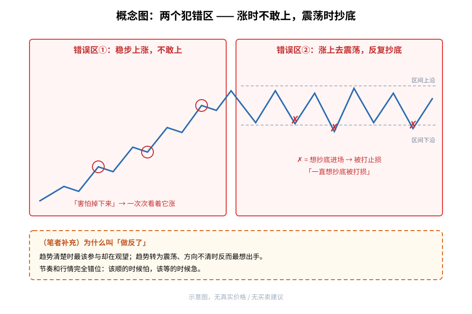
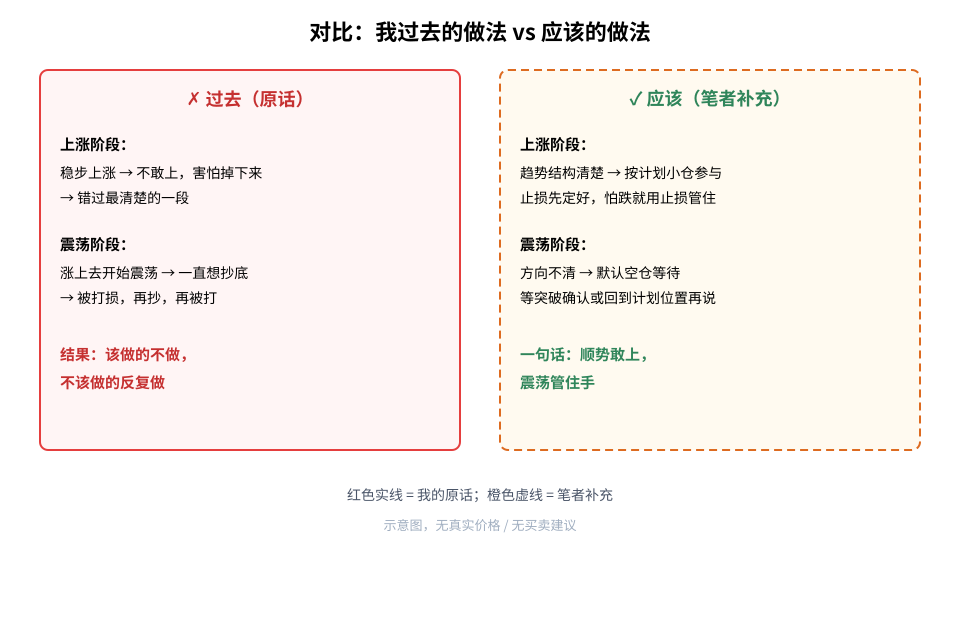
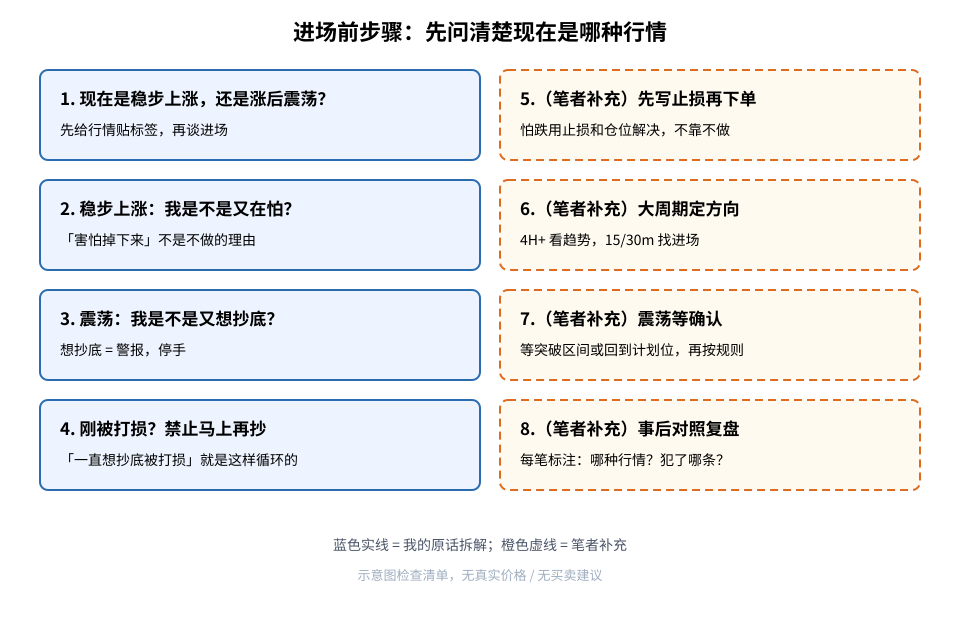

> 今天复盘的原话：**「每次都是稳步上涨的时候不敢上害怕掉下来，涨上去开始震荡了又一直想抄底被打损」**
> 这是我自己的交易经验，**不是**统计结论，也没有胜率数字。文中凡标（笔者补充）的内容，都是我在原话之外补充的通用常识。

## ⚠️ 铁律（先读这里，每次下单前再读一遍）

> **1. 稳步上涨时，「害怕掉下来」不是不做的理由——怕，就用止损和仓位管住，而不是站在场外看它涨。**
> **2. 涨上去开始震荡，「想抄底」本身就是警报——方向不清，默认空仓。**
> **3. 刚被打损，禁止马上再抄一次。「一直想抄底被打损」就是这样循环出来的。**
> **4. 下单前先回答：现在是稳步上涨，还是涨后震荡？答不上来，不做。**

**我的毛病不是看错，是节奏做反了：该上的时候怕，该等的时候急。**

## 1. 先搞懂几个词

- **稳步上涨**：价格一段一段往上走，回调不深、低点一个比一个高，方向清楚。
- **震荡**：价格在一个区间里上下来回，没有明确方向，上沿涨不上去、下沿也不怎么破。
- **抄底**：价格跌下来时，猜它「到底了」去买，想买在低点。
- **被打损**：进场后价格朝反方向走，触发止损被动离场。

## 2. 核心：两个犯错区

**读图**
- 左红框「错误区①」：稳步上涨，红圈是我本可以参与、却因为「害怕掉下来」没上的地方。
- 右红框「错误区②」：涨上去开始震荡，红色 ✗ 是我「一直想抄底」、进去后被打损的地方。
- 灰虚线是震荡区间的上下沿，纯示意，无真实价格。
- 橙色虚线框（笔者补充）：这叫「节奏做反」——趋势清楚时观望，方向不清时出手。

## 3. 对比：过去 vs 应该

**读图**
- 左红框是原话：上涨不敢上 → 错过；震荡反复抄 → 反复被打损。结果：该做的不做，不该做的反复做。
- 右侧橙色虚线框（笔者补充）：上涨阶段按计划小仓参与、先定止损；震荡阶段默认空仓，等突破确认或回到计划位置。
- 一句话：**顺势敢上，震荡管住手。**

## 4. 为什么会这样（笔者补充）

以下不是原话，是我对自己心理的推测和通用常识：
1. **涨的时候怕「买在山顶」**：看到已经涨了一段，总觉得随时会掉，于是一直等「回调再上」，回调不深就一直等不到。
2. **震荡时觉得「便宜了」**：价格从高处回落，和之前错过的高点一比，好像「打折」了，于是想抄。其实这时趋势可能已经变成震荡甚至转弱，抄底是在猜底。
3. **错过后的补偿心理**：上涨没赚到，心里憋着，到了震荡就想把错过的补回来，越急越频繁出手，越容易被来回扫止损。
4. **把「怕」当成风控**：真正的风控是止损位和仓位大小，不是「不做」。不做该做的单，和乱做不该做的单，一样是失误。

## 5. 进场前检查清单

**读图**
- 蓝色实线框 1～4 是原话拆解：先给行情贴标签 → 上涨时检查自己是不是又在怕 → 震荡时检查自己是不是又想抄底 → 刚被打损禁止马上再抄。
- 橙色虚线框 5～8 都是（笔者补充）：先写止损再下单；大周期定方向（见 [4H 以上看趋势、15/30 分钟找进场](./2026-10-20-multi-timeframe-4h-trend-15m-entry-lesson.md)）；震荡等确认；事后每笔标注「哪种行情、犯了哪条」。

## 6. 采用 / 观望 / 弃用

| 结论 | 内容 |
|---|---|
| 采用 | 下单前先判断「稳步上涨」还是「涨后震荡」；上涨时用止损和仓位管恐惧，按计划参与；震荡时默认空仓；被打损后不马上再抄 |
| 观望 | 怎样才算「震荡结束、重新有方向」的确认标准，需要更多复盘积累 |
| 弃用 | 稳步上涨时因为「害怕掉下来」站在场外；涨后震荡里一次次猜底抄底 |

## 参考

- 个人交易复盘（2026-11-05）
- 相关旧文：[趋势看 4H 以上，进场看 15/30 分钟](./2026-10-20-multi-timeframe-4h-trend-15m-entry-lesson.md)、[放量大阳线突破追进教训](./2026-10-20-volume-breakout-chase-lesson.md)
- 趋势 / 震荡 / 止损等为交易常识，属通用知识补充

> 学习笔记，仅供学习，不构成投资建议。
