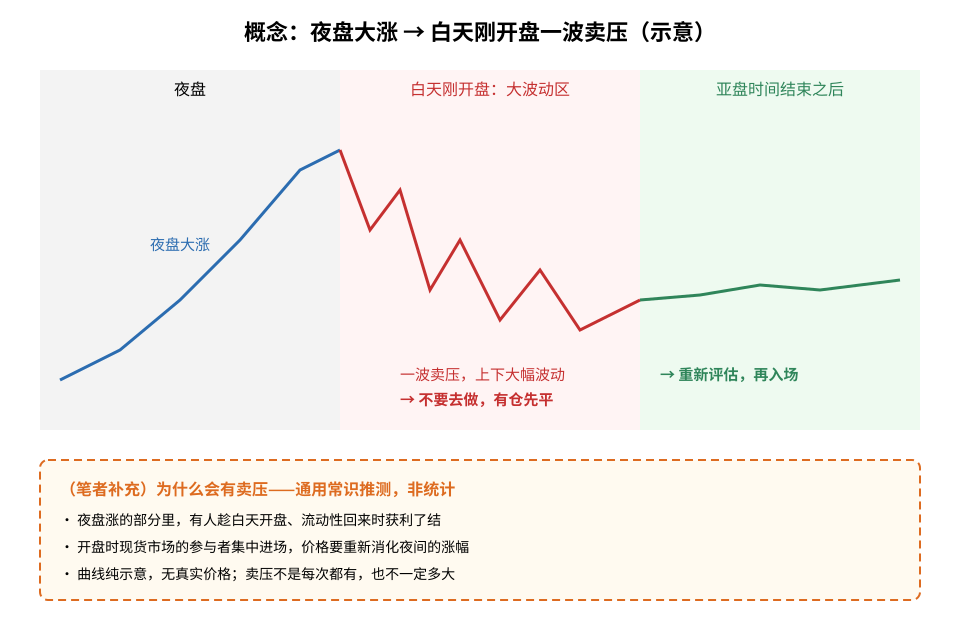
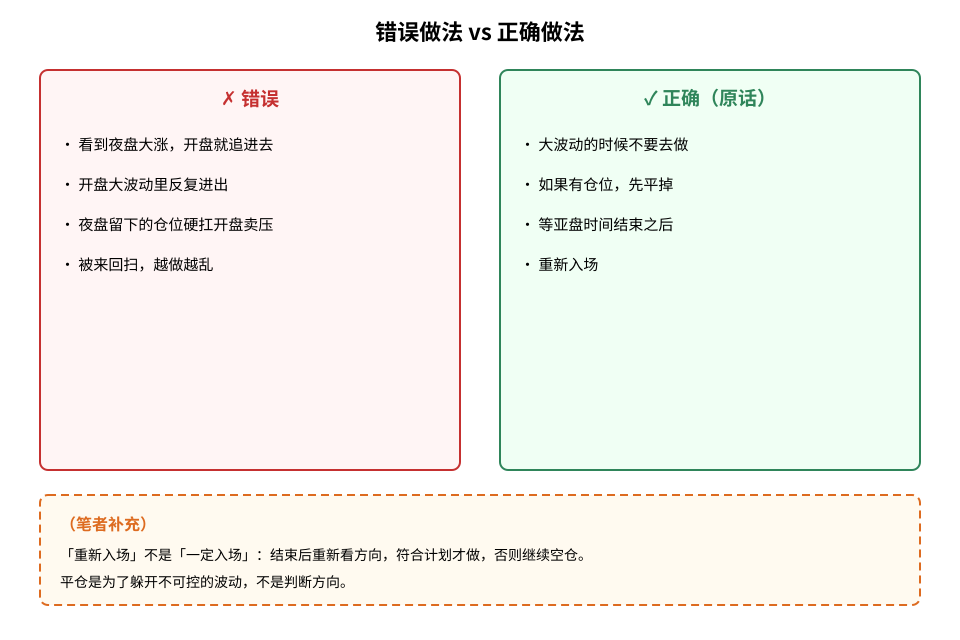
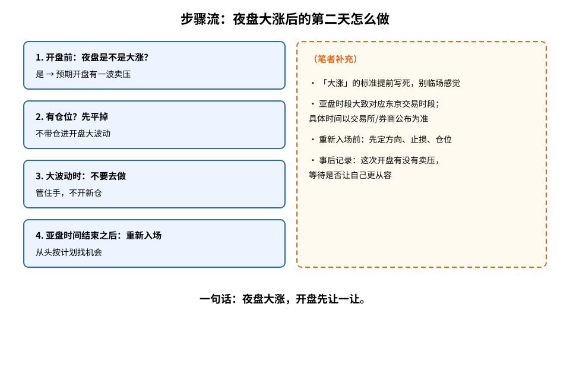

> 今天复盘的原话：**「日经这种如果夜盘大涨，白天刚开盘的时候会有一波卖压。这种时候就，大波动的时候不要去做，如果有仓位的话先平掉，等亚盘时间结束之后，重新入场。」**
> 这是我自己的交易经验，**不是**统计结论，也没有胜率数字。文中凡标（笔者补充）的内容，都是我在原话之外补充的通用常识。

## ⚠️ 铁律（先读这里，每次下单前再读一遍）

> **1. 日经夜盘大涨，白天刚开盘预期会有一波卖压。**
> **2. 大波动的时候不要去做。**
> **3. 如果有仓位，先平掉。**
> **4. 等亚盘时间结束之后，再重新入场。**

**夜盘大涨，开盘先让一让。**

## 1. 先搞懂几个词

- **夜盘**：日经相关期货在白天现货交易时段之外的交易时段。（笔者补充：具体时间以交易所/券商公布为准）
- **卖压**：卖的人集中出来，价格被往下压。
- **亚盘时间**：亚洲交易时段。（笔者补充：对日经来说大致对应东京交易时段，属通用常识，具体以交易所为准）

## 2. 核心：夜盘大涨后的开盘

**读图**
- 灰区「夜盘」：蓝线大涨。
- 红区「白天刚开盘」：一波卖压，上下大幅波动——原话：这里不要去做，有仓先平。
- 绿区「亚盘时间结束之后」：重新入场。
- 橙色虚线框（笔者补充）：卖压可能来自获利了结、开盘集中定价；曲线纯示意，无真实价格。

## 3. 对比：错误 vs 正确

**读图**
- 左红框：看夜盘大涨开盘就追、在大波动里反复进出、带仓硬扛卖压。
- 右绿框是原话：大波动不做 → 有仓先平 → 等亚盘结束 → 重新入场。
- 橙色虚线框（笔者补充）：「重新入场」不等于「一定入场」；平仓是为了躲开不可控的波动，不是判断方向。

## 4. 为什么会有卖压（笔者补充）

以下不是原话，是通用常识推测，没有数据支持：
1. **获利了结**：夜盘涨了一大段，白天流动性回来，有人趁机卖出兑现。
2. **重新定价**：现货开盘时更多参与者进场，要重新消化夜间涨幅，价格容易来回拉扯。
3. **波动大、止损容易被扫**：方向不清的大波动里，仓位容易被来回打掉，所以先离场更省心。

## 5. 步骤流

**读图**
- 蓝色实线框 1～4 是原话拆解：开盘前看夜盘是否大涨 → 有仓先平 → 大波动不做 → 亚盘时间结束后重新入场。
- 橙色虚线框（笔者补充）：「大涨」标准提前写好；亚盘时段以交易所/券商公布为准；重新入场前先定方向、止损、仓位；事后记录这次的情况。

## 6. 采用 / 观望 / 弃用

| 结论 | 内容 |
|---|---|
| 采用 | 日经夜盘大涨后，白天刚开盘大波动不做；有仓先平；亚盘时间结束之后重新入场 |
| 观望 | 多大算「夜盘大涨」、多大算「大波动」，需要自己复盘积累标准 |
| 弃用 | 看到夜盘大涨开盘就追；带着仓位硬扛开盘卖压；在开盘大波动里反复进出 |

## 参考

- 个人交易复盘（语音口述，2026-11-05）
- 相关旧文：[稳步上涨不敢上、震荡反复抄底——节奏做反了](./2026-11-05-fear-in-uptrend-bottomfish-in-range.md)
- 交易时段、获利了结等为通用常识补充；具体交易时间以交易所/券商公布为准

> 学习笔记，仅供学习，不构成投资建议。
