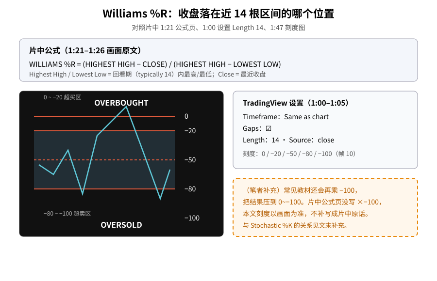
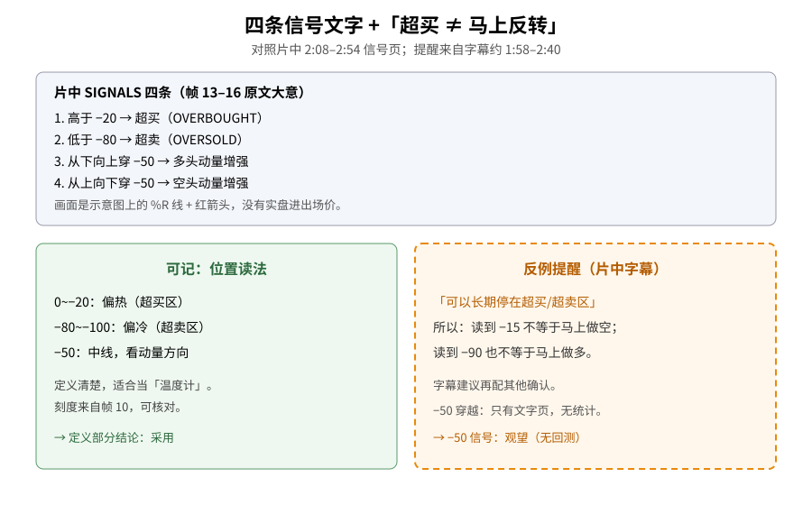
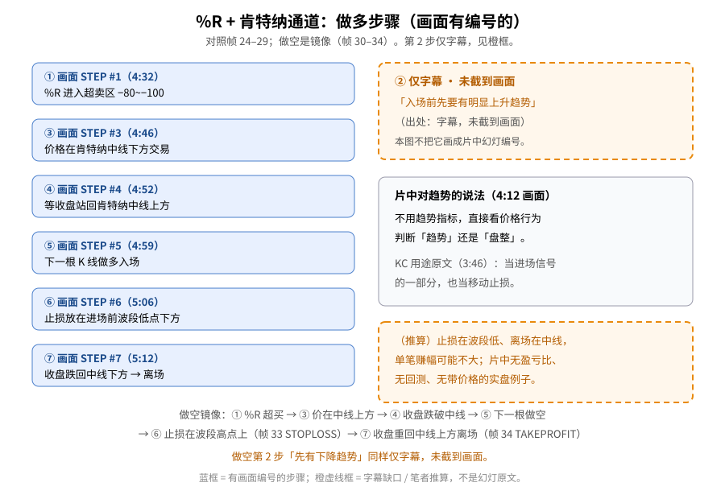

> 学习笔记：exTRADING《TRADING STRATEGY: Williams %R indicator + Keltner channel strategy》（YouTube，6:20）。正文只写片中画面和字幕里出现的内容；凡标「（笔者补充）」「（推算）」的都不是片中原话。第 2 步「先有明显趋势」仅出现在字幕、未截到画面，文中单独标明。**仅供学习，不构成投资建议。**

## 一、先认识它：收盘落在近 14 根的哪个位置

第一次接触 Williams %R（威廉百分比率），可以把它想成一把「温度计」：看**最近收盘价**，落在最近一段时间最高价和最低价之间的什么位置。范围是 **0 到 −100**（0 在上、−100 在下）。

片头（0:10）标题卡「WILLIAMS PERCENT RANGE」叠在 K 线图上，下方副图就是一条在两条红边界和一条虚线中线之间摆动的 %R。0:27 字幕说：大多数常见指标是动量类（RSI、随机指标、MACD），%R 是不太出名的一个。0:42 画面出现 Larry Williams 肖像，字幕称由这位资深交易员开发。

TradingView 设置（1:00–1:05，帧 05/06）：**Timeframe = Same as chart**，**Gaps ☑**，**Length = 14**，**Source = close**。

**读图**
- 上方灰框照抄片中 1:21–1:26 公式页：`(HIGHEST HIGH − CLOSE) / (HIGHEST HIGH − LOWEST LOW)`，回看期 typically 14。
- 左侧黑底刻度对照帧 10：0 / −20 / −50 / −80 / −100；上方 OVERBOUGHT、下方 OVERSOLD；中间虚线是 −50。
- 橙色虚线框是笔者补充：教材常见的「× −100」在片中公式页**没写**，本文不把它写成片中原话。

## 二、公式页上没写的那一笔

片中公式页（1:21–1:26，帧 08/09）文字是：

> WILLIAMS %R = (HIGHEST HIGH − CLOSE) / (HIGHEST HIGH − LOWEST LOW)

并解释：Highest High = 回看期内最高价（typically 14）；Close = 最近收盘；Lowest Low = 回看期内最低价（typically 14）。

画面上**没有**出现「× −100」。TradingView 图上实际刻度仍是 0~−100（帧 10），所以读图时以刻度图为准即可；不要把「画面没写的乘数」当成片中公式的一部分。

## 三、四条信号文字，和最重要的一句提醒

2:08–2:54（帧 13–16）在「SIGNALS」标题下逐条打出：

1. 价格（%R 读数）**高于 −20** → 超买；
2. **低于 −80** → 超卖；
3. **从下向上穿 −50** → 多头动量增强；
4. **从上向下穿 −50** → 空头动量增强。

字幕在讲超买/超卖时提醒：市场**可以长期停在超买或超卖区**，需要额外确认。人话：**读到超买 ≠ 马上反转做空**；超卖同理。这和之前学肯特纳通道时「碰轨 ≠ 反转」是同一类谨慎读法。

**读图**
- 上半灰框四条，对应帧 13–16 的编号文字；配图是示意线 + 箭头，片中没有带价格的实盘例子。
- 左绿框：刻度读法可核对，定义部分适合「采用」。
- 右橙虚线框：字幕提醒 + −50 穿越尚无统计 → 标「观望」。

## 四、策略章节：%R + 肯特纳通道回调

3:13 起进入「Trading strategy」：主图叠上肯特纳通道（蓝色上下轨、浅色中线），下方仍是 %R（帧 18–21）。3:46 画面大字：

> FOR OUR PURPOSES HERE, WE WILL USE IT AS PART OF OUR ENTRY SIGNAL AND AS A TRAILING STOP

即：KC **既当进场信号的一部分，也当移动止损**。

4:12（帧 22）白底蓝字说：不用趋势类指标，直接看价格行为，判断市场处在趋势阶段还是盘整阶段。4:19 字幕：这是一套「趋势背景下的简单回调策略」。

可回看旧文：[Keltner 肯特纳通道](./2026-11-04-keltner-channel.md)。

## 五、做多规则：画面有编号的步，和第 2 步字幕缺口

买规则章节从约 4:32 起。**画面上能截到编号的是第 1、3、4、5、6、7 步**；第 2 步「入场前先要有明显上升趋势」**只出现在字幕里，本批截图没有对应幻灯**（出处：字幕，未截到画面）。做空第 2 步「先有下降趋势」同样如此。

画面可核对的做多步骤：

| 步 | 时间 / 帧 | 画面文字大意 |
|---|---|---|
| 1 | 4:32 / 24 | %R 必须进入超卖区（−80~−100） |
| 2 | （字幕） | 入场前先要有明显上升趋势（**未截到画面**） |
| 3 | 4:46 / 25 | 价格在肯特纳**中线下方**交易 |
| 4 | 4:52 / 26 | 等价格**收盘站上**中线 |
| 5 | 4:59 / 27 | 站上中线后的**下一根**做多 |
| 6 | 5:06 / 28 | 止损放在进场前**波段低点**下方（白线标出） |
| 7 | 5:12 / 29 | 价格**收盘跌回中线下方**离场 |

做空镜像（5:19–6:03，帧 30–34）：① %R 超买；② 先有下降趋势（**仅字幕**）；③ 价在中线上方；④ 收盘跌破中线；⑤ 下一根做空；⑥ 止损在波段高点上方（画面写 STOPLOSS）；⑦ 收盘重回中线上方离场（画面写 TAKEPROFIT）。

**读图**
- 左侧六个蓝框 = 帧 24–29 有画面编号的步骤，按片中顺序排列（跳过未截到的 ②）。
- 右上橙虚线框单独标出第 2 步：出处是字幕，本图不把它画成片中幻灯。
- 右中灰框照抄 4:12 关于「用价格行为判断趋势/盘整」的画面文字。
- 右下橙框是推算：片中无盈亏比、无回测、无带价格的实盘例子。

## 六、（笔者补充）和 Stochastic 几乎是一家人

- 同回看期、不平滑时，**%R ≈ Stochastic 的 %K − 100**。所以「%R 低于 −80」大致对应「%K 低于 20」。片中没讲这句，详见旧文 [Stochastic](./2026-10-29-stochastic-oscillator.md)。
- 「之前有明显上升趋势」若要回测，得先换成可量化规则（例如均线方向、或 [ADX](./2026-10-26-adx-trend-strength.md) 阈值）——片中没给，也未验证。

## 七、采用 / 观望 / 弃用

| 内容 | 结论 | 理由 |
|---|---|---|
| %R 的定义、公式页、0~−100 刻度、Length 14 设置 | **采用** | 有公式页和 TradingView 设置画面，可核对 |
| 「超买 ≠ 马上反转」的提醒 | **采用** | 字幕明说可长期停在极值区；与 KC/RSI 学到的一致 |
| −50 穿越当动量信号 | **观望** | 只有文字页，没有例子和统计 |
| %R + KC 回调策略（含第 2 步趋势前提） | **观望** | 规则写得完整、可回测，但「先有趋势」靠肉眼/字幕、无回测、无实盘价例 |

## 参考来源

- exTRADING：[Williams %R indicator + Keltner channel strategy](https://www.youtube.com/watch?v=U8IA3azW2Lo)，时长 **6:20**，已看完 6:20/6:20（片尾推荐卡画面确认）。
- 文中时间戳来自截图文件名（`screenshots/01-williams-r/`，35 张）。重点帧：0:10 标题、1:00–1:05 设置、1:21–1:26 公式、1:47 刻度、2:08–2:54 四信号、3:13–3:46 KC、4:12 价格行为判趋势、4:32–5:12 做多、5:19–6:03 做空。
- **缺口**：① 0:14–0:27、约 0:42–0:49 两段播放时未盯画面，只采到 CC。② 做多/做空第 2 步仅字幕，无截图。③ 片子是幻灯+动画，**没有带价格的实盘例子、没有回测、没有盈亏数据**。④ 公式页未写 ×−100。
- 可链接旧文：肯特纳通道（2026-11-04）、Stochastic（2026-10-29）、ADX（2026-10-26）。

> 学习笔记，仅供学习，不构成投资建议。
